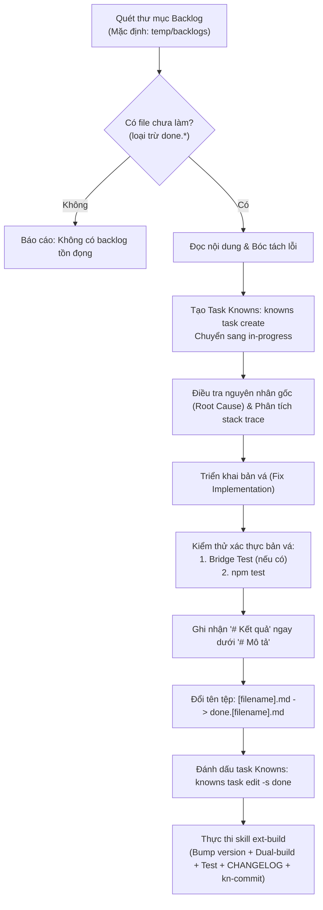

# Extension Backlog Processing Workflow (ext-backlog)

Skill này chuẩn hóa quy trình tiếp nhận, theo dõi và giải quyết tuần tự các yêu cầu lỗi hoặc backlog được ghi nhận dưới dạng tệp Markdown trong thư mục backlog (mặc định: `temp/backlogs`), sau đó đóng gói và commit đồng bộ bằng skill **`ext-build`** (skill kép đã bao gồm nâng version, dual-build `dist/` + `.output/chrome-mv3`, `npm test`, cập nhật `CHANGELOG.md` và `kn-commit`).



---

## 1. Tham Số Đầu Vào

- **`BacklogDirectory`** (Tùy chọn): Đường dẫn thư mục chứa backlog.
  - **Mặc định**: `temp/backlogs` (hoặc `temp\backlogs` trên Windows).
  - Có thể truyền đường dẫn khác nếu người dùng chỉ định cụ thể.

---

## 2. Quy Trình 6 Bước Chuẩn Hóa

### Bước 1: Quét và Lọc Tệp Backlog

1. Quét toàn bộ tệp `.md` trong thư mục được chỉ định:
   ```powershell
   Get-ChildItem -Path "temp/backlogs" -Filter "*.md"
   ```
2. **Quy tắc lọc**:
   - **Bỏ qua**: Các tệp đã có tiền tố `done.` (ví dụ `done.wasm-log.md`).
   - **Chọn**: Các tệp backlog chưa xử lý (ví dụ `wasm-log.md`, `dungeon-auto.md`, ...).
   - Nếu danh sách rỗng, thông báo cho người dùng và kết thúc lượt.

---

### Bước 2: Tạo Task Knowns & Đánh Dấu In-Progress

Với mỗi tệp backlog cần thực hiện:
1. Đọc nội dung tệp backlog để nắm bắt:
   - **UI / Màn hình**: Vị trí giao diện xảy ra vấn đề.
   - **Chức năng**: Tính năng đang bị ảnh hưởng.
   - **Lỗi & Stack trace**: Chi tiết exception, error code, hoặc context dữ liệu.
2. Tạo task mới trong hệ thống Knowns:
   ```powershell
   knowns task create "<Tiêu đề mô tả ngắn gọn vấn đề/lỗi>" --plain
   ```
   *Ví dụ:* `knowns task create "Fix WebAssembly execution trap in Dungeon simulation START_BATTLE_PLAY" --plain`
3. Lưu lại Task ID trả về (ví dụ `VHE-ZJ2RFB`) và chuyển trạng thái sang `in-progress`:
   ```powershell
   knowns task edit <TASK_ID> -s in-progress
   ```

---

### Bước 3: Điều Tra Nguyên Nhân Gốc & Thực Thi Bản Vá

1. **Phân tích Stack Trace & Luồng Dữ Liệu**:
   - Đối chiếu hàm và vị trí gây lỗi trong source code (`src/`).
   - Với lỗi WebAssembly / IL2CPP: Sử dụng các công cụ trong `debug-bridge/` (`lookup-symbol.js`, `check-signatures.js`) để tra cứu Function Index, Table Index và chữ ký hàm.
   - Chú ý các bẫy phổ biến:
     - Lệch Table Index do khác Function Index.
     - Sai lệch con trỏ do ép kiểu địa chỉ lẻ hoặc vùng nhớ chưa khởi tạo (cần kiểm tra căn chỉnh `ptr % 4 === 0`).
     - Bỏ qua hàm tìm kiếm động do kiểm tra điều kiện fallback không chặt chẽ.
2. **Thực thi bản vá**:
   - Sửa đổi mã nguồn trong `src/` (hoặc các components/dialogs tương ứng).
   - Đảm bảo tính tái sử dụng và hiệu năng (áp dụng caching cho các descriptor tốn chi phí tra cứu).
   - Cập nhật đồng bộ các file test/bridge liên quan nếu có sự thay đổi về chữ ký hay cơ chế tra cứu.

---

### Bước 4: Kiểm Thử Đa Tầng (Multi-tier Verification)

Thực hiện kiểm thử theo 3 cấp độ trước khi hoàn tất:

1. **Cấp 1: Live Engine / Bridge Test (nếu lỗi liên quan tới Game Engine/WASM)**:
   - Chạy các script test thực tế qua Native Messaging Bridge:
     ```powershell
     node debug-bridge/test-real-battle.js
     node debug-bridge/test-batch-sim.js
     ```
   - Xác nhận không còn trap hay runtime exception.
2. **Cấp 2: Unit Test Suite**:
   ```powershell
   npm test
   ```
   - Đảm bảo 100% tests pass (`0` fail, không gây regression).
3. **Cấp 3: Extension Build Validation**:
   ```powershell
   npm run build
   ```
   - Xác nhận toàn bộ tệp đầu ra trong thư mục `dist/` được đóng gói và validate hợp lệ.

---

### Bước 5: Ghi Nhận Kết Quả & Đổi Tên Tệp Backlog

1. **Ghi nhận nội dung `# Kết quả`**:
   - Mở tệp backlog gốc.
   - Thêm phần `# Kết quả` **ngay bên dưới phần `# Mô tả`** (trước phần `# Lỗi` hoặc các phần khác) theo cấu trúc chuẩn:
     ```markdown
     # Kết quả
     - **Nguyên nhân cốt lõi (Root Cause)**:
       - [Mô tả chi tiết nguyên nhân gốc rễ gây ra lỗi]
     - **Giải pháp xử lý (Fix Details)**:
       - [Tóm tắt các điểm đã sửa đổi, hàm nâng cấp, logic bổ sung]
     - **Xác thực thực tế (Verification)**:
       - [Kết quả chạy live bridge test / kiểm thử thực tế]
       - [Kết quả npm test: số lượng test pass]
       - [Kết quả build extension ra thư mục dist/]
     ```
2. **Đổi tên tệp backlog**:
   - Thêm tiền tố `done.` vào tên tệp:
     ```powershell
     Move-Item "temp/backlogs/<filename>.md" "temp/backlogs/done.<filename>.md"
     ```
3. **Cập nhật Task Knowns hoàn tất**:
   ```powershell
   knowns task edit <TASK_ID> -s done
   ```

---

### Bước 6: Đóng Gói, Cập Nhật Changelog & Commit Bằng `ext-build`

Thay vì chỉ gọi riêng `kn-commit`, **bắt buộc áp dụng trọn vẹn quy trình của skill `ext-build`** (`.agents/skills/ext-build/SKILL.md` — skill kép đã tích hợp sẵn `kn-commit`) để bảo đảm nhất quán giữa các session:
1. Đọc và thực thi đầy đủ các bước của skill `ext-build`:
   - Nâng phiên bản (mặc định `patch`, trừ khi người dùng yêu cầu `minor`/`major`) đồng bộ trên `package.json`, `package-lock.json`, `extension/manifest.json`.
   - Build kép đồng bộ cả 2 bản: Production (`dist/`, tắt debug bridge) và Debug/Unpacked (`.output/chrome-mv3/`, bật debug bridge) bằng `npm run build`.
   - Xác thực toàn bộ test suite (`npm test` -> `0` fail) và kiểm tra quyền `nativeMessaging` ở cả 2 bản build.
   - Cập nhật `CHANGELOG.md` tổng hợp đầy đủ các thay đổi vừa thực hiện.
2. Stage toàn bộ tệp liên quan (bao gồm mã nguồn, tests, task Knowns và artifact phát hành từ `ext-build`):
   ```powershell
   git add src/ tests/ .knowns/ debug-bridge/ package.json package-lock.json extension/manifest.json CHANGELOG.md dist/
   git status
   git diff --staged
   ```
3. Đề xuất commit message theo chuẩn Conventional Commits của `kn-commit` (đã tích hợp trong `ext-build`), ghi rõ `Closes task <TASK_ID>`, hỏi xác nhận từ người dùng và tiến hành commit.

---

## 3. Bảng Tham Chiếu Lệnh Nhanh

| Mục đích | Lệnh PowerShell |
|---|---|
| **Liệt kê backlog chưa làm** | `Get-ChildItem temp/backlogs/*.md \| Where-Object { $_.Name -notlike 'done.*' }` |
| **Tạo task Knowns** | `knowns task create "<Tiêu đề>" --plain` |
| **Chuyển task in-progress** | `knowns task edit <TASK_ID> -s in-progress` |
| **Chuyển task hoàn tất** | `knowns task edit <TASK_ID> -s done` |
| **Đổi tên tệp xong** | `Move-Item "temp/backlogs/<file>.md" "temp/backlogs/done.<file>.md"` |
| **Chạy kiểm thử nhanh** | `npm test` |
| **Bump + Dual-build + Test (`ext-build`)** | `node scripts/bump-version.mjs patch; if ($?) { npm run build }; if ($?) { npm test }` |
