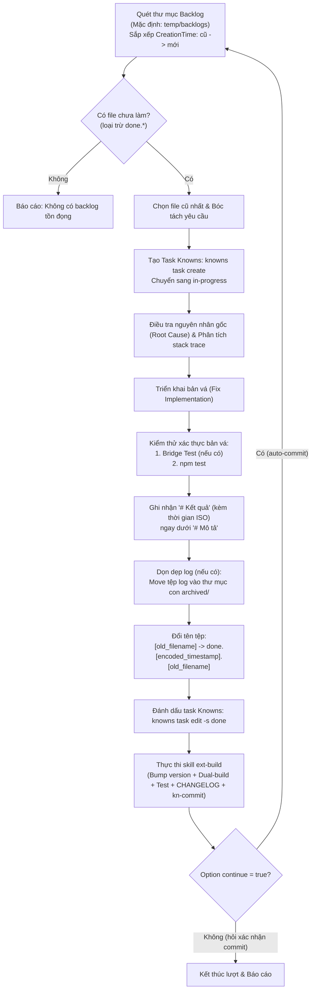

# Extension Backlog Processing Workflow (ext-backlog)

Skill này chuẩn hóa quy trình tiếp nhận, theo dõi và giải quyết tuần tự các yêu cầu lỗi hoặc backlog được ghi nhận dưới dạng tệp Markdown trong thư mục backlog (mặc định: `temp/backlogs`), sau đó đóng gói và commit đồng bộ bằng skill **`ext-build`** (skill kép đã bao gồm nâng version, dual-build `dist/` + `.output/chrome-mv3`, `npm test`, cập nhật `CHANGELOG.md` và `kn-commit`).



---

## 1. Tham Số Đầu Vào

- **`BacklogDirectory`** (Tùy chọn): Đường dẫn thư mục chứa backlog.
  - **Mặc định**: `temp/backlogs` (hoặc `temp\backlogs` trên Windows).
  - Có thể truyền đường dẫn khác nếu người dùng chỉ định cụ thể.
- **`continue`** (Tùy chọn, Boolean, mặc định: `false`):
  - **Nhận diện ngữ nghĩa**: Tự động bật `continue = true` khi người dùng truyền cờ `continue` hoặc dùng các từ/cụm từ đồng nghĩa, gần nghĩa trong yêu cầu gọi `/ext-backlog`, bao gồm nhưng không giới hạn:
    - Tiếng Anh: `continue`, `auto-continue`, `all`, `until done`, `keep going`, `run all`.
    - Tiếng Việt: `liên tục`, `tiếp tục`, `cho đến hết`, `chạy hết`, `làm hết`, `xử lý hết`, `tự động hết`.
  - **Hành vi khi `continue = true`**:
    1. **Tự động chấp nhận commit** ở Bước 6 (`ext-build` / `kn-commit`) ngay sau khi mọi bước xác thực (`npm test` = `0` fail, dual-build hợp lệ) đã pass — không dừng hỏi xác nhận commit sau mỗi task.
    2. **Tự động chuyển sang tệp backlog tiếp theo** (theo thứ tự `CreationTime` tăng dần) ngay sau khi commit xong, lặp lại cho đến khi thư mục backlog không còn tệp tồn đọng nào (hoặc dừng ngay nếu gặp lỗi không thể tự khắc phục).
  - **Hành vi khi `continue = false` (mặc định)**: Xử lý từng tệp một, hỏi xác nhận người dùng trước khi commit ở Bước 6 và kết thúc lượt sau khi hoàn tất.

---

## 2. Quy Trình 6 Bước Chuẩn Hóa

### Bước 1: Quét, Lọc và Sắp Xếp Tệp Backlog (Cũ Trước -> Mới Sau)

1. Quét toàn bộ tệp `.md` trong thư mục được chỉ định, loại trừ các tệp đã hoàn thành (`done.*`) và **sắp xếp tăng dần theo thời gian tạo file (`CreationTime`)** để luôn xử lý tệp cũ trước, mới sau:
   ```powershell
   Get-ChildItem -Path "temp/backlogs" -Filter "*.md" |
     Where-Object { $_.Name -notlike "done.*" } |
     Sort-Object CreationTime, Name
   ```
2. **Quy tắc chọn**:
   - **Bỏ qua**: Mọi tệp đã có tiền tố `done.` (ví dụ `done.wasm-log.md`, `done.0y8abc1.skill-modify.md`).
   - **Chọn tuần tự**: Lấy **tệp đầu tiên (cũ nhất)** trong danh sách đã sắp xếp để thực hiện trọn vẹn từ Bước 2 đến Bước 6 trước khi chuyển sang tệp kế tiếp.
   - Nếu danh sách rỗng, thông báo cho người dùng không còn backlog tồn đọng và kết thúc lượt.

---

### Bước 2: Tạo Task Knowns & Đánh Dấu In-Progress

Với tệp backlog đang xử lý:
1. Đọc nội dung tệp backlog để nắm bắt:
   - **UI / Màn hình / Skill**: Vị trí giao diện hoặc thành phần xảy ra vấn đề.
   - **Chức năng / Yêu cầu**: Tính năng đang bị ảnh hưởng hoặc hành vi cần điều chỉnh.
   - **Lỗi & Stack trace / Log / Tham khảo**: Chi tiết exception, error code, log đính kèm hoặc đoạn mã mẫu.
2. Tạo task mới trong hệ thống Knowns:
   ```powershell
   knowns task create "<Tiêu đề mô tả ngắn gọn vấn đề/lỗi>" --plain
   ```
   *Ví dụ:* `knowns task create "Fix WebAssembly execution trap in Dungeon simulation START_BATTLE_PLAY" --plain`
3. Lưu lại Task ID trả về (ví dụ `VHE-ZJ2RFB`) và chuyển trạng thái sang `in-progress`:
   ```powershell
   knowns task edit <TASK_ID> -s in-progress
   ```

---

### Bước 3: Điều Tra Nguyên Nhân Gốc & Thực Thi Bản Vá

1. **Phân tích Stack Trace & Luồng Dữ Liệu**:
   - Đối chiếu hàm và vị trí gây lỗi trong source code (`src/`, `.agents/skills/`, ...).
   - Với lỗi WebAssembly / IL2CPP: Sử dụng các công cụ trong `debug-bridge/` (`lookup-symbol.js`, `check-signatures.js`) hoặc phân tích `hwa-sim/downloads/build.wasm` + `symbols.json` để tra cứu Function Index, Table Index và chữ ký hàm.
   - Chú ý các bẫy phổ biến:
     - Lệch Table Index do khác Function Index.
     - Sai lệch con trỏ do ép kiểu địa chỉ lẻ hoặc vùng nhớ chưa khởi tạo (cần kiểm tra căn chỉnh `ptr % 4 === 0`).
     - Bỏ qua hàm tìm kiếm động do kiểm tra điều kiện fallback không chặt chẽ.
2. **Thực thi bản vá**:
   - Sửa đổi mã nguồn/tài liệu liên quan.
   - Đảm bảo tính tái sử dụng và hiệu năng (áp dụng caching cho các descriptor tốn chi phí tra cứu).
   - Cập nhật đồng bộ các file test/bridge liên quan nếu có sự thay đổi về chữ ký hay cơ chế tra cứu.

---

### Bước 4: Kiểm Thử Đa Tầng (Multi-tier Verification)

Thực hiện kiểm thử theo 3 cấp độ trước khi hoàn tất:

1. **Cấp 1: Live Engine / Bridge Test (nếu lỗi liên quan tới Game Engine/WASM)**:
   - Chạy các script test thực tế qua Native Messaging Bridge:
     ```powershell
     node debug-bridge/test-real-battle.js
     node debug-bridge/test-batch-sim.js
     ```
   - Xác nhận không còn trap hay runtime exception.
2. **Cấp 2: Unit Test Suite**:
   ```powershell
   npm test
   ```
   - Đảm bảo 100% tests pass (`0` fail, không gây regression).
3. **Cấp 3: Extension Build Validation**:
   ```powershell
   npm run build
   ```
   - Xác nhận toàn bộ tệp đầu ra trong thư mục `dist/` và `.output/chrome-mv3/` được đóng gói và validate hợp lệ.

---

### Bước 5: Ghi Nhận Kết Quả (Kèm Thời Gian ISO), Dọn Dẹp Log & Đổi Tên Tệp Theo Inverted Base36 Timestamp

1. **Ghi nhận nội dung `# Kết quả`**:
   - Mở tệp backlog gốc.
   - Thêm phần `# Kết quả` **ngay bên dưới phần `# Mô tả`** (trước phần `# Lỗi`, `# Log`, `# Tham khảo` hoặc các phần khác) theo cấu trúc chuẩn, **bắt buộc có dòng Thời gian hoàn tất theo chuẩn ISO 8601**:
     ```markdown
     # Kết quả
     - **Thời gian hoàn tất**: <YYYY-MM-DDTHH:mm:ss.sssZ hoặc YYYY-MM-DDTHH:mm:ss+07:00>
     - **Nguyên nhân cốt lõi (Root Cause)**:
       - [Mô tả chi tiết nguyên nhân gốc rễ gây ra lỗi / bối cảnh yêu cầu]
     - **Giải pháp xử lý (Fix Details)**:
       - [Tóm tắt các điểm đã sửa đổi, hàm nâng cấp, logic bổ sung]
     - **Xác thực thực tế (Verification)**:
       - [Kết quả chạy live bridge test / kiểm thử thực tế (nếu có)]
       - [Kết quả npm test: số lượng test pass]
       - [Kết quả build extension ra thư mục dist/ và .output/chrome-mv3/]
     ```
2. **Dọn dẹp & lưu trữ tệp log người dùng cung cấp (trước khi đổi tên tệp backlog)**:
   - Nếu trong quá trình điều tra có sử dụng các tệp log do người dùng cung cấp (ví dụ trong `temp/tracking-data/`, `temp/legend_draft/`, hoặc bất kỳ thư mục `temp/<folder>/` nào), **bắt buộc di chuyển các tệp log đó xuống 1 cấp thư mục con `archived`** ngay bên trong thư mục chứa log đó (ví dụ: `temp/tracking-data/<log>.json` -> `temp/tracking-data/archived/<log>.json`, `temp/legend_draft/<log>.json` -> `temp/legend_draft/archived/<log>.json`) để tránh tràn lan.
   - Bỏ qua các tệp đã nằm trong thư mục `archived` (hoặc `acrhive`) hoặc không thuộc `temp/`.
   - **Lệnh thực thi chuẩn (PowerShell)**:
     ```powershell
     $logPath = "<đường_dẫn_file_log>"
     if (Test-Path $logPath) {
       $parentDir = Split-Path -Path $logPath -Parent
       $archiveDir = Join-Path $parentDir "archived"
       if (-not (Test-Path $archiveDir)) { New-Item -ItemType Directory -Path $archiveDir -Force | Out-Null }
       Move-Item -Path $logPath -Destination $archiveDir -Force
     }
     ```
3. **Đổi tên tệp backlog theo quy tắc `done.[encoded_timestamp].[old_filename]`**:
   - **Mục đích**: Khi sắp xếp tệp theo tên (OS alphabetical sort), các tệp hoàn thành **mới nhất** luôn nằm **trên cùng**.
   - **Công thức tính `encoded_timestamp`**:
     - `EPOCH_2100 = 4102444800` (tương ứng `2100-01-01T00:00:00Z` tính bằng giây).
     - `nowSec = Math.floor(Date.now() / 1000)`.
     - `invertedSec = Math.max(0, EPOCH_2100 - nowSec)`.
     - `encoded_timestamp = invertedSec.toString(36).padStart(7, '0')` (chuỗi base36 chữ thường, độ dài cố định **7 ký tự** đến năm 2100).
   - **Định dạng tên tệp đích**: `done.<encoded_timestamp>.<old_filename>` (ví dụ: `done.11a3k9m.skill-modify.md`).
   - **Lệnh thực thi chuẩn (Node.js + PowerShell)**:
     ```powershell
     $oldName = "<old_filename>"
     $enc = node -e "const E=4102444800; const inv=Math.max(0, E-Math.floor(Date.now()/1000)); console.log(inv.toString(36).padStart(7,'0'));"
     Move-Item "temp/backlogs/$oldName" "temp/backlogs/done.$enc.$oldName"
     ```
4. **Cập nhật Task Knowns hoàn tất**:
   ```powershell
   knowns task edit <TASK_ID> -s done
   ```

---

### Bước 6: Đóng Gói, Cập Nhật Changelog & Commit Bằng `ext-build`

Thay vì chỉ gọi riêng `kn-commit`, **bắt buộc áp dụng trọn vẹn quy trình của skill `ext-build`** (`.agents/skills/ext-build/SKILL.md` — skill kép đã tích hợp sẵn `kn-commit`) để bảo đảm nhất quán giữa các session:
1. Đọc và thực thi đầy đủ các bước của skill `ext-build`:
   - Nâng phiên bản (mặc định `patch`, trừ khi người dùng yêu cầu `minor`/`major`) đồng bộ trên `package.json`, `package-lock.json`, `extension/manifest.json`.
   - Build kép đồng bộ cả 2 bản: Production (`dist/`, tắt debug bridge) và Debug/Unpacked (`.output/chrome-mv3/`, bật debug bridge) bằng `npm run build`.
   - Xác thực toàn bộ test suite (`npm test` -> `0` fail) và kiểm tra quyền `nativeMessaging` ở cả 2 bản build.
   - Cập nhật `CHANGELOG.md` tổng hợp đầy đủ các thay đổi vừa thực hiện.
2. Stage toàn bộ tệp liên quan (bao gồm mã nguồn, tests, skills nếu có chỉnh sửa, task Knowns và artifact phát hành từ `ext-build`):
   ```powershell
   git add src/ tests/ .agents/ .knowns/ debug-bridge/ package.json package-lock.json extension/manifest.json CHANGELOG.md dist/
   git status
   git diff --staged
   ```
3. **Commit theo chế độ `continue`**:
   - **Nếu `continue = false` (mặc định)**: Đề xuất commit message theo chuẩn Conventional Commits của `kn-commit`, ghi rõ `Closes task <TASK_ID>`, **hỏi xác nhận từ người dùng** rồi mới tiến hành commit.
   - **Nếu `continue = true`**: **Tự động chấp nhận và thực hiện `git commit` ngay** (không chờ xác nhận), sau đó **tự động quay lại Bước 1** để xử lý tệp backlog kế tiếp cho đến khi hết toàn bộ backlog tồn đọng.

---

## 3. Bảng Tham Chiếu Lệnh Nhanh

| Mục đích | Lệnh PowerShell |
|---|---|
| **Liệt kê backlog chưa làm (cũ -> mới)** | `Get-ChildItem temp/backlogs/*.md \| Where-Object { $_.Name -notlike 'done.*' } \| Sort-Object CreationTime, Name` |
| **Tạo task Knowns** | `knowns task create "<Tiêu đề>" --plain` |
| **Chuyển task in-progress** | `knowns task edit <TASK_ID> -s in-progress` |
| **Chuyển task hoàn tất** | `knowns task edit <TASK_ID> -s done` |
| **Lưu trữ tệp log vào `archived/`** | `$p = Split-Path "<log>" -Parent; $a = Join-Path $p "archived"; New-Item -ItemType Directory -Path $a -Force \| Out-Null; Move-Item "<log>" $a -Force` |
| **Phát sinh `encoded_timestamp` & đổi tên xong** | `$enc = node -e "console.log(Math.max(0,4102444800-Math.floor(Date.now()/1000)).toString(36).padStart(7,'0'))"; Move-Item "temp/backlogs/<file>.md" "temp/backlogs/done.$enc.<file>.md"` |
| **Lấy thời gian ISO hiện tại** | `node -e "console.log(new Date().toISOString())"` |
| **Chạy kiểm thử nhanh** | `npm test` |
| **Bump + Dual-build + Test (`ext-build`)** | `node scripts/bump-version.mjs patch; if ($?) { npm run build }; if ($?) { npm test }` |
