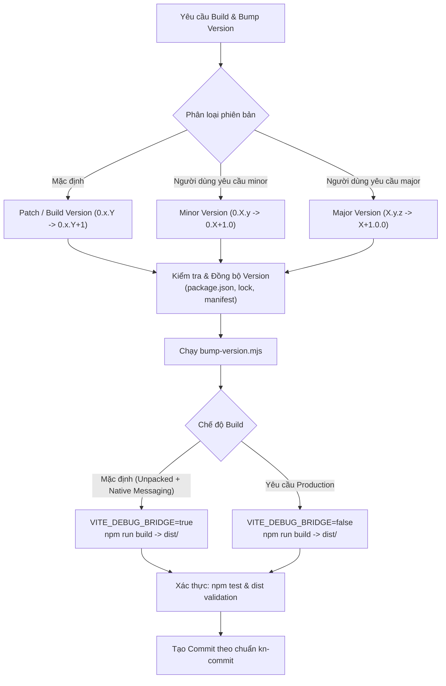

# Extension Version Bumping & Build Workflow (ext-build)

Skill này chuẩn hóa quy trình 4 bước để **nâng phiên bản**, **biên dịch extension (build)**, **kiểm thử chất lượng**, và **commit** thay đổi vào Git repository theo chuẩn `kn-commit`.



---

## 1. Nguyên Tắc Cốt Lõi

1. **Mặc định nâng build/patch version**:
   - Trừ khi người dùng nêu rõ từ khóa "minor" hoặc "major", luôn nâng build version (`patch`, ví dụ: `0.11.203` -> `0.11.204`).
2. **Mặc định build bản Unpacked hỗ trợ Native Messaging**:
   - Trừ khi người dùng nhấn mạnh "bản production" hoặc "release sạch không có debug bridge", bản build mặc định luôn kích hoạt cờ `VITE_DEBUG_BRIDGE=true` để phục vụ kết nối với Native Messaging Bridge (`debug-bridge/host.js`) cho việc gỡ lỗi, kiểm thử và hook IL2CPP.
3. **Đồng bộ tuyệt đối phiên bản**:
   - Bộ 3 tệp `package.json`, `package-lock.json`, và `extension/manifest.json` phải luôn khớp version chính xác trước và sau khi bump.
4. **Quy trình Commit tuân thủ `kn-commit`**:
   - Chỉ commit khi toàn bộ kiểm thử `npm test` thành công (`0` fail) và bản build được xác thực hợp lệ qua `scripts/validate-extension.mjs`.

---

## 2. Quy Trình Từng Bước

### Bước 1: Xác định loại Version Bump & Kiểm Tra Đồng Bộ

1. **Xác định mục tiêu nâng version**:
   - **`patch`** (Mặc định): Áp dụng cho các bản cập nhật tính năng định kỳ, sửa lỗi, hoàn thiện logic (vd: `0.11.203` -> `0.11.204`).
   - **`minor`**: Khi người dùng yêu cầu nâng minor hoặc có thay đổi lớn về tính năng (vd: `0.11.203` -> `0.12.0`).
   - **`major`**: Khi người dùng yêu cầu nâng major hoặc thay đổi kiến trúc phá vỡ tương thích (vd: `0.11.203` -> `1.0.0`).

2. **Kiểm tra tính đồng bộ trước khi bump**:
   Trước khi chạy script, kiểm tra version hiện tại ở cả 3 tệp:
   - `package.json`
   - `package-lock.json`
   - `extension/manifest.json`

   *Lưu ý:* Nếu có sự lệch phiên bản do chỉnh sửa thủ công từ trước, cần đồng bộ 3 tệp về cùng một số phiên bản trước khi gọi lệnh bump để tránh lỗi `Version mismatch`.

3. **Thực thi lệnh bump version**:
   ```powershell
   node scripts/bump-version.mjs patch   # Mặc định
   # Hoặc:
   # node scripts/bump-version.mjs minor
   # node scripts/bump-version.mjs major
   ```

---

### Bước 2: Thực Hiện Build Extension

#### Chế độ 1: Mặc định (Unpacked + Native Messaging Bridge)
- **Mục đích**: Tạo bản unpacked để nạp trực tiếp vào Chrome (`chrome://extensions` -> Load unpacked trỏ vào thư mục `dist/` hoặc `.output/chrome-mv3`), đồng thời cấp quyền `nativeMessaging` để giao tiếp với `debug-bridge/host.bat`.
- **Cấu hình**: Đảm bảo `VITE_DEBUG_BRIDGE=true` (trong `.env.local` hoặc đặt biến môi trường).
- **Thực thi lệnh**:
  ```powershell
  $env:VITE_DEBUG_BRIDGE="true"
  npm run build
  ```
- **Kiểm tra đầu ra**:
  - Tệp `dist/manifest.json` phải tồn tại và mục `"permissions"` chứa `"nativeMessaging"`, `"declarativeNetRequest"`.
  - Tệp `dist/.build-info` xác nhận build thành công từ WXT.

#### Chế độ 2: Production (Chỉ khi người dùng yêu cầu cụ thể)
- **Mục đích**: Bản phát hành chính thức, loại bỏ hoàn toàn code gỡ lỗi và quyền `nativeMessaging`.
- **Thực thi lệnh**:
  ```powershell
  $env:VITE_DEBUG_BRIDGE="false"
  npm run build
  ```
- **Kiểm tra đầu ra**:
  - `dist/manifest.json` KHÔNG chứa quyền `"nativeMessaging"`.

---

### Bước 3: Chạy Test Suite Xác Thực (Verification)

Chạy kiểm thử toàn bộ dự án để bảo đảm không có regression nào phát sinh:
```powershell
npm test
```
- Kiểm tra toàn bộ test suites đều pass (`fail: 0`).
- Xác nhận các script artifact và CSS được đóng gói đầy đủ.

---

### Bước 4: Tạo Commit Theo Chuẩn `kn-commit`

Áp dụng quy trình của skill `kn-commit`:

1. **Stage các tệp liên quan**:
   ```powershell
   git add package.json package-lock.json extension/manifest.json dist/
   git status
   git diff --staged
   ```

2. **Xây dựng Commit Message (Conventional Commits)**:
   - **Type**: `chore` (hoặc `build`)
   - **Scope**: `release`
   - **Tiêu đề**: `chore(release): bump version to <NEW_VERSION> and build unpacked`
   - **Body mẫu**:
     ```markdown
     chore(release): bump version to 0.11.204 and build unpacked

     - Bump extension version from 0.11.203 to 0.11.204 (patch)
     - Build unpacked extension with native messaging bridge enabled
     - Validate test suite (1175 tests pass) and verify artifact integrity
     ```

3. **Xác nhận & Commit**:
   - Trình bày thông điệp commit và kết quả kiểm thử cho người dùng.
   - Khi nhận được xác nhận, chạy commit:
     ```powershell
     git commit -m "chore(release): bump version to <NEW_VERSION> and build unpacked" -m "- Bump extension version to <NEW_VERSION>" -m "- Build unpacked extension with native messaging bridge enabled"
     ```
   - Kiểm tra `git log -1` để hoàn tất.

---

## 3. Bảng Tham Chiếu Lệnh Nhanh

| Hành động | Lệnh thực thi |
|---|---|
| **Bump Patch (mặc định)** | `node scripts/bump-version.mjs patch` |
| **Bump Minor** | `node scripts/bump-version.mjs minor` |
| **Bump Major** | `node scripts/bump-version.mjs major` |
| **Build Unpacked (Native Bridge)** | `$env:VITE_DEBUG_BRIDGE="true"; npm run build` |
| **Build Production** | `$env:VITE_DEBUG_BRIDGE="false"; npm run build` |
| **Chạy Tests** | `npm test` |
| **Kiểm tra manifest quyền bridge** | `Select-String -Path "dist/manifest.json" -Pattern "nativeMessaging"` |
