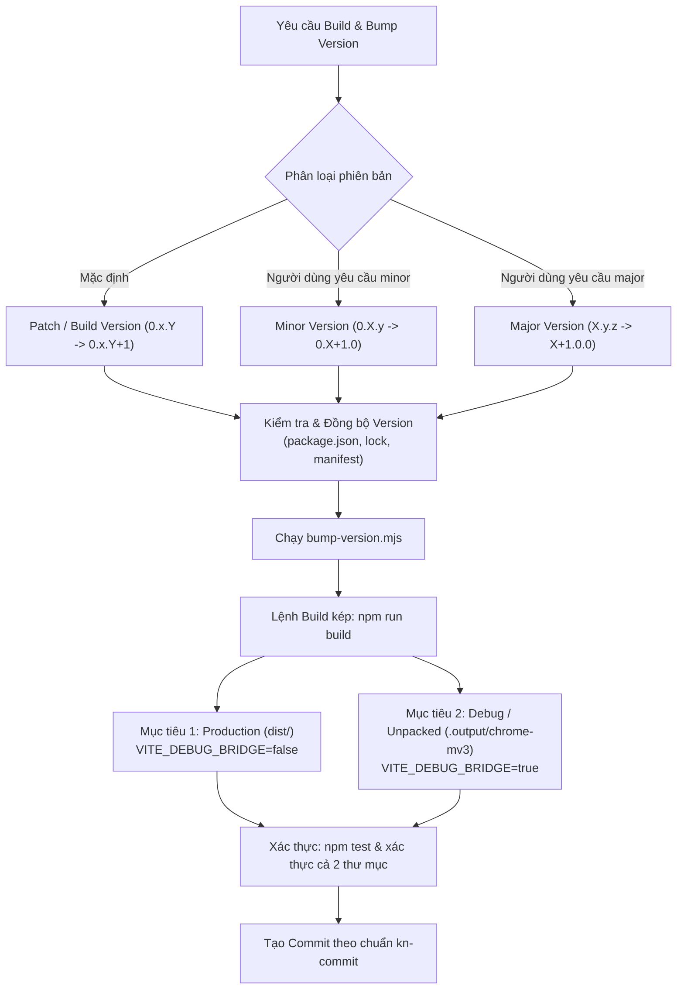

# Extension Version Bumping & Build Workflow (ext-build)

Skill này chuẩn hóa quy trình 4 bước để **nâng phiên bản**, **biên dịch đồng bộ extension cho cả 2 môi trường (Debug Unpacked và Production)**, **kiểm thử chất lượng**, và **commit** thay đổi vào Git repository theo chuẩn `kn-commit`.



---

## 1. Nguyên Tắc Cốt Lõi & Thống Nhất Thư Mục

1. **Quy định thư mục đầu ra**:
   - **`.output/chrome-mv3`**: Dành riêng cho bản **Debug / Unpacked mặc định**. Bản này kích hoạt cờ `VITE_DEBUG_BRIDGE=true`, bổ sung quyền `nativeMessaging` và `declarativeNetRequest` để kết nối Native Messaging Bridge (`debug-bridge/host.js`) phục vụ việc kiểm thử, telemetry và can thiệp engine trực tiếp. Khi nạp extension vào Chrome (`chrome://extensions` -> Load unpacked), luôn trỏ vào thư mục này.
   - **`dist/`**: Dành riêng cho bản **Production**. Bản này luôn tắt cờ `VITE_DEBUG_BRIDGE=false`, loại bỏ hoàn toàn code debug và quyền `nativeMessaging` để bảo đảm tính an toàn khi đóng gói / phân phối.
2. **Quy trình Build kép (Dual-Build Pipeline)**:
   - Lệnh `npm run build` (thực thi `scripts/build.mjs`) tự động xây dựng đồng thời cả 2 mục tiêu:
     1. Build Production sạch và copy vào thư mục `dist/`.
     2. Build Debug / Unpacked hoàn chỉnh tại `.output/chrome-mv3`.
   - Tránh triệt để tình trạng lệch phiên bản (mismatch/dị bản) giữa môi trường dev và production.
3. **Mặc định nâng build/patch version**:
   - Trừ khi người dùng nêu rõ từ khóa "minor" hoặc "major", luôn nâng build version (`patch`, ví dụ: `0.11.203` -> `0.11.204`).
4. **Đồng bộ tuyệt đối phiên bản**:
   - Bộ 3 tệp `package.json`, `package-lock.json`, và `extension/manifest.json` (cùng các manifest trong `dist/` và `.output/chrome-mv3/`) luôn được đồng bộ cùng một số phiên bản.
5. **Quy trình Commit tuân thủ `kn-commit`**:
   - Chỉ commit khi toàn bộ kiểm thử `npm test` thành công (`0` fail) và cả 2 bản build đều được xác thực hợp lệ.

---

## 2. Quy Trình Từng Bước

### Bước 1: Xác định loại Version Bump & Kiểm Tra Đồng Bộ

1. **Xác định mục tiêu nâng version**:
   - **`patch`** (Mặc định): Áp dụng cho các bản cập nhật định kỳ, sửa lỗi, hoàn thiện logic (vd: `0.11.203` -> `0.11.204`).
   - **`minor`**: Khi người dùng yêu cầu nâng minor hoặc có thay đổi lớn về tính năng (vd: `0.11.203` -> `0.12.0`).
   - **`major`**: Khi người dùng yêu cầu nâng major hoặc thay đổi kiến trúc phá vỡ tương thích (vd: `0.11.203` -> `1.0.0`).

2. **Kiểm tra tính đồng bộ trước khi bump**:
   Trước khi chạy script, kiểm tra version hiện tại ở cả 3 tệp:
   - `package.json`
   - `package-lock.json`
   - `extension/manifest.json`

   *Lưu ý:* Nếu có sự lệch phiên bản do chỉnh sửa thủ công từ trước, cần đồng bộ 3 tệp về cùng một số phiên bản trước khi gọi lệnh bump để tránh lỗi `Version mismatch`.

3. **Thực thi lệnh bump version**:
   ```powershell
   node scripts/bump-version.mjs patch   # Mặc định
   # Hoặc:
   # node scripts/bump-version.mjs minor
   # node scripts/bump-version.mjs major
   ```

---

### Bước 2: Thực Hiện Build Đồng Bộ 2 Thư Mục

Chạy lệnh build chính của dự án:
```powershell
npm run build
```

Script `scripts/build.mjs` sẽ tự động thực thi tuần tự:
1. **Giai đoạn 1 (Production)**:
   - Biên dịch WXT với `VITE_DEBUG_BRIDGE=false`.
   - Xác thực artifact qua `scripts/validate-extension.mjs`.
   - Làm sạch và ghi đè sang thư mục `dist/`.
   - Tạo `dist/.build-info` xác nhận bản production.
2. **Giai đoạn 2 (Debug / Unpacked)**:
   - Biên dịch WXT với `VITE_DEBUG_BRIDGE=true`.
   - Xác thực artifact với các quyền mở rộng.
   - Giữ nguyên tại `.output/chrome-mv3/` cho Chrome Load Unpacked.
   - Tạo `.output/chrome-mv3/.build-info` xác nhận bản debug.

---

### Bước 3: Chạy Test Suite Xác Thực (Verification)

Chạy kiểm thử toàn bộ dự án để bảo đảm không có regression nào phát sinh:
```powershell
npm test
```
- Kiểm tra toàn bộ test suites đều pass (`fail: 0`).
- Kiểm tra xác nhận:
  - `dist/manifest.json`: KHÔNG chứa quyền `nativeMessaging`.
  - `.output/chrome-mv3/manifest.json`: Chứa quyền `nativeMessaging`.

---

### Bước 4: Tạo Commit Theo Chuẩn `kn-commit`

Áp dụng quy trình của skill `kn-commit`:

1. **Stage các tệp liên quan**:
   ```powershell
   git add package.json package-lock.json extension/manifest.json dist/
   git status
   git diff --staged
   ```

2. **Xây dựng Commit Message (Conventional Commits)**:
   - **Type**: `chore` (hoặc `build`)
   - **Scope**: `release`
   - **Tiêu đề**: `chore(release): bump version to <NEW_VERSION> and dual-build [dist, .output]`
   - **Body mẫu**:
     ```markdown
     chore(release): bump version to 0.11.204 and dual-build [dist, .output]

     - Bump extension version from 0.11.203 to 0.11.204 (patch)
     - Build clean production extension in dist/ (debug bridge disabled)
     - Build unpacked debug extension in .output/chrome-mv3 (native messaging bridge enabled)
     - Validate test suite (1175 tests pass) and verify artifacts
     ```

3. **Xác nhận & Commit**:
   - Trình bày thông điệp commit và kết quả kiểm thử cho người dùng.
   - Khi nhận được xác nhận, chạy commit và kiểm tra `git log -1`.

---

## 3. Bảng Tham Chiếu Lệnh Nhanh

| Hành động | Lệnh thực thi |
|---|---|
| **Bump Patch (mặc định)** | `node scripts/bump-version.mjs patch` |
| **Bump Minor** | `node scripts/bump-version.mjs minor` |
| **Bump Major** | `node scripts/bump-version.mjs major` |
| **Build Kép (Production `dist` & Debug `.output`)** | `npm run build` |
| **Chạy Tests** | `npm test` |
| **Kiểm tra quyền Debug Bridge** | `Select-String -Path ".output/chrome-mv3/manifest.json" -Pattern "nativeMessaging"` |
| **Kiểm tra quyền Production sạch** | `Select-String -Path "dist/manifest.json" -Pattern "nativeMessaging"` (phải rỗng) |
