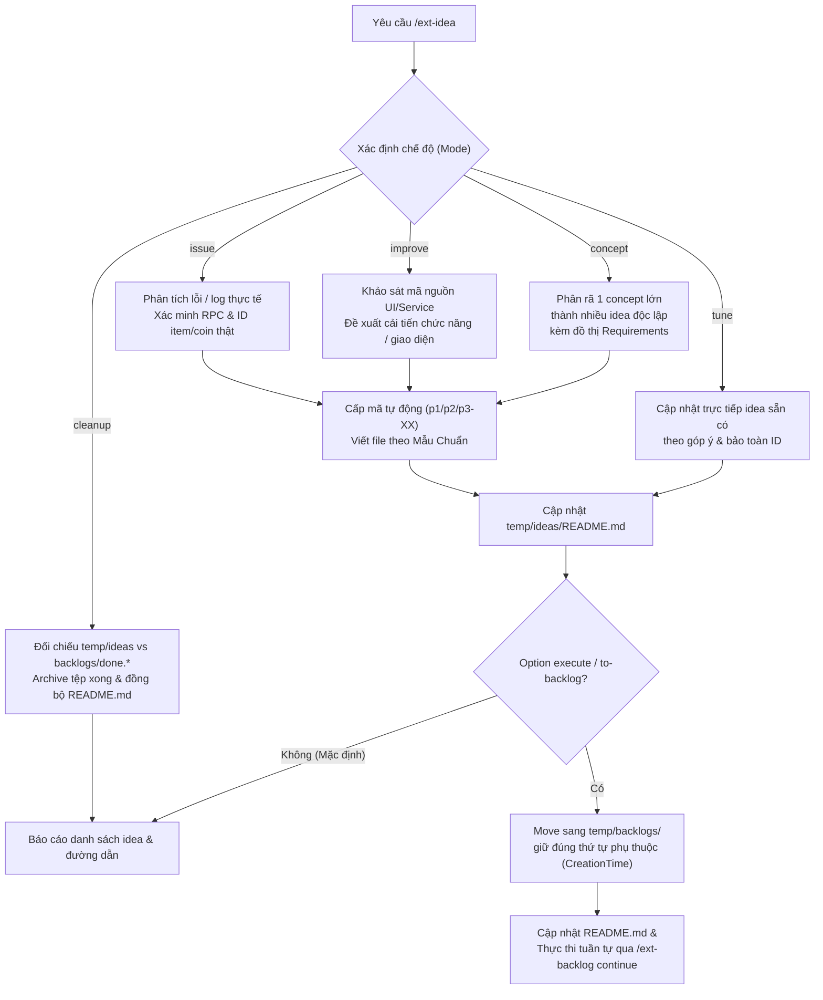

# Extension Idea Authoring & Lifecycle Workflow (ext-idea)

Skill này chuẩn hóa toàn bộ vòng đời ý tưởng phát triển trong thư mục `temp/ideas/` cho **VPL-HWA-Ext**: từ khảo sát mã nguồn / log thực tế, viết tài liệu ý tưởng đúng mẫu thống nhất (`P1` / `P2` / `P3`), tinh chỉnh theo góp ý (`tune`), dọn dẹp đồng bộ (`cleanup`), cho đến tự động bàn giao sang `temp/backlogs/` và thực thi tuần tự qua skill **`ext-backlog`** (kèm **`ext-build`**).



---

## 1. Các Chế Độ (Modes) & Tùy Chọn Đầu Vào (Options)

Skill tự động nhận diện ngữ nghĩa từ câu lệnh tiếng Việt hoặc tiếng Anh của người dùng (có thể kết hợp nhiều option trong cùng 1 lượt):

| Chế độ / Option | Từ khóa nhận diện (VN / EN) | Hành vi chuẩn |
|---|---|---|
| **`concept`** | `từ concept`, `tách nhiều idea`, `roadmap`, `breakdown`, `multi-idea`, `phân rã ý tưởng` | Phân rã 1 ý tưởng tổng quát thành **nhiều tệp idea độc lập, nhỏ gọn, có thể test & phát hành từng bước**, khai báo rõ `Requirements / Dependencies` giữa các phase để không tạo task quá lớn. |
| **`improve`** | `cải tiến`, `tối ưu UI`, `nâng cấp chức năng`, `improve`, `ux`, `refactor`, `gọn hơn` | Đọc trực tiếp file Vue/Service hiện tại (`src/components/`, `src/services/`, `src/composables/`) để xác định chính xác điểm bất cập, selector `#id`, và đề xuất phương án tối ưu cụ thể, không viết chung chung. |
| **`issue`** | `vấn đề`, `lỗi`, `bug`, `qua log`, `từ file record`, `issue`, `fix`, `rpc` | Phân tích trực tiếp log người dùng cung cấp (`temp/tracking-data/*.json`, stack trace, screenshot), trích xuất **Hợp đồng RPC thực tế** (tên RPC, `args`, `response`, ID item/coin thật từ `src/data/nameData.ts` & `src/data/itemData.ts`) và bổ sung chốt chặn an toàn (vd. không tiêu Emerald, validate payload). |
| **`tune`** | `tuning`, `điều chỉnh`, `sửa lại idea`, `cập nhật idea`, `bổ sung vào idea`, `tune`, `refine` | Mở đúng tệp idea hiện có trong `temp/ideas/`, cập nhật thiết kế & Acceptance Criteria theo góp ý mới (giữ nguyên ID và không tạo file trùng), đồng bộ lại dòng mô tả trong `temp/ideas/README.md`. |
| **`to-backlog` / `execute`** | `chuyển qua backlog`, `làm luôn`, `thực hiện luôn`, `triển khai tuần tự`, `execute`, `to-backlog`, `continue` | Sau khi tạo/tuning xong, tự động **move** các tệp idea liên quan từ `temp/ideas/` sang `temp/backlogs/` theo đúng thứ tự phụ thuộc (`Requirements` trước -> phụ thuộc sau), đồng bộ `temp/ideas/README.md`, rồi **chạy ngay quy trình `ext-backlog`** (bật `continue = true` khi có >= 2 idea hoặc người dùng yêu cầu chạy tuần tự đến hết). |
| **`cleanup`** | `dọn dẹp`, `cleanup`, `sync readme`, `archived`, `lọc idea cũ` | Đối chiếu `temp/ideas/*.md` với `temp/backlogs/done.*.md` và `temp/ideas/archived/`: chuyển mọi tệp đã triển khai/trùng lặp vào `temp/ideas/archived/` (hoặc xóa bản trùng nếu đã lưu trong `temp/backlogs/done.*`), sửa liên kết chết và cập nhật lại toàn bộ bảng trong `temp/ideas/README.md`. |

---

## 2. Quy Ước Đặt Tên, Đánh Số & Phân Loại Ưu Tiên

### 2.1. Phân loại Priority
- **`P1` (`p1-XX-<kebab-slug>.md`)**: Bugfix nghiêm trọng, ổn định Engine/WASM/Bridge, tính toàn vẹn dữ liệu, chốt chặn an toàn RPC (chống crash Unity, chống tiêu nhầm Emerald).
- **`P2` (`p2-XX-<kebab-slug>.md`)**: Cải tiến chức năng hiện có, tối ưu giao diện/mật độ hiển thị (UI/UX), hoàn thiện dialog dựa trên RPC đã xác minh, công cụ đồng bộ dữ liệu.
- **`P3` (`p3-XX-<kebab-slug>.md`)**: Tính năng tự động hóa mới quy mô lớn, công cụ chiến thuật/cạnh tranh mới (Autopilot, Optimizer, War Scout, Outland/Expedition dispatcher).

### 2.2. Quy tắc cấp số `XX` không bao giờ trùng
Trước khi tạo tệp mới, **bắt buộc** quét đồng thời 3 nơi: `temp/ideas/`, `temp/ideas/archived/`, và `temp/backlogs/` (kể cả `done.*`) để lấy số `XX` lớn nhất của cùng mức ưu tiên (`p1`, `p2`, hoặc `p3`) rồi cộng thêm `1` (pad 2 chữ số, vd. `p2-17`).

```powershell
# Lấy số thứ tự kế tiếp cho nhóm p2 (thay p2 bằng p1 hoặc p3 nếu cần)
node -e "
const fs = require('fs');
const dirs = ['temp/ideas', 'temp/ideas/archived', 'temp/backlogs'];
const prefix = 'p2';
let max = 0;
const re = new RegExp('(?:^|\\.)' + prefix + '-(\\d+)-');
for (const d of dirs) {
  if (!fs.existsSync(d)) continue;
  for (const f of fs.readdirSync(d)) {
    const m = f.match(re);
    if (m) max = Math.max(max, Number(m[1]));
  }
}
console.log(prefix + '-' + String(max + 1).padStart(2, '0'));
"
```

---

## 3. Mẫu Tài Liệu Ý Tưởng Chuẩn (Canonical Idea Template)

Mọi tệp trong `temp/ideas/<pX-XX-slug>.md` **bắt buộc** tuân theo cấu trúc gọn, rõ, có thể triển khai ngay mà không phải đoán mò:

```markdown
# [P2-XX] <Tên ngắn gọn, rõ phạm vi> — <Giá trị/Mục tiêu cốt lõi>

- **Priority**: P2 (<Nhóm: UI Cleanup / Core Upgrade / Safety Guard / Automation>)
- **Category**: <Khu vực & các file đích chính, vd. Hero Detail Dialog (`HeroDetailModal.vue`, `heroUpgradeService.ts`)>
- **Status**: Open
- **Requirements / Dependencies**: `p2-13` *(done)* *(hoặc `None`)*
- **Source Capture**: `temp/tracking-data/<file>.json` *(chỉ ghi khi có log thực tế)*

---

## 1. Bối cảnh & Vấn đề Hiện tại (hoặc Hợp đồng RPC Thực tế Đã Xác Minh)

1. Mô tả ngắn gọn thực trạng từ mã nguồn hiện tại (nêu rõ tên file, thành phần, selector `#id` nếu có).
2. *(Nếu có log mẫu)* Ghi rõ **Request / Response RPC thật**, tên trường cache (`rpcCache.ts`), và **ID thật** của item/coin/consumable đã kiểm chứng từ `src/data/nameData.ts` & `src/data/itemData.ts`.

---

## 2. Thiết kế Giải pháp Chi tiết

### 2.1. Logic / Service / Cache / Guard
- Tách logic thuần (pure functions) vào `src/services/` hoặc `src/utils/` để dễ unit test.
- Khai báo rõ chốt chặn an toàn (nếu có gửi RPC tiêu tài nguyên hoặc thay đổi đội hình, vd. `validateOutgoingMultiTeamRpcCalls` trong `src/services/rpcSanitizer.ts`).

### 2.2. Giao diện (UI/UX)
- Mô tả rõ bố cục, vị trí đặt component, selector `#id` dự kiến cho test, tooltip/trạng thái màu sắc.
- **Bắt buộc**: Mọi chuỗi hiển thị trong component `.vue` dưới `src/components/` phải **100% tiếng Anh** (dự án có test tự động chặn dấu tiếng Việt trong `.vue`).

---

## 3. Kế hoạch Kiểm thử & Acceptance Criteria

- **AC1 (<Tiêu chí chính 1>)**: Mô tả hành vi kiểm chứng được bằng unit test / assertion cụ thể.
- **AC2 (<Tiêu chí chính 2>)**: Mô tả selector `#id`, guard an toàn hoặc luồng RPC cụ thể.
- **AC3 (Verification)**: Cập nhật/bổ sung test trong `tests/*.test.mjs`, chạy `npm test` (`0` fail) và `npm run build` (`dist/` + `.output/chrome-mv3/`) thành công.
```

---

## 4. Quy Trình Thực Thi Từng Bước

### Bước 1: Xác minh Thực tế Trước Khi Viết (Code & Data First)
1. **Không đoán tên file, RPC, hay ID vật phẩm**:
   - Với `improve` / `concept`: đọc trực tiếp các file liên quan trong `src/` để biết kiến trúc, composable, cache key và selector đang dùng.
   - Với `issue` có log đính kèm: chạy script Node đọc `timeline` trong file JSON để xác minh chính xác `requestBody`, `responseBody`, `coin`/`consumable` ID và đối chiếu với `src/data/nameData.ts`, `src/data/itemData.ts`.
2. **Kiểm tra trùng lặp**: Quét `temp/ideas/` và `temp/backlogs/` xem đã có idea cùng chủ đề chưa; nếu có và người dùng đang góp ý bổ sung, chuyển sang chế độ **`tune`** thay vì tạo file trùng.

### Bước 2: Soạn Thảo / Phân Rã / Tuning Tệp Idea
- **Chế độ `concept` (tạo nhiều idea)**:
  - Chia nhỏ theo nguyên tắc **mỗi idea = 1 lát cắt giá trị độc lập**, hoàn thành gọn trong 1 chu kỳ `ext-backlog` (tránh gom quá nhiều hạng mục không liên quan vào 1 file).
  - Khai báo tường minh `Requirements / Dependencies` theo chuỗi (vd. `p2-15` -> `p2-16`).
- **Chế độ `tune`**:
  - Chỉnh sửa trực tiếp tệp gốc trong `temp/ideas/`, đảm bảo mọi thay đổi về yêu cầu, UI, RPC và AC đều nhất quán toàn văn bản.
- **Đồng bộ mục lục**: Cập nhật ngay bảng tương ứng trong `temp/ideas/README.md` (thêm dòng mới hoặc sửa tiêu đề/requirements cho tệp vừa tune).

### Bước 3: Tùy Chọn Bàn Giao Sang Backlog & Thực Thi Tuần Tự (`to-backlog` / `execute`)
Khi người dùng yêu cầu chuyển qua backlog và/hoặc thực hiện ngay:
1. **Di chuyển theo đúng thứ tự phụ thuộc** (sắp xếp topo: idea không phụ thuộc trước -> idea phụ thuộc sau). Khi di chuyển nhiều file trong 1 lệnh PowerShell, chèn khoảng nghỉ ngắn (`Start-Sleep -Milliseconds 1200`) giữa từng lần `Move-Item` / cập nhật `CreationTime` tăng dần để `ext-backlog` (sắp xếp theo `CreationTime, Name`) luôn bóc đúng thứ tự phụ thuộc:
   ```powershell
   $ordered = @(
     "p2-14-compact-header-active-automation-icons.md",
     "p2-15-hero-dialog-glyphs-levelup-and-spark-of-power.md",
     "p2-16-hero-dialog-unified-upgrades-tab-and-resource-bars.md"
   )
   $t = Get-Date
   foreach ($name in $ordered) {
     $src = "temp/ideas/$name"
     $dst = "temp/backlogs/$name"
     if (Test-Path $src) {
       Move-Item -Path $src -Destination $dst -Force
       (Get-Item $dst).CreationTime = $t
       $t = $t.AddSeconds(2)
     }
   }
   ```
2. Cập nhật `temp/ideas/README.md` (gỡ các tệp đã chuyển khỏi danh sách Active Ideas).
3. Nếu người dùng yêu cầu thực hiện luôn (`execute` / `làm luôn` / `continue`): chuyển tiếp liền mạch sang quy trình của skill **`ext-backlog`** (`.agents/skills/ext-backlog/SKILL.md`) với **`continue = true`** khi có nhiều tệp hoặc yêu cầu chạy tuần tự đến hết.

### Bước 4: Chế Độ Dọn Dẹp (`cleanup`)
Khi người dùng gọi dọn dẹp hoặc sau các đợt chuyển giao lớn:
1. Quét toàn bộ tệp `*.md` trong `temp/ideas/` (trừ `README.md`):
   - Nếu tên tệp đã xuất hiện dưới dạng `done.*.<filename>` trong `temp/backlogs/`: di chuyển tệp còn sót ở `temp/ideas/` vào `temp/ideas/archived/` (hoặc xóa bản trùng nếu `temp/ideas/archived/<filename>` đã tồn tại).
   - Nếu tệp đang nằm ở `temp/backlogs/<filename>` (đang pending): cảnh báo và loại khỏi danh sách Active ở `temp/ideas/` để tránh chỉnh sửa nhầm bản sao.
2. Kiểm tra lại toàn bộ bảng trong `temp/ideas/README.md`:
   - Gỡ các liên kết tới file không còn tồn tại trong `temp/ideas/`.
   - Bổ sung các file đang tồn tại trong `temp/ideas/` nhưng chưa được liệt kê.
   - Cập nhật dòng tổng kết `Archived Ideas` cho khớp số lượng thực tế.
3. **Lưu ý Git**: Tuyệt đối **không** `git add` thư mục `temp/ideas/` hay `temp/backlogs/` (chúng là không gian làm việc nội bộ, luôn loại trừ khi commit).

---

## 5. Bảng Tham Chiếu Lệnh Nhanh

| Mục đích | Lệnh PowerShell |
|---|---|
| **Liệt kê các idea đang mở** | `Get-ChildItem temp/ideas/*.md \| Where-Object { $_.Name -ne 'README.md' } \| Sort-Object Name` |
| **Tìm idea trùng đã hoàn tất trong backlog** | `$done = (Get-ChildItem temp/backlogs/done.*.md).Name; Get-ChildItem temp/ideas/*.md \| Where-Object { $_.Name -ne 'README.md' -and ($done -match [regex]::Escape($_.Name)) } \| Select-Object Name` |
| **Lưu trữ idea đã xong vào `temp/ideas/archived/`** | `New-Item -ItemType Directory -Force -Path temp/ideas/archived \| Out-Null; Move-Item "temp/ideas/<file>.md" "temp/ideas/archived/" -Force` |
| **Chuyển idea sang backlog giữ đúng thứ tự** | `Move-Item "temp/ideas/<file>.md" "temp/backlogs/<file>.md" -Force` |
| **Kiểm tra không có file `temp/` bị stage** | `git status -s` |
