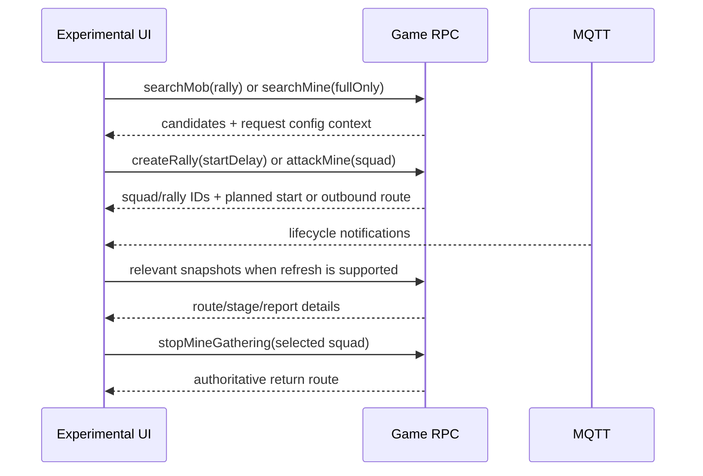

# World Map RPC Contracts

## Evidence and scope

Captured contracts: source IDs in @doc/api/observed-protocol-index. S11 records solo search/attack; S12 records rally search/create; S13 records gather/recall; S14 records mine search by level. S04 records return-route lookup; S02 and S10 contain bootstrap world summaries. General field inventories are in @doc/api/world-map-rpc-catalog.

The examples below preserve captured field names and meaningful configuration numbers. Map, boss, mine, rally, route and squad IDs are placeholders. Observed success does not establish all valid team sizes, delay options or resource limits.

## Shared squad and route

```json
{
  "heroes": [{"heroId": 16}, {"heroId": 2}, {"heroId": 79}, {"heroId": 70}, {"heroId": 60}],
  "units": [{"unitId": 7, "count": 1618}, {"unitId": 17, "count": 1617}, {"unitId": 27, "count": 1617}]
}
```

S12 supplies this shape as `args.squad`; S13 has another five-hero lineup. Hero IDs are configuration IDs, unit counts are troop quantities. The current Experimental UI selects five heroes and positive integer troop counts; that local validation is not a complete server contract. Lowest-power-five selection is an extension preference, not a server behavior.

Routes observed in S13 contain `routeId`, `from.coordinates`, `from.object`, `to.coordinates`, `to.object`, `startedAt`, `duration` and `durationMs`. Route `startedAt` is Unix milliseconds; `durationMs` is milliseconds. Captured legacy `duration` values match the millisecond duration; prefer `durationMs` when present. ETA is `startedAt + durationMs`.

Keep IDs separate: an object target ID is not a squad ID, rally ID or config ID.

## Boss search and rally creation

### searchMob:mob

```json
{
  "name": "searchMob",
  "feature": "mob",
  "args": {
    "mapId": "MAP_ID",
    "mobConfigIds": [79],
    "mobType": "rally",
    "center": {"x": 606, "y": 376}
  }
}
```

S12 returns `response.mobs[]` with `mobId` and `coordinates {x,y}`; it does not return a config ID for each candidate. Preserve the search's requested config ID and map ID alongside its result. S11 uses `mobType: "solo"` with `mobConfigIds: [37,67]`; do not reuse rally config ranges for solo monsters.

Current captured/config-backed PvP boss range: level 1–30 maps to config IDs 60–89 (`59 + level`). Other rally configs 25–29 name different targets in `hwaHelperRallyTargets`; their existence does not establish a second level formula. Evidence: `extension/march-rules.js`, `bossConfigId` in `extension/experimental-data.js`.

### getRallyAttackDefenders:squadBattle

S12 requests `args: {"PredefinedSquadId":84}` and receives `response.defenders` while opening the rally attack UI. Preserve the capital P. The capture proves this request occurs before creation, but does not prove it is a required precondition or how every boss maps to a predefined squad.

### createRally:mob

```json
{
  "name": "createRally",
  "feature": "mob",
  "args": {
    "mapId": "MAP_ID",
    "mobId": "SELECTED_BOSS_ID",
    "squad": {
      "heroes": [{"heroId":16},{"heroId":2},{"heroId":79},{"heroId":70},{"heroId":60}],
      "units": [{"unitId":7,"count":1618},{"unitId":17,"count":1617},{"unitId":27,"count":1617}]
    },
    "startDelay": 300000
  }
}
```

S12 confirms `startDelay` is milliseconds (300000 = five minutes). The response contains `squadId` and `rally {rallyId, plannedStartTime, membersLimit, unitsLimit}`. `plannedStartTime` is Unix milliseconds. Use the returned time rather than local request time plus delay. The capture does not establish all allowed start delays; the UI's 1–3600-second validation is only a local bound.

The implemented resource reducer charges 25 World Energy on creation and deduplicates by rally ID; cancellation refund handling is implemented. See `worldEnergyAction` in `hwaHelperRpcCache.merge`. A successful cancellation request is not present in this current raw capture corpus, so `cancelRally:rally` is implementation/test evidence, not an additional captured method.

### getRallyById:rally

Request `{"rallyId":"RALLY_ID"}`; observed response `response.rally` includes leader/member squads, target, leader coordinates and planned start. Use the local account's leader/member squad when displaying the team; another guild member's rally is not automatically the user's march.

Current reducer estimates legs from coordinates and `hwaHelperRouteSpeeds` until authoritative routes arrive. Such durations are estimates. Match updates by rally/squad identity. Do not attach an unrelated guild rally's team or route.

## Mine search, dispatch and recall

### searchMine:mine

```json
{
  "name": "searchMine",
  "feature": "mine",
  "args": {
    "mapId": "MAP_ID",
    "mineConfigIds": [66],
    "fullOnly": true,
    "center": {"x":606,"y":376}
  }
}
```

S14 records four searches: Food level 8 (66), Iron level 9 (87), Stone level 7 (75), Wood level 8 (56). Each returns `response.mines[] {mineId, coordinates {x,y}}`. An empty result must replace a prior search, not leave old targets selectable. Search candidates lack resource amount and config ID; keep request metadata for the candidate list.

`fullOnly: true` is observed; false-mode behavior has not been established. A mine can change after search, so a search result is not a reservation or a guarantee dispatch will succeed.

### Type and level config mapping

Columns list config IDs for levels 1 through 10.

| Type | L1 | L2 | L3 | L4 | L5 | L6 | L7 | L8 | L9 | L10 |
|---|---:|---:|---:|---:|---:|---:|---:|---:|---:|---:|
| wood | 12 | 20 | 21 | 22 | 23 | 24 | 55 | 56 | 57 | 58 |
| food | 27 | 28 | 29 | 30 | 31 | 32 | 65 | 66 | 67 | 68 |
| stone | 35 | 36 | 37 | 38 | 39 | 40 | 75 | 76 | 77 | 78 |
| iron | 43 | 44 | 45 | 46 | 47 | 48 | 85 | 86 | 87 | 88 |

Mapping source: captured remote-config reference `globalMapMine/8e7146741646f82dca4a58e87ee61598.json` from client 1.292.0, materialized in `mineConfigs` / `mineConfigId` in `extension/experimental-data.js`. Four mappings also have direct S14 request evidence. The table is a versioned configuration snapshot.

### getMineById:mine

Request `{"mineId":"MINE_ID"}`; S14 returns `mineId` and `resourceAmount`. Captured examples confirm full amounts depend on type and level. Do not infer mine level from amount alone.

### attackMine:mine

```json
{
  "name": "attackMine",
  "feature": "mine",
  "args": {
    "mapId": "MAP_ID",
    "mineId": "SELECTED_MINE_ID",
    "battleType": "pve",
    "squad": {
      "heroes": [{"heroId":504},{"heroId":53},{"heroId":8},{"heroId":19},{"heroId":10}],
      "units": [{"unitId":7,"count":1424},{"unitId":17,"count":1424},{"unitId":27,"count":1424}]
    }
  }
}
```

S13 returns `squadId` and an outbound `route`. This route times travel, not the entire gathering duration. After arrival, `routeToMineCompleted` MQTT provides gathering-plan fields; see @doc/api/captured-mqtt-event-catalog. Current reducer does not consume that event directly, so current UI gathering completion is not authoritative from that event alone.

### stopMineGathering:mine

Request `{"squadId":"GATHERING_SQUAD_ID"}`. S13 records two successful recalls. Response: `squadId`, `remainingResourceAmount`, and return `route`. Use this route for return ETA. Remaining amount is not the amount gained. Recall one selected squad, not all squads.

## Map and march snapshots

`getChunks:globalMap` requests `mapId`, `lod`, `chunkCoordinates[] {x,y}`. Responses contain `chunks[]` with mobs, mines, outposts and update time, plus routes. Map tile coordinates and chunk coordinates are different domains; do not use tile center as chunk coordinates.

`getMarches:march` uses an empty args object in bootstrap captures. It supplies own squad stages and routes. `getRoutesByIds:globalMap` resolves route details; see the inventory for exact observed argument shape. Do not infer squad ownership from a global `routeCreated` notification.

## End-to-end timeline



For rally: waiting ends at `plannedStartTime`; outbound route ends at boss arrival; battle result must come from report/result data; return finishes at route ETA or explicit completion. `mobRallyAttackResult` handling is implemented but absent from the current raw captures. For solo attacks, S11 provides `soloMobAttackResult` reports; return estimates should be replaced by later routes.

## Implementation and tests

Builders: `buildMineSearchCall`, `buildRallyCall`, `buildGatherCall`, `buildSquad` in `extension/experimental-data.js`. Reducers: `rallyAction`, `gatherAction`, `mineMapAction`, `experimentalActionStatus` in `extension/rpc-cache.js`. Tests: `tests/experimental-data.test.mjs`, `tests/rpc-cache.test.mjs`, `tests/background.test.mjs`.

Related implementation tasks: @task-VHE-C0GGBR and @task-VHE-XTBH0Y. Documentation audit: @task-VHE-68C0H0.
