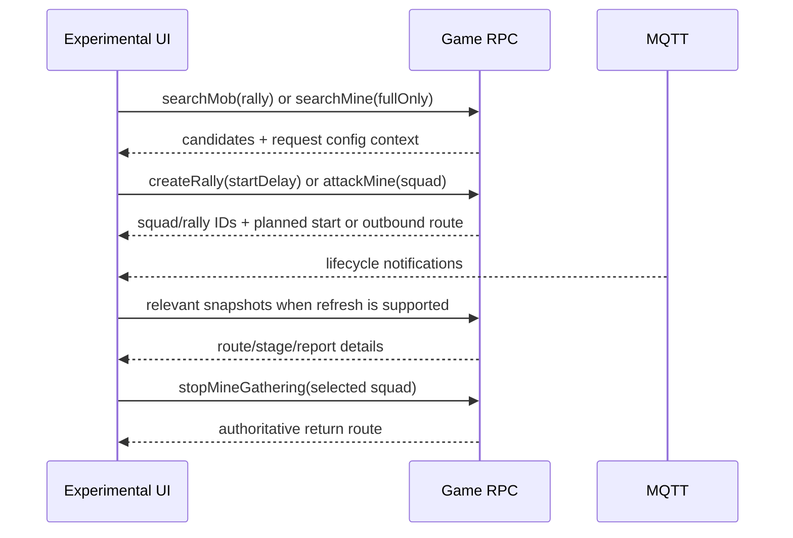

# World Map RPC Contracts

## Evidence and scope

Captured contracts: source IDs in @doc/api/observed-protocol-index. S11 records solo search/attack; S12 records rally search/create; S13 records gather/recall; S14 records mine search by level. S04 records return-route lookup; S02 and S10 contain bootstrap world summaries. General field inventories are in @doc/api/world-map-rpc-catalog.

The examples below preserve captured field names and meaningful configuration numbers. Map, boss, mine, rally, route and squad IDs are placeholders. Observed success does not establish all valid team sizes, delay options or resource limits.

## Shared squad and route

```json
{
  "heroes": [{"heroId": 16}, {"heroId": 2}, {"heroId": 79}, {"heroId": 70}, {"heroId": 60}],
  "units": [{"unitId": 7, "count": 1618}, {"unitId": 17, "count": 1617}, {"unitId": 27, "count": 1617}]
}
```

S12 supplies this shape as `args.squad`; S13 has another five-hero lineup. Hero IDs are configuration IDs, unit counts are troop quantities. The current Experimental UI selects five heroes and positive integer troop counts; that local validation is not a complete server contract. Lowest-power-five selection is an extension preference, not a server behavior.

Routes observed in S13 contain `routeId`, `from.coordinates`, `from.object`, `to.coordinates`, `to.object`, `startedAt`, `duration` and `durationMs`. Route `startedAt` is Unix milliseconds; `durationMs` is milliseconds. Captured legacy `duration` values match the millisecond duration; prefer `durationMs` when present. ETA is `startedAt + durationMs`.

Keep IDs separate: an object target ID is not a squad ID, rally ID or config ID.

## Boss search and rally creation

### searchMob:mob

```json
{
  "name": "searchMob",
  "feature": "mob",
  "args": {
    "mapId": "MAP_ID",
    "mobConfigIds": [79],
    "mobType": "rally",
    "center": {"x": 606, "y": 376}
  }
}
```

S12 returns `response.mobs[]` with `mobId` and `coordinates {x,y}`; it does not return a config ID for each candidate. Preserve the search's requested config ID and map ID alongside its result. S11 uses `mobType: "solo"` with `mobConfigIds: [37,67]`; do not reuse rally config ranges for solo monsters.

Current captured/config-backed PvP boss range: level 1–30 maps to config IDs 60–89 (`59 + level`). Other rally configs 25–29 name different targets in `hwaHelperRallyTargets`; their existence does not establish a second level formula. Evidence: `extension/march-rules.js`, `bossConfigId` in `extension/experimental-data.js`.

### getRallyAttackDefenders:squadBattle

S12 requests `args: {"PredefinedSquadId":84}` and receives `response.defenders` while opening the rally attack UI. Preserve the capital P. The capture proves this request occurs before creation, but does not prove it is a required precondition or how every boss maps to a predefined squad.

### createRally:mob

```json
{
  "name": "createRally",
  "feature": "mob",
  "args": {
    "mapId": "MAP_ID",
    "mobId": "SELECTED_BOSS_ID",
    "squad": {
      "heroes": [{"heroId":16},{"heroId":2},{"heroId":79},{"heroId":70},{"heroId":60}],
      "units": [{"unitId":7,"count":1618},{"unitId":17,"count":1617},{"unitId":27,"count":1617}]
    },
    "startDelay": 300000
  }
}
```

S12 confirms `startDelay` is milliseconds (300000 = five minutes). The response contains `squadId` and `rally {rallyId, plannedStartTime, membersLimit, unitsLimit}`. `plannedStartTime` is Unix milliseconds. Use the returned time rather than local request time plus delay. Game 1.292.0 `globalMapRallySettings` config `f69b9fce107369b9c8fb8e086ecdc7e4` verifies `startDelayOptions = [00:01:00, 00:05:00, 00:15:00, 00:30:00]`. Builders and UI accept exactly 60, 300, 900 or 1800 seconds; this supersedes the former arbitrary 1–3600-second local bound. The same config specifies five joiner slots (leader makes six) and 400000 units; use response membership fields for current counts.

The implemented resource reducer charges 25 World Energy on creation and deduplicates by rally ID; cancellation refund handling is implemented. See `worldEnergyAction` in `hwaHelperRpcCache.merge`. A successful cancellation request is not present in this current raw capture corpus, so `cancelRally:rally` is implementation/test evidence, not an additional captured method.

### getRallyById:rally

Request `{"rallyId":"RALLY_ID"}`; observed response `response.rally` includes leader/member squads, target, leader coordinates and planned start. Use the local account's leader/member squad when displaying the team; another guild member's rally is not automatically the user's march.

Current reducer estimates legs from coordinates and `hwaHelperRouteSpeeds` until authoritative routes arrive. Such durations are estimates. Match updates by rally/squad identity. Do not attach an unrelated guild rally's team or route.

## Mine search, dispatch and recall

### searchMine:mine

```json
{
  "name": "searchMine",
  "feature": "mine",
  "args": {
    "mapId": "MAP_ID",
    "mineConfigIds": [66],
    "fullOnly": true,
    "center": {"x":606,"y":376}
  }
}
```

S14 records four searches: Food level 8 (66), Iron level 9 (87), Stone level 7 (75), Wood level 8 (56). Each returns `response.mines[] {mineId, coordinates {x,y}}`. An empty result must replace a prior search, not leave old targets selectable. Search candidates lack resource amount and config ID; keep request metadata for the candidate list.

`fullOnly: true` is observed; false-mode behavior has not been established. A mine can change after search, so a search result is not a reservation or a guarantee dispatch will succeed.

### Type and level config mapping

Columns list config IDs for levels 1 through 10.

| Type | L1 | L2 | L3 | L4 | L5 | L6 | L7 | L8 | L9 | L10 |
|---|---:|---:|---:|---:|---:|---:|---:|---:|---:|---:|
| wood | 12 | 20 | 21 | 22 | 23 | 24 | 55 | 56 | 57 | 58 |
| food | 27 | 28 | 29 | 30 | 31 | 32 | 65 | 66 | 67 | 68 |
| stone | 35 | 36 | 37 | 38 | 39 | 40 | 75 | 76 | 77 | 78 |
| iron | 43 | 44 | 45 | 46 | 47 | 48 | 85 | 86 | 87 | 88 |

Mapping source: captured remote-config reference `globalMapMine/8e7146741646f82dca4a58e87ee61598.json` from client 1.292.0, materialized in `mineConfigs` / `mineConfigId` in `extension/experimental-data.js`. Four mappings also have direct S14 request evidence. The table is a versioned configuration snapshot.

### getMineById:mine

Request `{"mineId":"MINE_ID"}`; S14 returns `mineId` and `resourceAmount`. Captured examples confirm full amounts depend on type and level. Do not infer mine level from amount alone.

### attackMine:mine

```json
{
  "name": "attackMine",
  "feature": "mine",
  "args": {
    "mapId": "MAP_ID",
    "mineId": "SELECTED_MINE_ID",
    "battleType": "pve",
    "squad": {
      "heroes": [{"heroId":504},{"heroId":53},{"heroId":8},{"heroId":19},{"heroId":10}],
      "units": [{"unitId":7,"count":1424},{"unitId":17,"count":1424},{"unitId":27,"count":1424}]
    }
  }
}
```

S13 returns `squadId` and an outbound `route`. This route times travel, not the entire gathering duration. After arrival, `routeToMineCompleted` MQTT provides gathering-plan fields; see @doc/api/captured-mqtt-event-catalog. Current reducer does not consume that event directly, so current UI gathering completion is not authoritative from that event alone.

### stopMineGathering:mine

Request `{"squadId":"GATHERING_SQUAD_ID"}`. S13 records two successful recalls. Response: `squadId`, `remainingResourceAmount`, and return `route`. Use this route for return ETA. Remaining amount is not the amount gained. Recall one selected squad, not all squads.

## Map and march snapshots

`getChunks:globalMap` requests `mapId`, `lod`, `chunkCoordinates[] {x,y}`. Responses contain `chunks[]` with mobs, mines, outposts and update time, plus routes. Map tile coordinates and chunk coordinates are different domains; do not use tile center as chunk coordinates.

`getMarches:march` uses an empty args object in bootstrap captures. It supplies own squad stages and routes. `getRoutesByIds:globalMap` resolves route details; see the inventory for exact observed argument shape. Do not infer squad ownership from a global `routeCreated` notification.

Rally correlation was corrected under @task-VHE-MACK1D during the backlog audit. Return routes update only a unique match by squad/rally/known route ID, or by exact boss instance plus matching route leader/current account. Routes for another player's return and ambiguous shared-boss routes are ignored. Route IDs survive march snapshots and MQTT return results.

Legacy `rallyMobAttackResult` reports containing only `mobConfigId` (boss level/config) do not prove a rally instance and must not change any ETA, even if only one rally is cached. They still update mail/report rewards. A report with an actual matching squad/rally/mob instance identifier may enrich that march; prior authoritative return times remain intact.

`getRallyById` uses current account ID or a squad ID already established by own march data. Hardcoded player IDs, display-name matching and leader-team substitution for an unknown own member are removed. Same-timestamp snapshot/details batches may enrich an existing squad.

## End-to-end timeline



For rally: waiting ends at `plannedStartTime`; outbound route ends at boss arrival; battle result must come from report/result data; return finishes at route ETA or explicit completion. `mobRallyAttackResult` handling is implemented but absent from the current raw captures. For solo attacks, S11 provides `soloMobAttackResult` reports; return estimates should be replaced by later routes.

## Implementation and tests

Builders: `buildMineSearchCall`, `buildRallyCall`, `buildGatherCall`, `buildSquad` in `extension/experimental-data.js`. Reducers: `rallyAction`, `gatherAction`, `mineMapAction`, `experimentalActionStatus` in `extension/rpc-cache.js`. Tests: `tests/experimental-data.test.mjs`, `tests/rpc-cache.test.mjs`, `tests/background.test.mjs`.

Related implementation tasks: @task-VHE-C0GGBR and @task-VHE-XTBH0Y. Documentation audit: @task-VHE-68C0H0.

## Managed raid queue and troop allocation

Implemented by @task-VHE-1K5J8J. `extension/raid-queue.js` owns a pure transition controller; background serializes transitions and persists `raidQueue` before dispatch. The popup persists account-scoped `raidPreferences`: last selected lineup, last **searched** boss level, wait, minimum members, raid count. Capacity defaults live in global Settings; squad observations are learned in the cache. Editing a level without searching does not replace the saved search level.

### Capacity and available units

Updated by @task-VHE-NFV32J after the user's 2026-11-06 UI/capacity clarification. The Rally form has no hero or base capacity inputs. It shows total allocated troops and three compact per-type counts with level breakdowns.

`troopCapacitySettings` is stored in global Settings: `defaultHero:600`, `base:950`. Invalid stored values fall back to those defaults. Explicit hero `troopCapacity` data and the five previously supplied matching level/star samples take precedence over the default. Legacy manual `raidPreferences.capacities` and `baseTroops` are no longer read by the popup/queue. Settings changes affect preview and each background roster refresh; no manual confirmation is required after hero stats change.

**Corrected troop mapping, per user instruction:** IDs **1–9 = Marksmen levels 1–9**, **11–19 = Spearmen levels 1–9**, **21–29 = Infantry levels 1–9**. The former Front/Middle/Back interpretation in this doc was incorrect. IDs 0/10/20/30 and other unknown IDs are excluded from allocation and type summaries.

`getUnitSummary:unit {}` supplies `available[{unitId,unitConfigId,count}]`, `reserved` and deployed `squads`. Allocate only available stock. Refresh heroes and troop stock before each raid and reject selected heroes still deployed. `allocateTroops` maximizes the total up to capacity/inventory, balances the three types, redistributes shortages and fills each type from highest level down.

### Observed squad capacity model

`troopCapacityEvidence` retains at most 100 own-account lineup/profile observations. Successful native/manual or helper `createRally:mob`, `rallyUserAutojoined`, own member/leader data in `getRallyById:rally`, and successful `attackMine:mine` contribute deployed troop totals. Unknown own hero data, failed RPCs, foreign rally members and observations older than the cached hero snapshot are excluded. All troop rows are counted, including mixed tiers beyond five rows.

Each observation binds five unique sorted hero IDs to their cached level/star/power signatures and account ID. Repeated observations retain the **maximum** load for that same profile; smaller/partially filled squads never reduce it. Stat changes invalidate observations for the changed profiles.

`capacityModel` uses the configured base as a fixed assumption and solves observed lineup sums after subtracting known hero contributions. Row reduction exposes only uniquely identifiable hero contributions. Underdetermined contributions keep the configured fallback instead of receiving an arbitrary equal split; inconsistent systems produce no inferred hero values. Equations below the fallback minimum are ignored. The observed maximum for the exact selected lineup can still improve that lineup's total without claiming individual hero contributions.

A troop load demonstrates that a squad carried that quantity; it does **not** prove the game filled its true maximum. Inferred contributions and lineup totals therefore remain operational estimates, while 600/950 provide immediate fallback behavior. There is still no verified executable power/level capacity curve; the exposed `squadSetting` coefficients are not fitted or treated as such. Tests cover a full-rank set of overlapping lineups, underdetermined/conflicting data, partial loads, account/stat isolation and Settings propagation.

### Sequential lifecycle

`refreshing → searching → creating → active → refreshing|complete`. Requested count is 1–100. A fresh search uses the chosen boss level each time. Create confirmation matches the expected map, mob, heroes, units and delay, and records server `rallyId`, `squadId`, `plannedStartTime`. The queue stays pinned to its game tab/account and selected options; a second popup cannot start a concurrent queue.

Only a matching `mobRallyAttackResult` with `battleResult.battleResult:"win"` plus either matching `returnFromMobCompleted` or a newer well-formed `getMarches:march` snapshot lacking that squad permits another raid. Return can arrive before result. Return ETA/countdown expiry alone never advances the queue. Loss, RPC error/timeout, no available troops, account switch, disconnection or explicit stop ends the queue. Mutating commands are never automatically retried. Stopping removes unsent RPCs owned by the queue; commands already sent continue in game.

The cache retains bounded rally-to-mob mappings and defeated `{mapId,mobId}` tombstones (200 each), plus result history (20). A matching win removes that boss from current candidates and subsequent searches, including result delivery after the squad has returned. Other boss IDs and losses do not remove candidates.

### Ten-second membership cancellation

The leader counts once alongside unique member user IDs; total slots are current participants plus `membersCapacityLeft`. Threshold is 1–6 (default 4). The controller requests current details on creation and about 20 seconds before server departure, then evaluates at 10 seconds. Membership older than 25 seconds before departure or missing membership is treated conservatively as insufficient evidence to proceed, also triggering cancellation. Underfilled rallies issue **one** `cancelRally:rally {rallyId}`, then stop the queue; no replacement raid is started.

Cancellation expires one second before departure. The background, content bridge and MAIN interceptor forward an absolute `expiresAt` deadline and queue owner `group`; expired mutations are discarded and stopping drops unsent calls in that group. A missed timer deadline stops with an explicit status instead of issuing a late cancel.

All calls inherit @doc/architecture/shared-rpc-settings, including cancellation. Piggyback needs a native carrier RPC before the deadline; MQTT-assisted uses the existing local nudge. Neither forces Direct. Cancellation cannot be guaranteed if no carrier arrives or the browser suspends/throttles the game tab. The content-script timer wakes the MV3 worker with the popup closed; keep the game tab open. Persisted intent is resumed by processing events/ticks without replaying a create after worker restart. Turning off RPC/monitoring or changing dispatch mode stops the queue. Live in-game validation is still required; automated checks use synthetic RPC/MQTT and the available private captures.

### Regression coverage

`tests/experimental-ui.test.mjs` covers lineup persistence writes, troop changes, last searched level and game wait options. `tests/experimental-data.test.mjs` covers allocation/capacity/member counts. `tests/raid-queue.test.mjs` covers identity correlation, return confirmation, loss/timeout, unknown membership and one-shot deadline cancellation. Background tests cover all three shared modes, tab ownership and popup-independent progression; interceptor tests cover expired cancellation, group removal and no mutation retry. Cache tests cover won-boss filtering across fresh searches and delayed results.
