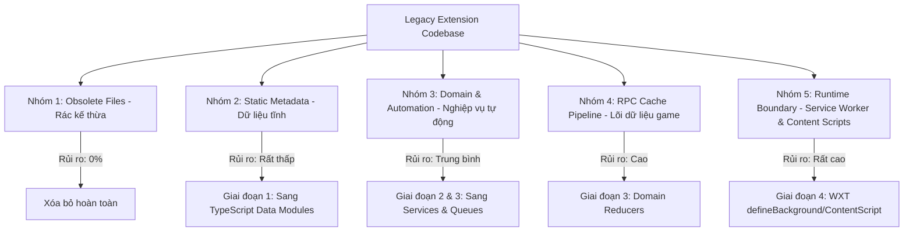
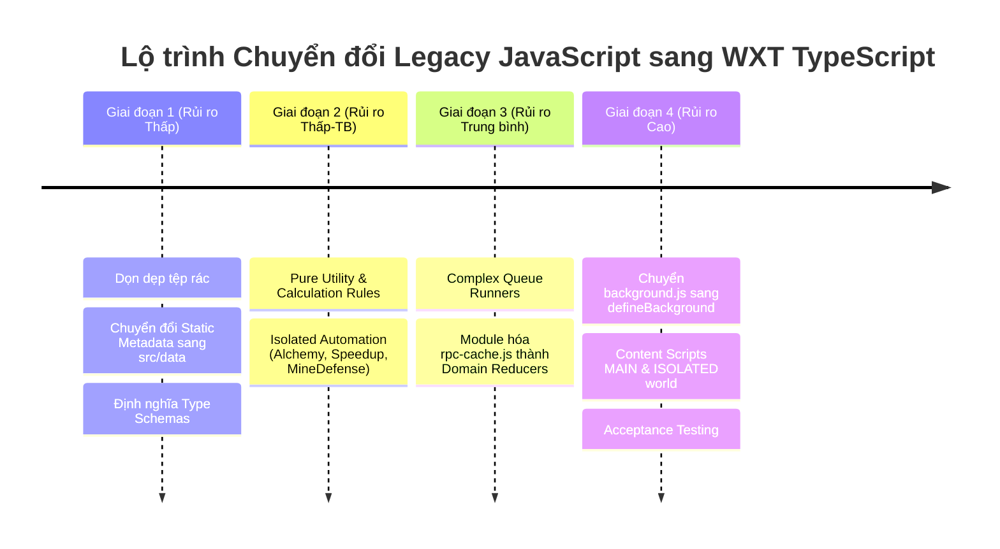

# Đánh giá & Kế hoạch Chuyển đổi Legacy JavaScript sang Kiến trúc WXT / TypeScript

## 1. Bối cảnh & Mục tiêu Chiến lược

Dự án HWA Helper đã hoàn thành việc chuyển đổi giao diện người dùng Popup sang kiến trúc hiện đại **Vue 3 (Composition API) + Tailwind v4 + Vite** do **WXT** biên dịch (tại `entrypoints/popup/`). 

Tuy nhiên, toàn bộ phần nền tảng (Service Worker background, content scripts, cache pipeline, metadata và automation runners) hiện vẫn đang nằm trong thư mục `extension/` với **hơn 50 tệp JavaScript thuần** (~2.2 MB mã nguồn). Các file này hoạt động theo cơ chế kế thừa từ Manifest V2/đầu V3:
- Sử dụng `importScripts(...)` nạp hàng loạt vào Service Worker `background.js`.
- Gán toàn bộ API và dữ liệu vào biến toàn cục `globalThis.hwaHelper...` không có ranh giới module rõ ràng.
- Thiếu kiểu dữ liệu tĩnh (strict TypeScript), tiềm ẩn các lỗi runtime phổ biến của dynamic JavaScript (như `TypeError: Cannot read properties of undefined`, hoặc `reduce is not a function` khi gặp mảng bị biến dạng thành object).
- Dữ liệu game metadata khổng lồ (~700 KB) nạp trực tiếp vào RAM của Service Worker mà không có tree-shaking.

### Mục tiêu Chuyển đổi:
1. **Clean Code & Modularity:** Xóa bỏ hoàn toàn biến toàn cục `globalThis`; chuyển sang chuẩn **ES Modules** (`import` / `export`), áp dụng Single Responsibility Principle (SRP) và tách biệt rõ ràng giữa Data, Domain Logic, và Runtime Infrastructure.
2. **Type Safety & Bug Prevention:** Trang bị 100% strict TypeScript types cho toàn bộ models, RPC contracts, cache slices và automation states; bắt lỗi tại thời điểm compile (`vue-tsc` / `tsc`).
3. **Hiệu năng & Tiết kiệm Bộ nhớ:** Tận dụng Vite compiler của WXT để tối ưu hóa, lazy-load hoặc tree-shake các bộ từ điển metadata; giảm footprint bộ nhớ của Service Worker khi chạy nền trong Chrome.
4. **Đồng bộ Kiến trúc:** Tận dụng tối đa các tính năng cốt lõi của WXT (`defineBackground`, `defineContentScript`, auto-imports, typed storage) để thống nhất một codebase duy nhất, dễ bảo trì và dễ test.

---

## 2. Kiểm kê & Phân loại 50+ File Legacy JavaScript

Dựa trên phân tích mã nguồn hiện tại, toàn bộ các tệp trong thư mục `extension/` được phân loại thành 5 nhóm chức năng với mức độ rủi ro khác nhau:

### Chi tiết kiểm kê theo nhóm:

| Nhóm | Tệp tin tiêu biểu | Kích thước | Vai trò hiện tại | Mức độ rủi ro |
|---|---|---|---|---|
| **1. Obsolete / Dead** | `popup.js`, `popup.html`, `popup.css`, `theme.css`, `export-name.js` | ~730 KB | Mã nguồn giao diện HTML cũ, đã bị `wxt.config.ts` loại trừ khỏi build. | **Không có (0%)** |
| **2. Static Metadata** | `hero-metadata.js`, `building-data.js`, `research-data.js`, `item-resources.js`, `data-names.js`, `campaign-missions.js`, `quest-data.js`, `quest-catalog.json`, `name-map.js`, `hero-stat-data.js`, `titan-metadata.js`, `tower-buffs.js`, `tower-rules.js`, `refillable-rules.js`, `march-rules.js`, `speedup-data.js`, `smart-gather-data.js`, `mine-defense-data.js` | ~740 KB | Dữ liệu tĩnh về chỉ số hero, công thức nâng cấp, map ải, tên vật phẩm, icon texture mapping. | **Rất thấp (Low)** |
| **3. Domain Automation** | `building-queue.js`, `research-queue.js`, `raid-queue.js`, `raid-energy-auto.js`, `monster-queue.js`, `auto-gather.js`, `smart-gather.js`, `tower-automation.js`, `tower-runner.js`, `dungeon-automation.js`, `dungeon-runner.js`, `mine-defense.js`, `speedup.js`, `free-alchemy.js`, `mail-data.js`, `world-read.js`, `tracking-filter.js`, `clan-versus-rules.js` | ~180 KB | Thuật toán xếp hàng, logic kiểm tra điều kiện xuất quân, quét mỏ, tự động quay vòng quay ngọc, xử lý báo cáo thư. | **Trung bình (Medium)** |
| **4. RPC Cache Pipeline** | `rpc-cache.js` (5,150+ dòng code) | ~272 KB | Trái tim đồng bộ dữ liệu: bóc tách RPC/MQTT, reducers cho 50+ API methods, snapshot store, action deduplication, cache pruning. | **Cao (High)** |
| **5. Runtime Boundary** | `background.js`, `bridge.js`, `intercept.js`, `mqtt-capture.js` | ~260 KB | MV3 Service worker, ISOLATED world bridge, MAIN world network monkey-patching (`fetch`, `XHR`, `WebSocket`). | **Rất cao (Critical)** |

---

## 3. Đánh giá Khả năng Đáp ứng của Kiến trúc WXT / Vue 3

### 3.1. Khả năng thay thế Service Worker (`background.js` → `entrypoints/background.ts`)
- **Khả thi 100%:** WXT cung cấp `defineBackground()` biên dịch ra file `background.js` chuẩn MV3.
- **Lợi thế:** Cho phép thay thế toàn bộ danh sách 29 lệnh `importScripts(...)` bằng các lệnh `import { ... } from '@/src/...'` chuẩn ES Modules. Vite sẽ tự động gom mã, gỡ bỏ mã chết và tối ưu scope.

### 3.2. Khả năng xử lý Content Scripts (`bridge.js`, `intercept.js`, `mqtt-capture.js`)
- **Khả thi 100%:** WXT hỗ trợ đầy đủ các thuộc tính của Content Script:
  - `entrypoints/bridge.content.ts`: `defineContentScript({ matches: [...], runAt: 'document_start' })` (ISOLATED world).
  - `entrypoints/intercept.content.ts`: `defineContentScript({ matches: [...], world: 'MAIN', runAt: 'document_start' })` (MAIN world).
- **Lợi thế:** Tự động đăng ký trong manifest phát hành mà không cần duy trì manifest thủ công.

### 3.3. Tái cấu trúc State & Reactive Management
- Không đưa toàn bộ logic background vào Vue components. Giữ nguyên ranh giới: Background sở hữu authoritative state; UI tiêu thụ dữ liệu phản ứng qua `useRpcCache()` và composables.
- Các queue runners và automation runners chuyển thành TypeScript classes hoặc functional services độc lập, được test tự động với mock context.

---

## 4. Ma trận Rủi ro & Phương án Phòng ngừa / Fallback

| Rủi ro kỹ thuật | Mức độ | Hậu quả tiềm ẩn | Phương án Phòng ngừa & Fallback |
|---|---|---|---|
| **1. Trễ thời điểm monkey-patch ở MAIN world** | **Rất cao** | Nếu script `intercept.js` được compile qua Vite mà có overhead wrapper làm chạy chậm hơn game script, các lệnh `fetch` khởi động đầu tiên của game sẽ bị lọt lưới. | Giữ script intercept cực kỳ tinh gọn, không nạp dependencies nặng, cấu hình `runAt: 'document_start'` tuyệt đối. Luôn kiểm thử với Chrome CDP fixture đo thời gian khởi động. |
| **2. Service Worker Termination của MV3** | **Cao** | Service worker trong Chrome MV3 sẽ bị tắt sau 30s không hoạt động. Nếu migration làm mất cơ chế thức dậy qua `chrome.alarms` hoặc mất listener binding sớm, automation sẽ bị treo. | Duy trì việc đăng ký listener (`onMessage`, `onChanged`, `alarms.onAlarm`) đồng bộ ngay tại top-level của `defineBackground`, không đặt trong hàm async. |
| **3. Phá vỡ cấu trúc Cache `rpcCache`** | **Cao** | UI Vue hiện đang phụ thuộc vào cấu trúc các keys trong `rpcCache` (`resource:gold`, `buildingStatus`, v.v.). Sai một tên trường trong reducer sẽ làm trắng giao diện hoặc sai số liệu. | Sử dụng Zod hoặc TypeScript interfaces định nghĩa cứng schema cache. Chạy bộ 867 unit test hiện tại sau mỗi bước chuyển đổi reducer. |
| **4. Xung đột kiểu dữ liệu Object vs Array** | **Trung bình** | Game thường trả về mảng nhưng đôi khi trả về object index `{ "0": {...} }`. Mã TypeScript nếu gán cứng `Array<T>` mà không qua defensive normalization sẽ gây crash. | Áp dụng triệt để các helper chuẩn hóa như `normalizeArrayData`, `teamMemberIds`, không bao giờ gọi `.reduce` hay `.map` trực tiếp trên raw payload. |
| **5. Build lỗi làm tê liệt Extension** | **Trung bình** | Quá trình chuyển đổi làm hỏng artifact khiến người dùng không dùng được tiện ích. | Áp dụng cơ chế **Dual Boundary**: WXT hook `build:publicAssets` vẫn giữ nguyên khả năng load file legacy song song; chỉ ngắt file legacy khi module TypeScript tương đương đã vượt qua toàn bộ test suite. |

---

## 5. Kế hoạch Triển khai theo 4 Giai đoạn (Phased Roadmap)

Nguyên tắc cốt lõi: **Triển khai từ phân mục ít rủi ro nhất (Zero Risk) đến phân mục rủi ro cao nhất (High Risk)**. Mỗi giai đoạn đều phải vượt qua `npm run check` (typecheck + 867 tests + build validation) trước khi tiến sang giai đoạn kế tiếp.

---

### Giai đoạn 1: Dọn dẹp Artifacts cũ & Chuyển đổi Dữ liệu Tĩnh (Ít rủi ro nhất)
- **Mục tiêu:** Giảm dung lượng repository, tạo nền tảng Type Definition cho toàn bộ dự án.
- **Hành động cụ thể:**
  1. Xóa bỏ hoàn toàn các file legacy HTML popup không còn dùng: `extension/popup.js`, `extension/popup.html`, `extension/popup.css`, `extension/theme.css`, `extension/export-name.js`.
  2. Tạo thư mục `src/data/` và `src/types/game/`:
     - Chuyển `building-data.js` → `src/data/buildings.ts` (export typed building levels & costs).
     - Chuyển `research-data.js` → `src/data/research.ts` (export typed research tree).
     - Chuyển `hero-metadata.js` & `titan-metadata.js` → `src/data/heroes.ts` & `src/data/titans.ts`.
     - Chuyển `item-resources.js`, `data-names.js` → `src/data/items.ts`.
     - Chuyển `campaign-missions.js` → `src/data/campaign.ts`.
     - Chuyển `quest-data.js` → `src/data/quests.ts`.
  3. Cập nhật các component Vue chuyển sang `import` trực tiếp từ `src/data/` thay vì đọc từ `globalThis`.
- **Rủi ro:** 0%. Không ảnh hưởng tới runtime background hiện tại.

---

### Giai đoạn 2: Chuyển đổi Pure Utilities, Rules & Đơn vị Tự động hóa Độc lập
- **Mục tiêu:** Loại bỏ các hàm toán học/chuẩn hóa thuần túy khỏi `extension/`, đưa vào `src/utils/` và kiểm thử 100% bằng unit tests.
- **Hành động cụ thể:**
  1. Chuyển đổi các rule files:
     - `march-rules.js` → `src/utils/marchRules.ts`
     - `refillable-rules.js` → `src/utils/refillableRules.ts`
     - `speedup-data.js` → `src/utils/speedupData.ts`
     - `tracking-filter.js` → `src/utils/trackingFilter.ts`
     - `mission-costs.js` → `src/utils/missionCosts.ts`
  2. Chuyển đổi các automation units độc lập, ít tương tác chéo:
     - `free-alchemy.js` → `src/services/freeAlchemy.ts`
     - `speedup.js` → `src/services/speedupService.ts`
     - `mine-defense.js` → `src/services/mineDefenseService.ts`
     - `world-read.js` → `src/services/worldReadService.ts`
     - `mail-data.js` → `src/services/mailService.ts` (đã có bộ test hoàn chỉnh).
- **Rủi ro:** Rất thấp. Logic đã có test bao phủ; có thể export ngược lại ra `globalThis` tạm thời nếu `background.js` cũ vẫn cần dùng.

---

### Giai đoạn 3: Tái cấu trúc Hàng đợi Phức tạp & Module hóa `rpc-cache.js`
- **Mục tiêu:** Giải quyết tệp `rpc-cache.js` khổng lồ (272 KB) và các runners hàng đợi.
- **Hành động cụ thể:**
  1. Chuyển đổi các queue controllers:
     - `building-queue.js` & `research-queue.js` → `src/services/queues/buildingQueue.ts`
     - `raid-queue.js`, `monster-queue.js`, `raid-energy-auto.js` → `src/services/queues/raidQueue.ts`
     - `auto-gather.js`, `smart-gather.js` → `src/services/queues/gatherQueue.ts`
     - `tower-automation.js`, `tower-runner.js` → `src/services/queues/towerQueue.ts`
     - `dungeon-automation.js`, `dungeon-runner.js` → `src/services/queues/dungeonQueue.ts`
  2. Chia tách `rpc-cache.js` theo cấu trúc Domain Reducers:
     - `src/core/cache/cacheStore.ts`: Quản lý store, atomic merge, snapshot comparison, pruneCache.
     - `src/core/cache/extractors/`: Bóc tách RPC call và Socket frames (`heroExtractor.ts`, `questExtractor.ts`, v.v.).
     - `src/core/cache/reducers/`: Reducer độc lập cho từng domain (`heroReducer.ts`, `inventoryReducer.ts`, `towerReducer.ts`, `mailReducer.ts`).
- **Rủi ro:** Trung bình - Cao. Đòi hỏi bảo toàn 100% token deduplication (`call.ident`) và thứ tự xử lý action. Kiểm tra nghiêm ngặt bằng 867 test cases hiện có.

---

### Giai đoạn 4: Chuyển đổi Ranh giới Runtime Extension (Background & Content Scripts)
- **Mục tiêu:** Di chuyển hoàn toàn sang WXT entrypoints, hoàn tất quá trình hiện đại hóa codebase.
- **Hành động cụ thể:**
  1. Tạo `entrypoints/background.ts`:
     - Triển khai `defineBackground()` tích hợp các services từ Giai đoạn 2 & 3.
     - Quản lý lifecycle `chrome.alarms`, storage listeners, RPC queue count và session recordings.
  2. Tạo `entrypoints/bridge.content.ts`:
     - Triển khai `defineContentScript({ matches: [...], runAt: 'document_start' })`.
     - Quản lý cầu nối message giữa MAIN world và Extension Background.
  3. Tạo `entrypoints/interceptor.content.ts`:
     - Triển khai `defineContentScript({ matches: [...], world: 'MAIN', runAt: 'document_start' })`.
     - Gộp logic đánh chặn mạng từ `intercept.js` và `mqtt-capture.js`.
  4. Cập nhật `wxt.config.ts`:
     - Bỏ hook copy thủ công `build:publicAssets` cho các file js cũ.
     - Để WXT đóng gói tự nhiên toàn bộ extension.
- **Rủi ro:** Rất cao. Cần kiểm chứng thực tế qua Chrome CDP Acceptance Test (`scripts/browser-backlog-acceptance.mjs`) trước khi phát hành chính thức.

---

## 6. Quy chuẩn Kỹ thuật khi Thực hiện Chuyển đổi (Guidelines)

1. **Nguyên tắc "Zero Regression":**
   - Mọi tệp chuyển đổi phải được kiểm tra tương thích ngược với dữ liệu đã lưu trong `chrome.storage.local`.
   - Giữ nguyên các key định danh lưu trữ (`rpcCache`, `raidQueue`, `monsterQueue`, `smartGatherSettings`, v.v.).
2. **Defensive Programming:**
   - Mọi mảng/tập hợp từ server phải đi qua helper phòng vệ, tuyệt đối không tin tưởng 100% dữ liệu trả về từ RPC có dạng mảng.
   - Luôn sử dụng Optional Chaining (`?.`) và Nullish Coalescing (`??`) thay cho falsy checks (`||`).
3. **Tiêu chuẩn Commit & Review:**
   - Mỗi giai đoạn được tách thành các commit / task con độc lập (theo tiêu chuẩn Conventional Commits).
   - Không thực hiện gộp chuyển đổi toàn bộ file trong một commit duy nhất.
   - Luôn chạy `npm run check` thành công trước mỗi bước chuyển đổi.
