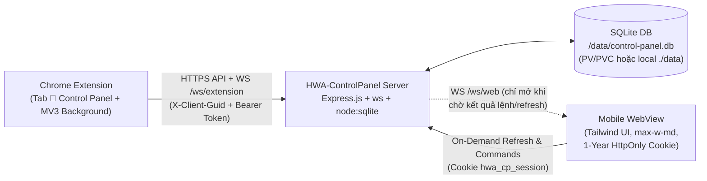

# HWA Control Panel — Hướng Dẫn Vận Hành & Thông Tin Quan Trọng

Tài liệu vận hành đầy đủ cho **HWA Control Panel** (`HWA-ControlPanel/`): proxy website cá nhân tối ưu cho điện thoại di động, cho phép theo dõi tình trạng automation và gửi các lệnh khẩn cấp cơ bản tới Chrome Extension **HWA Helper**.

---

## 1. Tổng Quan Kiến Trúc



### Đặc điểm cốt lõi
- **Thư mục mã nguồn**: `HWA-ControlPanel/` (độc lập hoàn toàn với build Extension).
- **Stack công nghệ**: Node.js `>= 22.5`, **Express.js**, **`ws`**, SQLite tích hợp sẵn của Node (`node:sqlite` — không cần biên dịch C++ hay chạy pod database rời), giao diện mobile dùng **Tailwind CSS** đóng gói sẵn trong `HWA-ControlPanel/public/`.
- **Không quản lý người dùng rườm rà**: xác thực bằng **`Client GUID` + `6-digit TOTP`** phát sinh trực tiếp trên Extension → cấp **cookie phiên sống 1 năm (`hwa_cp_session`)**.
- **Tiết kiệm pin di động**: Dashboard **không** chạy live stream liên tục; người dùng chủ động bấm **Refresh** khi cần xem trạng thái mới. WebSocket `/ws/web` chỉ mở tạm trong lúc chờ kết quả lệnh/refresh rồi tự đóng ngay khi nhận ack.

---

## 2. Chạy Test Local & LAN (Không Cần Docker)

Phù hợp để kiểm thử nhanh trên trình duyệt máy tính hoặc từ điện thoại thật cùng mạng Wi-Fi nội bộ.

### Bước 1: Cài đặt thư viện (chỉ cần chạy 1 lần)
```powershell
npm --prefix HWA-ControlPanel install
```

### Bước 2: Khởi chạy server bằng lệnh Node
```powershell
npm run cp:dev
# Hoặc chạy trực tiếp:
node HWA-ControlPanel/src/server.mjs
```

Console sẽ in ra đầy đủ địa chỉ truy cập và đường dẫn DB local:
```text
HWA Control Panel Server running
  Local: http://localhost:8080
  LAN:   http://192.168.1.x:8080
  DB:    ...\HWA-ControlPanel\data\control-panel.db
```

> **Lưu ý khi test qua Wi-Fi LAN trên Windows**:
> - Thư mục `HWA-ControlPanel/data/` đã được đưa vào `.gitignore` để không commit dữ liệu DB local lên Git.
> - Nếu điện thoại không truy cập được `http://192.168.1.x:8080`, hãy kiểm tra Windows Defender Firewall đã mở inbound TCP port `8080` cho mạng Private chưa.
> - Khi chạy HTTP trên Local/LAN, server tự động bỏ cờ `Secure` trên cookie `hwa_cp_session` để trình duyệt di động lưu được phiên bình thường; khi chạy HTTPS sau Ingress sẽ tự bật `Secure`.

### Bước 3: Ghép nối Extension & Điện thoại (Quét QR 1 lần)
1. Mở Extension → chuyển sang tab **`📱 Control Panel`**.
2. Nhập **Proxy Endpoint URL**:
   - Production: `https://hwa-cp.yourdomain.com`
   - Test Local/LAN: `http://192.168.1.x:8080` (Extension chấp nhận `https://` và các dải IP nội bộ RFC-1918: `localhost`, `127.0.0.1`, `192.168.*`, `10.*`, `172.16–31.*`, `*.local`).
3. Bấm **Check Connection** → xác nhận hiện `✓ Online (Xms)`.
4. Bật checkbox **Enable Control Panel Bridge** → trạng thái chuyển sang **`Connected`**.
5. Dùng camera điện thoại quét **mã QR** trên Extension → mở trang đăng nhập đã điền sẵn `Client GUID`.
6. Nhập **6 số OTP** đang hiển thị trên Extension → bấm **Connect & Remember (1 Year)**. Từ lần sau mở lại hoặc refresh trang trên điện thoại sẽ vào thẳng Dashboard mà không cần nhập OTP.

---

## 3. Biến Môi Trường (Environment Variables)

| Biến | Mặc định | Mô tả |
|---|---|---|
| `HOST` | `0.0.0.0` | Địa chỉ bind của HTTP/WS server. |
| `PORT` | `8080` | Cổng lắng nghe HTTP/WS. |
| `DATA_DIR` | `./HWA-ControlPanel/data` (local) / `/data` (Docker/K8s) | Thư mục chứa file SQLite `control-panel.db` (cần quyền ghi cho user `node`, UID `1000`). |
| `COOKIE_SECURE` | `auto` | `auto`: tự bật `Secure` khi `req.secure` hoặc `X-Forwarded-Proto: https`; đặt `true` để ép bắt buộc HTTPS, `false` cho môi trường HTTP nội bộ. |
| `BOOTSTRAP_KEY` | *(rỗng)* | **Khuyến nghị đặt khi public internet.** Khóa phụ yêu cầu Extension gửi kèm header `X-Bootstrap-Key` khi gọi `POST /api/ext/pair`. |

---

## 4. Bảo Mật, Quyền Lệnh & Xử Lý Khi Mất Điện Thoại

### 4.1. Chốt chặn bảo mật
- **Không lộ dữ liệu nhạy cảm của game**: `buildRemoteTelemetrySnapshot()` chỉ trích xuất trạng thái automation, năng lượng, tiến độ đào mỏ, tỷ lệ thương binh và 15 log gần nhất — **tuyệt đối không** gửi cookie game, `Authorization`, `lastRpcHeaders`, hay `deviceToken`.
- **Chống brute-force & replay OTP**:
  - Sai quá **5 lần / 5 phút / IP** trên `POST /api/web/auth` → trả `429 Too Many Requests`.
  - Mỗi bước TOTP 30 giây đã xác thực thành công sẽ bị khóa replay trong 90 giây.
- **Strict Allowlist lệnh từ xa**: Extension từ chối mọi lệnh không nằm trong 5 nhóm sau (không hỗ trợ gửi raw RPC, không có lệnh tiêu Emerald):
  1. `refresh-snapshot` — làm mới & đẩy snapshot mới nhất.
  2. `emergency-recall-gatherers` — rút toàn bộ đội đang đào mỏ về thành (trên Mobile có xác nhận 2 chạm trong 5 giây).
  3. `toggle-automation` — bật/tắt `autoGather`, `mineDefense`, `autoHeal`, `autoTrain`, `energyBurn`, `expiringClaims`, `shopFavorites`.
  4. `stop-queue` — dừng khẩn cấp `raid`, `monster`, `tower`, `dungeon`, `building`, `research`.
  5. `trigger-special` — chạy `run-daily-autopilot`, `run-batch-heal`, `claim-freebies`.

### 4.2. Quy trình khi mất điện thoại hoặc đổi thiết bị
- **Chỉ muốn đăng xuất mọi điện thoại đang nhớ cookie 1 năm**: mở tab `📱 Control Panel` trên Extension → bấm **Revoke Sessions**. Server xóa toàn bộ `web_sessions` trong SQLite và đóng mọi kết nối WS web ngay lập tức.
- **Nghi ngờ lộ GUID / OTP Secret**: bấm **Regenerate** trên Extension (sinh mới toàn bộ `GUID`, `deviceToken`, `otpSecret`) rồi quét lại QR mới trên thiết bị mới.

---

## 5. Build & Push Docker Image Bằng Jenkins CI

Pipeline mẫu được đặt chung thư mục với `Dockerfile` tại **[HWA-ControlPanel/Jenkinsfile](../HWA-ControlPanel/Jenkinsfile)**, chuyên biệt cho việc build Docker image và push lên Container Registry.

### Cấu hình bắt buộc trên Jenkins (Không hardcode secret trong Git)
1. **Tạo Jenkins Credential**:
   - Loại: `Username with password`
   - ID mặc định: `hwa-registry-creds` (hoặc đặt ID khác rồi khai báo qua biến môi trường `HWA_REGISTRY_CREDENTIALS_ID`).
2. **Khai báo Environment Variables** (tại *Manage Jenkins → System → Global properties* hoặc cấp Folder/Job):
   - `HWA_REGISTRY_URL`: địa chỉ registry (vd. `ghcr.io` hoặc `registry.yourdomain.com`).
   - `HWA_CP_IMAGE_NAME`: tên image (vd. `vplghost/hwa-control-panel`).
   - `HWA_REGISTRY_CREDENTIALS_ID`: ID credential ở bước 1 (mặc định `hwa-registry-creds`).
3. **Tạo Jenkins Pipeline Job**:
   - Chọn **Pipeline script from SCM** → trỏ tới Git repository này.
   - **Script Path**: `HWA-ControlPanel/Jenkinsfile`.
4. **Cơ chế hoạt động của Pipeline**:
   - `Checkout` → lấy short commit SHA làm tag mặc định (có thể ghi đè qua parameter `IMAGE_TAG`, kèm tùy chọn `PUSH_LATEST`).
   - `Docker Build` → build multi-stage `HWA-ControlPanel/Dockerfile` (non-root user `node`).
   - `Docker Push` → đăng nhập bằng `docker login --password-stdin` thông qua `withCredentials`, push image tag và `:latest`.
   - `post { always }` → tự động `docker logout` và dọn image tạm trên agent.

---

## 6. Triển Khai & Vận Hành Trên Kubernetes (K8s)

Bộ manifest chuẩn nằm tại `HWA-ControlPanel/k8s/`:
- `pvc.yaml` — `PersistentVolumeClaim` (`ReadWriteOnce`, `1Gi`) mount vào `/data`.
- `deployment.yaml` — `Deployment` chạy container `hwa-control-panel`.
- `service.yaml` — `ClusterIP` (`80 -> 8080`).
- `ingress.yaml` — HTTPS Ingress kèm annotation timeout cho WebSocket (`proxy-read-timeout: 3600`).

### Các lưu ý vận hành BẮT BUỘC trên K8s
1. **Giữ `replicas: 1` và `strategy.type: Recreate`**: vì SQLite dùng file trên PVC `ReadWriteOnce`, không được chạy RollingUpdate 2 pod ghi đồng thời vào cùng file DB.
2. **Cập nhật Image & Domain trước khi apply**:
   - Sửa `image:` trong `k8s/deployment.yaml` trỏ đúng tới image do Jenkins push.
   - Sửa `host:` và `secretName:` TLS trong `k8s/ingress.yaml`.
   - *(Khuyến nghị)* Tạo K8s Secret cho `BOOTSTRAP_KEY` và bỏ comment phần `secretKeyRef` trong `k8s/deployment.yaml`:
     ```bash
     kubectl create secret generic hwa-control-panel-secret \
       --from-literal=bootstrap-key="$(openssl rand -hex 24)"
     ```
3. **Triển khai**:
   ```bash
   kubectl apply -f HWA-ControlPanel/k8s/pvc.yaml
   kubectl apply -f HWA-ControlPanel/k8s/deployment.yaml
   kubectl apply -f HWA-ControlPanel/k8s/service.yaml
   kubectl apply -f HWA-ControlPanel/k8s/ingress.yaml
   kubectl rollout status deployment/hwa-control-panel
   ```
4. **Kiểm tra sức khỏe & Logs**:
   ```bash
   kubectl get pods -l app=hwa-control-panel
   kubectl logs -f deploy/hwa-control-panel
   # Liveness & Readiness
   curl -i https://hwa-cp.yourdomain.com/healthz
   curl -i https://hwa-cp.yourdomain.com/readyz
   ```
5. **Sao lưu nhanh file SQLite từ PVC**:
   ```bash
   POD=$(kubectl get pod -l app=hwa-control-panel -o jsonpath='{.items[0].metadata.name}')
   kubectl cp "$POD:/data/control-panel.db" ./control-panel-backup.db
   ```

---

## 7. Danh Mục Endpoint API & WebSocket

| Nhóm | Method / Protocol | Path | Xác thực | Mục đích |
|---|---|---|---|---|
| Health | `GET` | `/healthz` | Public | Liveness probe & nút `Check Connection` trên Extension |
| Health | `GET` | `/readyz` | Public | Readiness probe (kiểm tra SQLite đọc/ghi OK) |
| Extension | `POST` | `/api/ext/pair` | Optional `X-Bootstrap-Key` | Ghép nối `clientGuid`, `deviceToken`, `otpSecret` |
| Extension | `POST` | `/api/ext/snapshot` | `X-Client-Guid` + `Bearer` | Đẩy telemetry snapshot (HTTP fallback) |
| Extension | `POST` | `/api/ext/command-ack` | `X-Client-Guid` + `Bearer` | Xác nhận kết quả thực thi lệnh |
| Extension | `POST` | `/api/ext/revoke-sessions` | `X-Client-Guid` + `Bearer` | Thu hồi toàn bộ cookie 1 năm của client |
| Extension | `WS` | `/ws/extension` | Header hoặc first-frame `auth` | Kênh 2 chiều nhận lệnh khẩn cấp & đẩy snapshot |
| Mobile | `POST` | `/api/web/auth` | `guid` + `otp` (rate-limited) | Xác thực OTP và set cookie `hwa_cp_session` (1 năm) |
| Mobile | `POST` | `/api/web/logout` | Cookie `hwa_cp_session` | Xóa phiên hiện tại và clear cookie |
| Mobile | `GET` | `/api/web/session` | Cookie `hwa_cp_session` | Kiểm tra cookie còn hiệu lực |
| Mobile | `GET` | `/api/web/state` | Cookie `hwa_cp_session` | Lấy snapshot mới nhất + trạng thái Extension + lịch sử lệnh |
| Mobile | `POST` | `/api/web/command` | Cookie `hwa_cp_session` | Gửi lệnh khẩn cấp / `refresh-snapshot` xuống Extension |
| Mobile | `WS` | `/ws/web` | Cookie `hwa_cp_session` | Chỉ mở tạm khi đang chờ kết quả lệnh/refresh (`command_updated`) |

---

## 8. Xử Lý Sự Cố Thường Gặp (Troubleshooting)

| Triệu chứng | Nguyên nhân phổ biến | Cách xử lý |
|---|---|---|
| **Check Connection báo `Unreachable`** | Sai URL, chưa chạy server, hoặc chặn Firewall port `8080` | Kiểm tra `curl http://localhost:8080/healthz`; mở inbound TCP `8080` nếu test qua LAN |
| **Extension báo `Invalid bootstrap pairing key`** | Server đặt `BOOTSTRAP_KEY` nhưng Extension để trống hoặc nhập sai | Nhập đúng giá trị vào ô `Optional Pairing Key (BOOTSTRAP_KEY)` trên tab `📱 Control Panel` |
| **Mobile báo `401 Invalid or expired OTP`** | Đồng hồ máy tính/điện thoại lệch quá 30s, hoặc nhập lại mã OTP vừa dùng | Đồng bộ giờ tự động (NTP) trên máy và điện thoại; chờ sang chu kỳ OTP 30s kế tiếp |
| **Mobile báo `429 Too many failed attempts`** | Nhập sai OTP 5 lần trong vòng 5 phút | Chờ 5 phút để hết cửa sổ rate-limit |
| **Reload trang mobile bị hỏi lại OTP** | Dùng HTTPS nhưng Ingress không truyền `X-Forwarded-Proto: https`, hoặc trình duyệt đang ở chế độ Ẩn danh (Private/Incognito) | Mở bằng trình duyệt thường (không ẩn danh); đảm bảo Ingress chuyển header `X-Forwarded-Proto` hoặc đặt `COOKIE_SECURE=true` trên HTTPS |
| **Mobile hiển thị `Extension Offline`** | Trình duyệt chạy Extension đã đóng, hoặc chưa bật `Enable Control Panel Bridge` | Kiểm tra chấm trạng thái trên tab `📱 Control Panel` của Extension; tắt/bật lại toggle để ép reconnect |
| **K8s Pod CrashLoopBackOff lỗi quyền `/data`** | Volume mount không cho user `node` (UID `1000`) ghi | Đảm bảo `securityContext.fsGroup: 1000` trong `k8s/deployment.yaml` được giữ nguyên |
