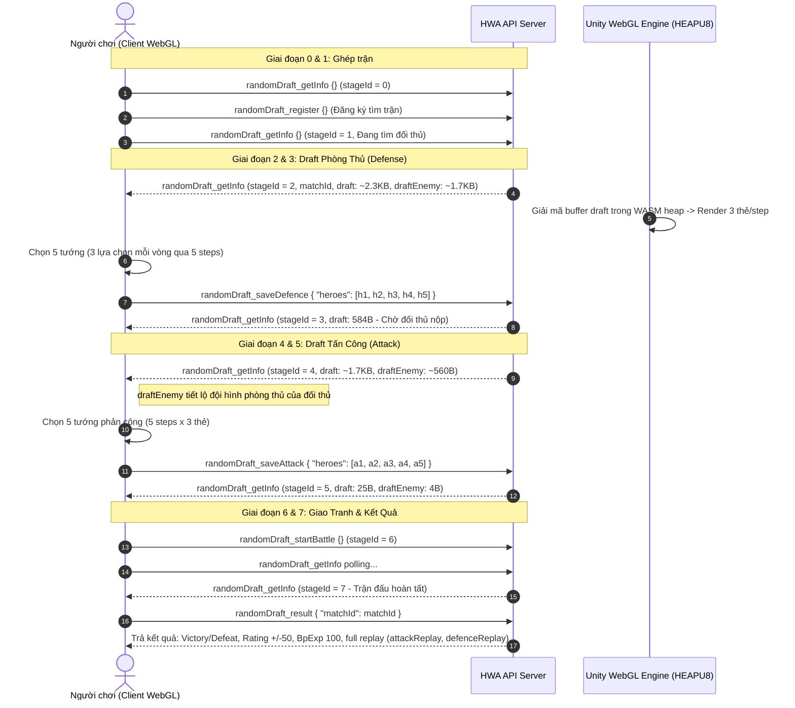
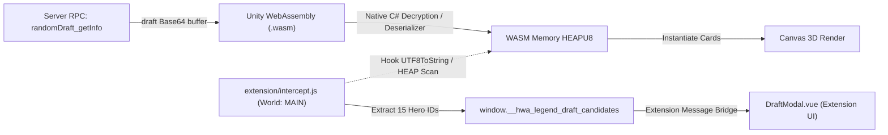

# Phân Tích Toàn Diện Tính Năng Legends Draft (randomDraft)

Tài liệu này xâu chuỗi và tổng hợp toàn bộ các nghiên cứu, dấu vết gói tin mạng (RPC), cấu trúc nhị phân và dữ liệu thực nghiệm đã ghi nhận được cho chế độ **Legends Draft (`randomDraft`)** trong Hero Wars: Alliance.

---

## 1. Tổng Quan Kiến Trúc Legends Draft

Legends Draft là chế độ thi đấu PvP thời gian thực đồng bộ (Synchronized Turn-based PvP Draft) giữa 2 người chơi:
1. **Quy tắc tuyển chọn (Pick Matrix):**
   - Mỗi giai đoạn (Draft Phòng thủ và Draft Tấn công) diễn ra qua **5 vòng (Step 1 → Step 5)**.
   - Tại **mỗi vòng**, giao diện trò chơi đưa ra chính xác **3 ứng viên tướng (Candidate Heroes)**.
   - Người chơi chọn **1 tướng duy nhất** cho mỗi vòng, tạo thành đội hình chuẩn gồm **5 tướng**.
   - Tổng cộng mỗi giai đoạn có **15 ứng viên** được máy chủ cấp phát độc quyền cho trận đấu đó.
2. **Hàng rào xác thực máy chủ (Server Validation Barrier):**
   - Khi người chơi hoàn tất 5 lượt chọn, client gửi mảng 5 ID tướng lên máy chủ thông qua RPC (`randomDraft_saveDefence` hoặc `randomDraft_saveAttack`).
   - Máy chủ kiểm tra nghiêm ngặt danh sách 5 tướng này: nếu có bất kỳ tướng nào không thuộc danh sách 15 ứng viên đã cấp cho người chơi trong trận đó, máy chủ sẽ lập tức từ chối với lỗi:
     ```json
     { "error": { "code": 5, "name": "ValidationError", "message": "Invalid heroes list" } }
     ```

---

## 2. Quy Trình Gửi Nhận RPC & Vòng Đời Trận Đấu (Stage Lifecycle)

Quy trình giao tiếp giữa Client và Server diễn ra qua phương thức RPC POST tới endpoint `/api/rpc`:



### Chi tiết các Stage ID:

| Stage ID | Trạng thái | Hành động Client | Dữ liệu trả về từ Server |
|---|---|---|---|
| **0** | Idle (Chưa vào trận) | `randomDraft_getInfo {}` | `matchId: null`, `draft` (25 bytes), `draftEnemy` (4 bytes), `journal` (lịch sử 10 trận gần nhất), `winstreak`. |
| **1** | Matching (Đang tìm đối thủ) | `randomDraft_register {}` rồi poll `randomDraft_getInfo {}` | `matchId: null`, `draft` (25 bytes), `draftEnemy` (4 bytes). |
| **2** | Defense Draft (Chọn đội thủ) | Nhận thông tin đối thủ, chọn 5 tướng qua 5 bước | `matchId: <id>`, `enemyUser` (tên, avatar, clan, level), `draft` (~2.338 bytes), `draftEnemy` (~1.681 bytes), `stageFinishTs` (+90 giây đếm ngược). |
| **3** | Defense Submitted (Chờ đối thủ) | Gửi `randomDraft_saveDefence` | `draft` co lại còn 584 bytes (lưu đội hình đã chọn), `draftEnemy` giữ nguyên 1.681 bytes cho đến khi đối thủ nộp xong. |
| **4** | Attack Draft (Chọn đội công) | Xem đội hình thủ đối thủ, chọn 5 tướng khắc chế | `draft` (~1.702 bytes), `draftEnemy` (~559 - 561 bytes chứa đội hình phòng thủ của đối thủ). |
| **5** | Attack Submitted (Sẵn sàng) | Gửi `randomDraft_saveAttack` | `draft` co lại 25 bytes, `draftEnemy` co lại 4 bytes. Sẵn sàng vào trận. |
| **6** | In Battle (Đang giao chiến) | Gửi `randomDraft_startBattle {}` | Client Unity mô phỏng trận đánh tự động. Gửi polling `randomDraft_getInfo` định kỳ 5 giây. |
| **7** | Match Finished (Hoàn tất) | Gửi `randomDraft_result {"matchId": ...}` | Nhận toàn bộ replay JSON đầy đủ (`attackers`, `defenders`, chỉ số rune, skin, artifact của cả 2 bên), điểm xếp hạng delta (`userDifRating`), điểm Battle Pass (`draftBpExp`). |

---

## 3. Phân Tích Các Gói Binary (`draft` và `draftEnemy`) Qua Từng Giai Đoạn

Dữ liệu nhị phân của `draft` và `draftEnemy` được máy chủ trả về dưới dạng chuỗi mã hóa **Base64** trong response của `randomDraft_getInfo`.

### Bảng So Sánh Kích Thước Nhị Phân Qua Các Trận Đấu Thực Nghiệm:

| Stage | Tên Giai Đoạn | Match #360295686 (Log 01:06) | Match #360413879 (Log 12:31) | Match #360504765 (Log 19:43) | Ý Nghĩa Nội Dung |
|---|---|---|---|---|---|
| **0, 1** | Idle / Search | `draft`: 25B<br>`enemy`: 4B | `draft`: 25B<br>`enemy`: 4B | `draft`: 25B<br>`enemy`: 4B | Buffer giữ chỗ rỗng (Placeholder / State header). |
| **2** | Defense Draft | `draft`: **2.338B**<br>`enemy`: **1.681B** | `draft`: **2.342B**<br>`enemy`: **1.677B** | `draft`: **2.333B**<br>`enemy`: **1.677B** | Buffer chứa toàn bộ 15 tướng ứng viên phòng thủ + chỉ số power/sao/artifact. |
| **3** | Defense Wait | `draft`: **584B**<br>`enemy`: 1.681B | - (chuyển nhanh sang stage 4) | - (chuyển nhanh sang stage 4) | Buffer người chơi đã chọn xong 5 tướng thủ (kích thước giảm xuống 584B). |
| **4** | Attack Draft | `draft`: **1.702B**<br>`enemy`: **559B** | `draft`: **1.698B**<br>`enemy`: **563B** | `draft`: **1.702B**<br>`enemy`: **561B** | `draft` chứa 15 ứng viên tấn công mới.<br>`enemy` chứa đội hình thủ của đối thủ (~560B). |
| **5, 6, 7** | Battle / Done | `draft`: 25B<br>`enemy`: 4B | `draft`: 25B<br>`enemy`: 4B | `draft`: 25B<br>`enemy`: 4B | Giải phóng buffer drafting, chuyển trạng thái kết quả. |

---

## 4. Phát Hiện Đột Phá Về Đặc Tính Mã Hóa Nhị Phân (Cryptanalysis Findings)

Qua phân tích nhị phân cấp byte giữa các gói tin ở các trận đấu khác nhau, ta rút ra các kết luận nền tảng sau:

### 1. Header Khóa Phiên (Session Prefix Signature)
Trong suốt toàn bộ vòng đời của một phiên chơi, **mọi gói `draft` đều mang cùng một tiền tố (prefix) cố định**:
- **Trận #360295686:** Mọi gói `draft` bắt đầu bằng 8 bytes: `4a 19 46 38 30 54 21 09` (`J\u0019F80T!\t`).
- **Trận #360413879:** Mọi gói `draft` bắt đầu bằng 8 bytes: `61 0f 12 67 2d 75 66 2d` (`a\u000f\u0012g-uf-`).
- **Trận #360504765:** Mọi gói `draft` bắt đầu bằng 8 bytes: `7b 39 56 7d 3c 25 54 2b` (`{9V}<%T+`).

Đồng thời, gói `draftEnemy` trong cùng một phiên luôn có **2 byte đầu tiên trùng khớp hoàn toàn** với 2 byte đầu tiên của gói `draft`:
- Phiên 1: `draft` bắt đầu `4a 19...` ↔ `draftEnemy` bắt đầu `4a 19...`
- Phiên 2: `draft` bắt đầu `61 0f...` ↔ `draftEnemy` bắt đầu `61 0f...`
- Phiên 3: `draft` bắt đầu `7b 39...` ↔ `draftEnemy` bắt đầu `7b 39...`

### 2. Bản Chất Mã Hóa: Stream Cipher / XOR Keystream (Không Phải Block Cipher)
Khi thực hiện phép tính vi sai XOR giữa gói `draft` ở **Stage 2** (Defense) và **Stage 4** (Attack) trong cùng một trận đấu (Match #360504765):

```text
Offset (Byte):   00 01 02 03 04 05 06 07 08 09 | 10 11 | 12 13 14 15 16 17 18 19 | 20 21 | 22 23 24 25 26 27 28 29 30 31
XOR Delta:       00 00 00 00 00 00 00 00 00 00 | 04 04 | 00 00 00 00 00 00 00 00 | 04 04 | 00 00 00 00 00 00 00 00 00 00
```

> [!IMPORTANT]
> **Ý nghĩa then chốt:**
> - Nếu sử dụng thuật toán mã hóa khối (Block Cipher như AES-CBC hoặc AES-GCM), chỉ cần 1 bit plaintext thay đổi thì toàn bộ các byte trong khối 16-byte và các khối tiếp theo sẽ bị xáo trộn hoàn toàn (hiệu ứng thác tuyết - avalanche effect).
> - Ở đây, các byte từ 0..9 **trùng khớp 100% (XOR = 0x00)**.
> - Tại byte 10-11 và 20-21, giá trị XOR chính xác là `0x04 0x04`.
> - Các byte trung gian (12..19) và tiếp theo (22..31) lại **trùng khớp 100%**.
> - **Kết luận:** Đây chắc chắn là cơ chế **Stream Cipher** (hoặc Keystream PRNG / XOR Mask). Giá trị ciphertext tại vị trí $i$ phụ thuộc 1:1 vào plaintext tại vị trí $i$:
>   $$\text{Ciphertext}[i] = \text{Plaintext}[i] \oplus \text{Keystream}[i]$$

---

## 5. Dữ Liệu Thực Nghiệm Chi Tiết Từ Lượt Đấu Match #360295686

Trích xuất từ file log theo dõi đầy đủ: `temp/tracking-data/hwa-game-record-202611090106_legends_draft.json`.

### 1. Thông Tin Trận Đấu
- **Mã trận (matchId):** `360295686`
- **Người chơi:** Rating 1600
- **Đối thủ:** `ShallowWorkmans` (Level 120, Clan `Apex Assassins`, Rating 1730)
- **Thời gian bắt đầu:** 2026-11-08T18:03:25.617Z

### 2. Tương Quan Click Canvas và Lượt Pick Phòng Thủ (Stage 2)
Trong giai đoạn Stage 2, người chơi thực hiện 5 lần chọn tướng trên màn hình canvas tương ứng với 5 bước:

| Vòng (Step) | Thời điểm Click | Tọa độ Canvas (X, Y) | Vị trí Thẻ | ID Tướng Được Chọn | Tên Tướng |
|---|---|---|---|---|---|
| **Step 1** | 18:03:31.964Z | (1197, 427) | **Thẻ Trái** | `11` | **Chabba** |
| (Xác nhận 1) | 18:03:32.860Z | (2038, 1040) | Nút Confirm | - | - |
| **Step 2** | 18:03:35.151Z | (2054, 458) | **Thẻ Phải** | `58` | **Fafnir** |
| (Xác nhận 2) | 18:03:35.598Z | (2119, 1002) | Nút Confirm | - | - |
| **Step 3** | 18:03:38.416Z | (1200, 476) | **Thẻ Trái** | `67` | **Cascade** |
| (Xác nhận 3) | 18:03:39.063Z | (2058, 1016) | Nút Confirm | - | - |
| **Step 4** | 18:03:43.172Z | (2023, 483) | **Thẻ Phải** | `500` | **Kayla** |
| (Xác nhận 4) | 18:03:43.742Z | (2127, 1005) | Nút Confirm | - | - |
| **Step 5** | 18:03:45.716Z | (1090, 405) | **Thẻ Trái** | `54` | **Iris** |
| (Xác nhận 5) | 18:03:47.027Z | (2138, 1060) | Nút Confirm | - | - |

- **RPC Submission (18:03:47.500Z):**
  ```json
  { "name": "randomDraft_saveDefence", "args": { "heroes": [11, 58, 67, 500, 54] } }
  ```
- **Máy chủ phản hồi:** Chấp thuận và chuyển trạng thái sang `stageId = 3` (kích thước `draft` giảm từ 2.338 bytes xuống 584 bytes).

### 3. Tương Quan Click Canvas và Lượt Pick Tấn Công (Stage 4)
Sau khi đối thủ nộp xong phòng thủ, trận đấu chuyển sang Stage 4 (18:05:07Z):

| Vòng (Step) | Thời điểm Click | Tọa độ Canvas (X, Y) | Vị trí Thẻ | ID Tướng Được Chọn | Tên Tướng |
|---|---|---|---|---|---|
| **Step 1** | 18:05:16.885Z | (2027, 458) | **Thẻ Phải** | `55` | **Mushy and Shroom** |
| (Xác nhận 1) | 18:05:18.262Z | (2039, 1069) | Nút Confirm | - | - |
| **Step 2** | 18:05:22.776Z | (1221, 485) | **Thẻ Trái** | `10` | **Jorgen** |
| (Xác nhận 2) | 18:05:23.602Z | (2119, 1085) | Nút Confirm | - | - |
| **Step 3** | 18:05:25.602Z | (1660, 454) | **Thẻ Giữa** | `29` | **Lian** |
| (Xác nhận 3) | 18:05:26.513Z | (2100, 1038) | Nút Confirm | - | - |
| **Step 4** | 18:05:29.394Z | (1082, 411) | **Thẻ Trái** | `72` | **Byrna** |
| (Xác nhận 4) | 18:05:30.068Z | (2069, 1028) | Nút Confirm | - | - |
| **Step 5** | 18:05:32.588Z | (1136, 419) | **Thẻ Trái** | `57` | **Tristan** |
| (Xác nhận 5) | 18:05:33.477Z | (2157, 1045) | Nút Confirm | - | - |

- **RPC Submission (18:05:33.889Z):**
  ```json
  { "name": "randomDraft_saveAttack", "args": { "heroes": [55, 10, 29, 72, 57] } }
  ```
- **Máy chủ phản hồi:** Chấp thuận và chuyển sang `stageId = 5` (Ready for Battle).

### 4. Quy Luật Tọa Độ Trên Unity Canvas
Các tọa độ click chuột trên `canvas#gameCanvas` phản ánh chính xác layout 3 thẻ bài 3D của giao diện Legend Draft:
- **Thẻ Trái (Left Card):** $X \in [1080, 1220]$, $Y \in [400, 485]$.
- **Thẻ Giữa (Center Card):** $X \approx 1660$, $Y \in [450, 480]$.
- **Thẻ Phải (Right Card):** $X \in [2020, 2055]$, $Y \in [450, 485]$.
- **Nút Xác Nhận (Confirm Button):** $X \in [2030, 2160]$, $Y \in [1000, 1085]$.

### 5. Kết Quả Trận Đấu & Replay (RPC `randomDraft_result`)
- **Đội hình Công (Attackers):** `[10, 29, 55, 57, 72]` (Jorgen, Lian, Mushy and Shroom, Tristan, Byrna)
- **Đội hình Thủ đối phương (Enemy Attackers trong replay phản hồi):** `[9, 16, 32, 33, 52]` (Judge, Daredevil, Qing Mao, Fox, Heidi)
- **Kết quả:** Thắng (`result: 0`, `resultDetails: 2`).
- **Điểm thưởng:** `userDifRating: +50` (Rating tăng từ 1600 lên 1650), nhận `100 draftBpExp`.

---

## 6. Các Phương Án Giải Mã Khả Thi (Decryption & Reverse Engineering)

### Phương Án 1: Hook Trực Tiếp Bộ Nhớ WebAssembly / Unity Runtime (Khả Thi Tuyệt Đối - Đề Xuất)

Vì client game chạy trên nền tảng **Unity WebGL compiled bằng Emscripten sang WebAssembly (`.wasm`)**, game engine bắt buộc phải giải mã buffer `draft` thành các đối tượng C#/C++ trong bộ nhớ (`Module.HEAPU8`) để Unity render các mô hình 3D thẻ bài tướng lên canvas.



#### Kiến Trúc Kỹ Thuật:
1. **Môi trường thực thi:** Extension đã có sẵn script inject chạy ở context `world: "MAIN"` thông qua [`extension/intercept.js`](file:///C:/Projects/git/vplghost/VPL-HWA-Ext/extension/intercept.js).
2. **Điểm can thiệp (Hook Points):**
   - Hook các hàm xuất chuỗi của Emscripten: `Module.UTF8ToString`, `Module.AsciiToString`, `Module.stringToUTF8`.
   - Hook các `dynCall` hoặc hàm nạp dữ liệu mảng thẻ bài khi Unity chuyển cảnh vào Legend Draft.
3. **Cơ chế bắt ứng viên:**
   - Ngay khi Unity gọi hàm phân giải gói `draft`, Extension bắt mảng 15 Hero IDs và cấu hình sao/trang bị.
   - Bắn sự kiện sang Extension Cache (`cache.legendDraft.candidates`).
4. **Ưu điểm:**
   - Không cần phá mã thuật toán mã hóa của máy chủ.
   - Bất chấp máy chủ thay đổi khóa (seed) hay thuật toán sinh khóa phiên, dữ liệu sau giải mã trong bộ nhớ client luôn là dữ liệu chuẩn xác 100%.

---

### Phương Án 2: Phân Tích Mã Hóa Dựa Trên Plaintext Đã Biết (Known-Plaintext Cryptanalysis)

Từ các phát hiện về **Stream Cipher / Keystream Mask** ở mục 4:
1. **Xây dựng ma trận Plaintext giả định:**
   - Cấu trúc giải mã bên trong nhiều khả năng là Protobuf, MessagePack hoặc một C-Struct tuần tự:
     - Header: MatchId, StageId, Timestamp, Đếm số tướng (15).
     - Mỗi tướng: HeroId (int32 / varint), Star (int8), Level (int8), Power (int32), Artifacts (mảng int32), Skins.
2. **Tấn công XOR Known-Plaintext:**
   - Vì ta đã có đầy đủ danh sách các tướng được pick ở từng bước trong cả 2 trận thực nghiệm:
     - Match #360295686: 11, 58, 67, 500, 54 (Thủ); 55, 10, 29, 72, 57 (Công).
     - Match #360504765: 11, 54, 77, 36, 78 (Thủ); 55, 36, 5, 64, 72 (Công).
   - Bằng cách lấy $\text{Ciphertext}[i] \oplus \text{KnownHeroID}$, ta có thể suy ra các đoạn Keystream tại các offset tương ứng.
3. **Truy tìm thuật toán sinh khóa (PRNG Seed):**
   - So sánh mối liên hệ giữa các 8-byte prefix (`4a 19...`, `61 0f...`, `7b 39...`) với `accountId`, `userId`, `matchId`, hoặc `stageFinishTs`.
   - Nếu máy chủ sử dụng một PRNG chuẩn (như Xorshift128, LCG, hoặc Mersenne Twister) với seed dẫn xuất từ các thông số phiên, có thể tái tạo hoàn toàn thuật toán giải mã bằng JavaScript thuần.

---

### Phương Án 3: Dự Đoán Đối Thủ Dựa Trên Replay & Suy Luận Lựa Chọn

- **Đặc điểm:** Khi trận đấu ở Stage 4, server gửi gói `draftEnemy` (~560 bytes) chứa đội hình phòng thủ đã nộp của đối thủ.
- **Ứng dụng:**
  - Ngay tại Stage 4, Extension có thể đọc trước và hiển thị đội hình thủ của đối phương cho người chơi trước khi người chơi chọn tướng tấn công (tạo lợi thế khắc chế tuyệt đối).
  - Kết hợp ma trận khắc chế hệ (counter-picking) để đề xuất tướng tối ưu trong 3 lựa chọn của từng vòng.

---

## 7. Hiện Trạng Tích Hợp Trong HWA Helper

Hệ thống Legend Draft hiện đã được xây dựng hoàn thiện các lớp giao diện và pipeline dữ liệu trong mã nguồn extension:

1. **Header Alert & Trạng Thái Trực Quan ([`src/components/common/Header.vue`](file:///C:/Projects/git/vplghost/VPL-HWA-Ext/src/components/common/Header.vue)):**
   - Icon cúp Draft tự động xuất hiện trên thanh tiêu đề khi `isDraftActive` (Stage 1 đến 6).
   - Tooltip hiển thị giai đoạn hiện tại (Defense Draft / Attack Draft) cùng đồng hồ đếm ngược `stageFinishTs`.
2. **Giao Diện Hộp Thoại Hoàn Chỉnh ([`src/components/dialogs/DraftModal.vue`](file:///C:/Projects/git/vplghost/VPL-HWA-Ext/src/components/dialogs/DraftModal.vue)):**
   - Hỗ trợ giao diện chọn 3-choice-per-step (5 bước x 3 thẻ) đúng chuẩn thực nghiệm.
   - Thẻ hiển thị đối thủ: Avatar, tên, level, clan, rating so sánh.
   - Chuyển đổi linh hoạt giữa xem đội hình Thủ (Defense) và Công (Attack).
   - Đảm bảo an toàn: Chặn người chơi chọn các tướng ngoài pool để triệt tiêu lỗi `ValidationError`.
3. **Quản Lý Cache & Đồng Bộ RPC ([`src/core/cache/rpcCache.ts`](file:///C:/Projects/git/vplghost/VPL-HWA-Ext/src/core/cache/rpcCache.ts)):**
   - Tự động bóc tách và cập nhật `legendDraftStatus`, lưu trữ `matchId`, `defenceHeroes`, `attackHeroes`, `enemyDefenceHeroes`, và kết quả replay `lastResult`.
4. **Dữ Liệu Thử Nghiệm ([`src/utils/popupData.ts`](file:///C:/Projects/git/vplghost/VPL-HWA-Ext/src/utils/popupData.ts)):**
   - Hàm `observedDraftChoices` đã lưu trữ dữ liệu thực nghiệm chuẩn của các trận đã ghi nhận, phục vụ kiểm thử và mô phỏng offline.

---

## 8. Lộ Trình Triển Khai Tiếp Theo

1. **Giai đoạn 1 (Hiện tại):** Duy trì và tối ưu giao diện DraftModal với 3 lựa chọn mỗi vòng, hiển thị cảnh báo an toàn và ghi nhận toàn bộ payload `draft` vào telemetry log.
2. **Giai đoạn 2 (Trọng tâm kế tiếp):** Triển khai module hook bộ nhớ `HEAPU8` trong [`extension/intercept.js`](file:///C:/Projects/git/vplghost/VPL-HWA-Ext/extension/intercept.js) để bắt tự động 15 Candidate Hero IDs từ WebAssembly khi Unity khởi tạo giao diện Draft.
3. **Giai đoạn 3 (Giải mã thuần):** Sau khi có thêm dữ liệu bắt từ WASM, phân tích hoàn chỉnh thuật toán Keystream để tiến tới bộ giải mã `decodeDraftPayload(base64String)` chạy độc lập 100% bằng JavaScript.
