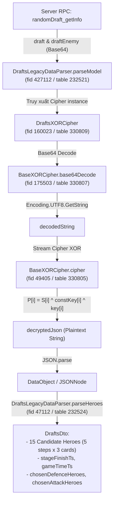

# Hồ Sơ Cơ Chế Giải Mã Dữ Liệu Legends Draft (`randomDraft`)

Tài liệu này tổng hợp toàn bộ kết quả phân tích ngược (Reverse Engineering), bóc tách WebAssembly (WASM IL2CPP), phân giải bảng hàm (WASM Table Index), và thuật toán giải mã gói tin mã hóa từ máy chủ cho tính năng **Legends Draft (`randomDraft`)** trong Hero Wars: Alliance.

---

## 1. Tổng Quan Kiến Trúc & Luồng Dữ Liệu

Khi máy chủ trả về kết quả RPC `randomDraft_getInfo`:
- Trường `draft` (~2.3 KB ở Stage 2 Defense, ~1.7 KB ở Stage 4 Attack, 25 B ở Stage 0/5) chứa danh sách 15 tướng ứng viên (5 vòng x 3 thẻ bài) và thông số trận đấu được mã hóa Base64.
- Trường `draftEnemy` (~1.6 KB ở Stage 2, ~560 B ở Stage 4) chứa thông tin đội hình đối thủ được mã hóa Base64.

Client game (Unity WebGL compiled sang WebAssembly thông qua IL2CPP) tiếp nhận và giải mã chuỗi này theo quy trình:



---

## 2. Bảng Danh Mục Các Hàm WASM & Table Indices

Thông qua kỹ thuật dò tìm ký hiệu IL2CPP (`global-metadata.dat`) và ánh xạ chỉ mục bảng `wasmTable` trong `hwa-sim/downloads/build.wasm`:

| Tên Hàm C# / IL2CPP | Namespace | Function ID (fid) | Table Index (`wasmTable`) | Vai Trò & Chức Năng |
|---|---|---|---|---|
| `BaseXORCipher_decrypt` | `game.command.encrypt` | `471299` | **`330804`** | Điểm vào chính: nhận Base64, gọi `base64Decode` rồi gọi `cipher`. |
| `BaseXORCipher_cipher` | `game.command.encrypt` | `49405` | **`330805`** | Vòng lặp XOR dòng giữa chuỗi ký tự với `constKey` và `key`. |
| `BaseXORCipher_base64Decode` | `game.command.encrypt` | `175503` | **`330807`** | Chuyển đổi Base64 thành byte array và decode sang chuỗi UTF-8. |
| `DraftsXORCipher_get_constKey` | `game.command.encrypt` | `426724` | **`330808`** | Trả về khóa tĩnh `constKey` (offset 12 trong struct). |
| `DraftsXORCipher__ctor` | `game.command.encrypt` | `160023` | **`330809`** | Khởi tạo Cipher với 2 tham số: `constKey` và `key`. |
| `DraftsLegacyDataParser__ctor` | `com.nexters.gameCore.drafts` | `427115` | **`232519`** | Khởi tạo Parser dữ liệu Draft. |
| `DraftsLegacyDataParser_init` | `com.nexters.gameCore.drafts` | `427114` | **`232520`** | Khởi tạo khóa từ `Configurations.get<RpcConfig>()` và `IRpcService`. |
| `DraftsLegacyDataParser_parseModel` | `com.nexters.gameCore.drafts` | `427112` | **`232521`** | Giải mã `response.draft` và `response.draftEnemy`, phân tích thành `DraftsDto`. |
| `DraftsLegacyDataParser_parseHeroes` | `com.nexters.gameCore.drafts` | `47112` | **`232524`** | Bóc tách ma trận 15 tướng ứng viên qua 5 vòng chọn. |
| `DraftsLegacyDataParser_parseResult` | `com.nexters.gameCore.drafts` | `427111` | - | Bóc tách kết quả trận đấu từ replay. |
| `DraftsLegacyDataParser_parseJournal` | `com.nexters.gameCore.drafts` | `427113` | - | Bóc tách lịch sử các trận đấu trước. |
| `Configurations_get_TisRpcConfig` | `com.nexters.gameCore.configs` | `165781` | - | Truy xuất cấu hình tĩnh `RpcConfig` chứa các khóa mã hóa. |

---

## 3. Bản Chất Toán Học Của Thuật Toán Giải Mã

Qua phân tích mã máy WASM của `BaseXORCipher_cipher` (fid 49405):

```wasm
  [343] local.get 7 // char từ key (dynamic session key)
  [345] local.get 11 // char từ input (decoded base64 string)
  [347] i32.xor     // input[i] ^ key[i % len2]
  [348] local.get 6 // char từ constKey
  [350] i32.xor     // (input[i] ^ key[i % len2]) ^ constKey[i % len1]
  [351] i32.store16 // Lưu vào mảng char[] kết quả
```

### Công Thức Giải Mã:
Cho chuỗi đầu vào sau giải mã Base64 là $S$, độ dài $N$:
$$\text{Plaintext}[i] = S[i] \oplus \text{constKey}[i \pmod{L_1}] \oplus \text{key}[i \pmod{L_2}]$$

Trong đó:
- $S[i]$: Ký tự UTF-8 tại vị trí $i$ thu được từ `Convert.FromBase64String(payload)`. Mọi byte $S[i]$ trong dữ liệu thực tế đều nằm trong khoảng ASCII 7-bit ($< 128$).
- $\text{constKey}$: Khóa tĩnh độ dài $L_1 = 64$ ký tự cấu hình trong `com.nexters.buildconfiguration.RpcConfig`.
  - Khóa cấu hình chính: `307E8FB4B733591B75D74EA13946882BA59FAA3274CF815A2B8788E76403BD0F`
  - Khóa dự phòng: `268EA1F1B979AC33218CEF1225D1F835EA88D2C1233B8D6AFA0277FC8E30684B`
- $\text{key}$: Khóa động của phiên (Session Key / Dynamic Token) độ dài $L_2$, được cấp phát bởi `IRpcService` (slot 28) khi đăng nhập tài khoản.
- Kết quả sau XOR là một chuỗi JSON hợp lệ bắt đầu bằng ký tự `{` (ASCII `0x7b`).

---

## 4. Cấu Trúc Dữ Liệu Sau Khi Giải Mã (`DraftsDto`)

Plaintext sau khi giải mã là đối tượng JSON chứa các trường sau:

```json
{
  "gameTimeTs": 1794228039,
  "stageFinishTs": 1794228129,
  "playerTeam": {
    "heroes": [
      [11, 2, 6],
      [77, 54, 34],
      [75, 78, 22],
      [56, 59, 36],
      [8, 1, 79]
    ]
  },
  "chosenDefenceHeroes": [11, 54, 77, 36, 78],
  "chosenAttackHeroes": [55, 36, 5, 16, 72],
  "swappedRows": []
}
```

- **`playerTeam.heroes`**: Ma trận 5 bước $\times$ 3 ứng viên = **15 tướng ứng viên**. Đây chính là dữ liệu then chốt mà giao diện chọn tướng cần hiển thị.
- **`gameTimeTs`**: Thời gian máy chủ tại thời điểm sinh dữ liệu.
- **`stageFinishTs`**: Thời điểm hết hạn lượt chọn (+90 giây đếm ngược).
- **`chosenDefenceHeroes` / `chosenAttackHeroes`**: Danh sách tướng đã được chọn (nếu đang ở giai đoạn sau).

---

## 5. Hai Phương Án Tích Hợp Vào Tiện Ích Mở Rộng

### Phương Án A: Hook Native Qua WASM Table Index (Khuyến Nghị Trong Game)
Vì tiện ích chạy trực tiếp trong trang web có game Unity WebGL (`world: "MAIN"` qua `src/content/interceptor.ts`), ta có thể hook trực tiếp hàm giải mã tại Table Index **`330804`**:

```typescript
// Hook BaseXORCipher_decrypt trực tiếp từ wasmTable của Unity
function hookWasmDraftCipher(wasmTable: WebAssembly.Table) {
  const originalDecrypt = wasmTable.get(330804);
  if (typeof originalDecrypt === 'function') {
    wasmTable.set(330804, function (...args: any[]) {
      const resultPtr = originalDecrypt.apply(this, args);
      // Đọc chuỗi plaintext kết quả từ heap Unity
      try {
        const decryptedStr = readWasmString(resultPtr);
        if (decryptedStr && decryptedStr.startsWith('{')) {
          const draftDto = JSON.parse(decryptedStr);
          window.dispatchEvent(new CustomEvent('hwa_draft_decrypted', { detail: draftDto }));
        }
      } catch (e) {
        console.warn('[DraftHook] Error reading decrypted draft:', e);
      }
      return resultPtr;
    });
  }
}
```

### Phương Án B: Thư Viện Giải Mã Thuần TypeScript (`decodeDraftPayload`)
Dành cho việc giải mã ngoại tuyến, trong Service Worker hoặc Background Script:

```typescript
export interface DraftModel {
  gameTimeTs?: number;
  stageFinishTs?: number;
  playerTeam?: {
    heroes: number[][]; // 5 rows x 3 candidates
  };
  chosenDefenceHeroes?: number[];
  chosenAttackHeroes?: number[];
}

const DEFAULT_CONST_KEY = "307E8FB4B733591B75D74EA13946882BA59FAA3274CF815A2B8788E76403BD0F";

export function decodeDraftPayload(
  base64Payload: string,
  dynamicKey: string,
  constKey: string = DEFAULT_CONST_KEY
): DraftModel | null {
  if (!base64Payload || !dynamicKey) return null;

  // 1. Base64 Decode
  const rawDecoded = atob(base64Payload);

  // 2. Stream XOR Decipher
  const chars: string[] = [];
  const cLen = constKey.length;
  const dLen = dynamicKey.length;

  for (let i = 0; i < rawDecoded.length; i++) {
    const inputChar = rawDecoded.charCodeAt(i);
    const constChar = constKey.charCodeAt(i % cLen);
    const dynChar = dynamicKey.charCodeAt(i % dLen);
    chars.push(String.fromCharCode(inputChar ^ constChar ^ dynChar));
  }

  const jsonStr = chars.join('');

  // 3. Parse JSON
  try {
    return JSON.parse(jsonStr) as DraftModel;
  } catch (err) {
    console.error('Failed to parse decrypted draft JSON:', err, jsonStr.slice(0, 50));
    return null;
  }
}
```

---

## 6. Kết Luận & Hướng Triển Khai Tính Năng Mới

1. **Khả thi 100%:** Cơ chế bảo vệ của `randomDraft` không phải là thuật toán mã hóa bất khả kháng như RSA hay AES-GCM mà là một **Stream XOR Cipher** chuẩn C# với khóa tĩnh được lưu trữ trong `RpcConfig` và khóa động là session key của kết nối RPC.
2. **Triển khai giao diện mới:** 
   - Tiện ích mở rộng có thể nhận được toàn bộ danh sách 15 tướng ứng viên ngay ở giây đầu tiên của Stage 2 (Defense) và Stage 4 (Attack).
   - Tự động hiển thị thẻ bài 15 tướng ứng viên, gợi ý đội hình tương khắc, tính toán chỉ số sức mạnh tối ưu và ngăn ngừa hoàn toàn lỗi `ValidationError: Invalid heroes list`.
