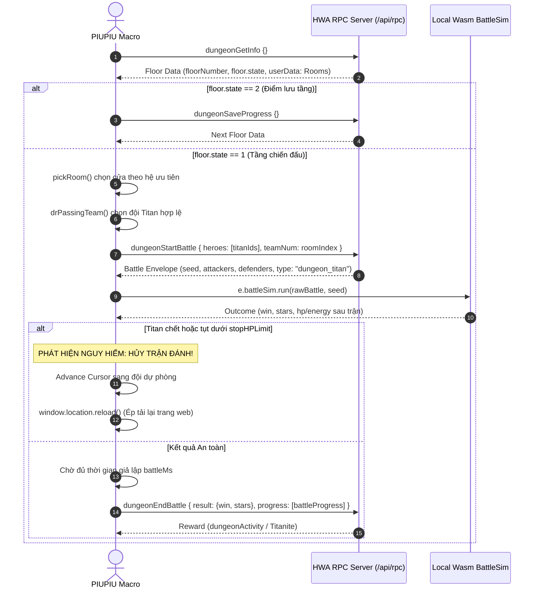
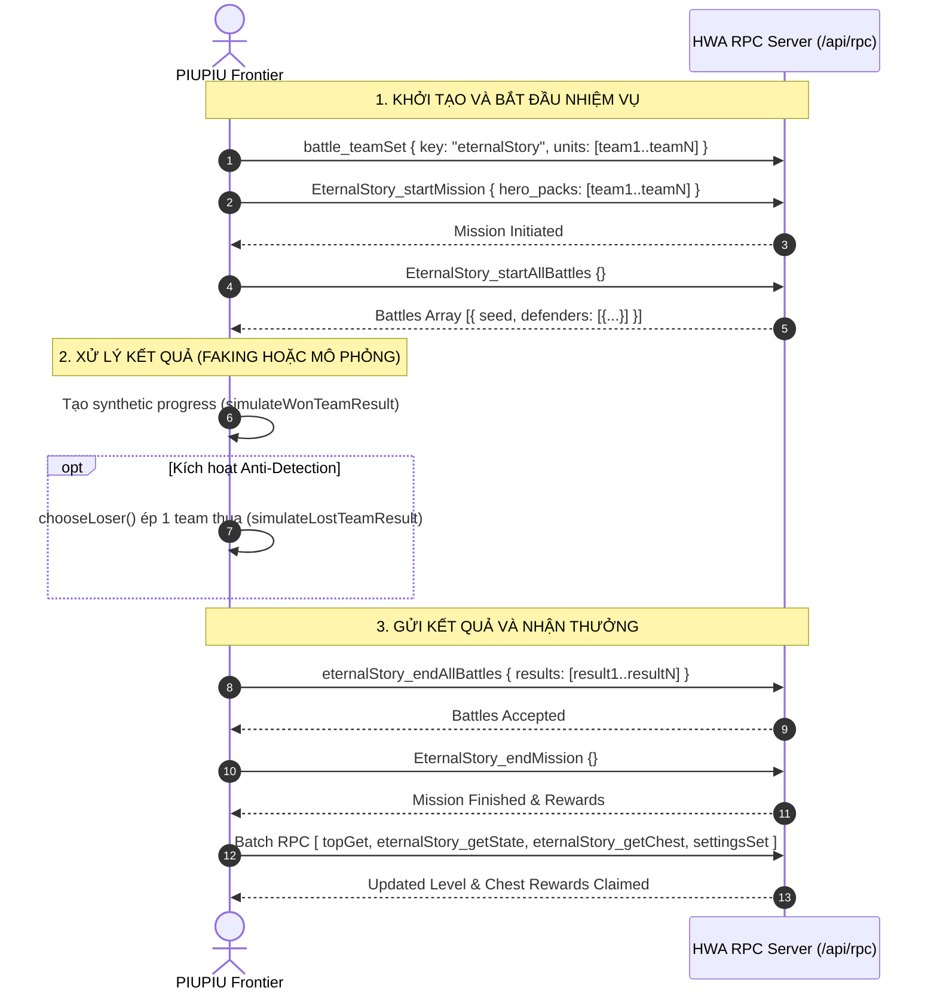

# BÁO CÁO PHÂN TÍCH SOURCE CODE PIUPIU (HWA-EXT)
## CHUYÊN ĐỀ: LOGIC PHÂN HỆ DUNGEON VÀ FRONTIER

> [!NOTE]
> **Tuyên bố phạm vi và nguồn gốc:**
> - Tài liệu này ghi nhận kết quả giải mã và phân tích source code của extension bên thứ ba **PIUPIU** (`v2.8.6`, thư mục `temp\HWA-Ext`).
> - Toàn bộ mã nguồn và logic được phân tích **không thuộc project hiện tại** và không tham gia vào luồng runtime của extension chúng ta.
> - Báo cáo này đóng vai trò tài liệu nghiên cứu, bóc tách các phát hiện kỹ thuật (RPC API contracts, luồng xử lý, thuật toán xếp đội hình, công thức toán học và các rủi ro gian lận/anti-cheat) nhằm phục vụ công tác đánh giá và tham chiếu chất lượng.

---

## 1. TỔNG QUAN KIẾN TRÚC SOURCE CODE NGUỒN

### 1.1. Cấu trúc tệp tin
Extension PIUPIU được đóng gói theo chuẩn Chrome Manifest V3 với các thành phần chính:
- `manifest.json`: Khai báo quyền `storage`, `unlimitedStorage`, host permissions tới `https://*.hero-wars-alliance.com/*` và máy chủ bản quyền `https://licence.hwa-bot.dev/*`.
- `src/background.js`: Service worker đảm nhiệm tính toán checksum/digest của mã nguồn (`buildDigest`) để chống chỉnh sửa và xác thực với license server.
- `src/content.js`: Content script trung gian chạy ở `document_start`, làm cầu nối postMessage giữa trang web và extension runtime; thu thập `installId` và chuyển tiếp thông tin `frontierPosition` về server bản quyền.
- `src/rpc/inject.js`: Injected script chạy trong context của trang game, can thiệp vào `window.fetch`, `XMLHttpRequest` và `WebSocket` (MQTT) để đánh chặn, giải mã, ghi lại và ký số (`x-auth-signature`) các request RPC `/api/rpc`.
- `src/main.js`: Bundle JavaScript chính (dung lượng ~3.8 MB, chạy trong execution world `MAIN`), chứa toàn bộ UI popup, macro bot, state management, và module mô phỏng trận đấu thông qua Unity WebAssembly.

### 1.2. Danh mục Module liên quan trong `main.js`
Qua rà soát mã nguồn, hai phân hệ trọng tâm được tổ chức thành các đối tượng logic:
1. **Dungeon (Hầm ngục Titan)**:
   - `e.requests`: Khai báo các hàm wrapper gọi RPC (`dungeonGetInfo`, `dungeonStartBattle`, `dungeonEndBattle`, `dungeonSaveProgress`).
   - `e.macros.dungeonRequests`: Toàn bộ bộ điều khiển cày hầm ngục tự động bằng request API.
   - `e.battleData`: Quản lý danh sách đội hình titan (`dungeonTeamsFor`), trạng thái máu/nộ (`dungeonTitanCondition`), thuật toán chọn Tank (`dungeonTankTeam`).
2. **Frontier (Biên Giới - Tên mã nội bộ: `eternalStory`)**:
   - `e.frontierAuto`: Bộ điều khiển tự động đánh Frontier, logic tạo kết quả trận giả lập (`simulateWonTeamResult`, `simulateLostTeamResult`), điều tiết tỉ lệ thắng (`chooseLoser`).
   - `e.frontierPower`: Quản lý lực chiến phòng thủ/tấn công, công thức boost tỉ lệ thắng dựa trên khoảng cách lực chiến (`boost`), kết hợp tiền nghiệm Bayesian (`slotRates`).
   - `e.frontierSims`: Điều phối mô phỏng Monte-Carlo đối đầu giữa các đội hình, lưu trữ ma trận đối đầu lịch sử.
   - `e.frontierRebalance`: Thuật toán hoán đổi tướng giữa các đội hình để tối ưu hóa đội hình yếu.
   - `e.frontierDelayedUlt`: Kỹ thuật tinh chỉnh độ trễ kích hoạt Ultimate (nộ) của tướng.

---

## 2. PHÂN TÍCH CHUYÊN SÂU PHÂN HỆ DUNGEON (HẦM NGỤC TITAN)

### 2.1. Danh mục RPC API Contracts
Toàn bộ quá trình cày Dungeon được thực hiện thông qua 4 phương thức RPC với cơ chế retry đặc thù:



#### Chi tiết hợp đồng API:
1. **`dungeonGetInfo`**:
   - Request: `{}`
   - Response:
     ```json
     {
       "floorNumber": 1254,
       "floorType": "battle",
       "floor": {
         "state": 1, // 1: Đang đánh cửa, 2: Đã xong cửa cần Save Progress
         "userData": [
           { "attackerType": "neutral", "defenderType": "water" },
           { "attackerType": "earth", "defenderType": "fire" }
         ]
       },
       "states": {
         "titans": {
           "4011": { "hp": "1500000", "maxHp": "1500000", "energy": "600", "isDead": false }
         }
       }
     }
     ```
2. **`dungeonSaveProgress`**:
   - Điều kiện gọi: Kích hoạt khi `floor.state === 2` (sau mỗi mốc 5 tầng/trận chiến).
   - Request: `{}`
   - Response: Cập nhật sang tầng kế tiếp.
3. **`dungeonStartBattle`**:
   - Request: `{ "heroes": [4011, 4012, 4013, 4014, 4015], "teamNum": 0 }`
   - Lưu ý: Tham số mang tên `heroes` nhưng thực chất truyền ID của các Titan. `teamNum` là chỉ số index của phòng (0 hoặc 1).
   - Response: Gói thông tin khởi tạo trận đấu (`attackers`, `defenders`, `seed`, `type: "dungeon_titan"`).
4. **`dungeonEndBattle`**:
   - Request:
     ```json
     {
       "result": { "win": true, "stars": 3 },
       "progress": [{
         "attackers": { "heroes": { ... }, "input": [] },
         "defenders": { "heroes": { ... }, "input": [] },
         "duration": 14.5,
         "seed": 128947192
       }]
     }
     ```
   - Response: Ghi nhận kết quả, trả về `reward.dungeonActivity` (Titanite nhận được).

#### Cơ chế Retry & Phục hồi lỗi (`dungeonCall`):
- `DUNGEON_RETRIES = 10`: Cho phép thử lại tối đa 10 lần khi mạng chập chờn.
- Backoff Exponential: Khởi đầu `DUNGEON_RETRY_BASE_MS = 1000` ms, trần `DUNGEON_RETRY_MAX_MS = 30000` ms.
- Xử lý mã lỗi đặc biệt:
  - Nếu gặp lỗi `InvalidSession`: Buộc reload trang để lấy session mới.
  - Nếu `dungeonEndBattle` gặp `NotFound: Battle with type`: Đánh dấu `battle-gone` (trận đấu đã kết thúc hoặc bị hủy).

---

### 2.2. Quy trình Chọn Cửa & Xếp Đội hình Titan

#### Thứ tự Ưu tiên Chọn Cửa (`pickRoom`):
Bản đồ nguyên tố:
```javascript
const Ln = { neutral: "mixed", water: "water", fire: "fire", earth: "earth" };
```
Hàm duyệt qua mảng `drRooms(floor)` và so sánh với mảng ưu tiên cấu hình của người chơi (`e.state.elementsOrder`):
- Mỗi phòng được gán trọng số rank: `rank = elementsOrder.indexOf(Ln[attackerType])`.
- Phòng có rank nhỏ nhất (ưu tiên cao nhất) sẽ được chọn.

#### Các Thuật toán Xếp Đội hình (`autoDungeonAlgorithm`):
PIUPIU cung cấp 5 thuật toán (`ALGORITHMS = ["none", "tank-hp", "most-healing", "next-on-fail", "least-hp"]`):

1. **`none` (Mặc định)**:
   - Dùng nguyên vẹn đội hình được ghi nhớ trong cache từ lần đánh tay gần nhất của người dùng (`dungeonTeams[attackerType]`).
2. **`tank-hp` (Cân bằng Tank ải Hỗn hợp)**:
   - Dành riêng cho ải `neutral` (hỗn hợp). Hai Tank chủ lực được theo dõi là **Angus** và **Moloch** (`DUNGEON_TANKS = [4011, 4012]`).
   - Hàm `dungeonTankTeam` phân tích HP% và nộ của 2 Tank:
     ```javascript
     // Sắp xếp ưu tiên Tank có HP% thấp hơn hoặc Nộ thấp hơn để đưa vào hồi máu/tích nộ
     sort((e, t) => e.pct - t.pct || e.energy - t.energy)
     ```
   - Tự động hoán đổi (swap) Tank vào đội hình nếu Tank đó còn sống và đủ điều kiện sinh tồn.
3. **`most-healing` (Tối đa hóa Hồi máu)**:
   - Trước khi chốt đánh, macro chạy probe/mô phỏng tất cả các đội hình khả dĩ cho cửa đó.
   - Tính toán chỉ số hồi phục máu ròng (`healPct`):
     $$\Delta \text{HP}_{\text{team}} = \sum_{i \in \text{Titans}} \left(\text{HP}_{\text{sau trận}}\% - \text{HP}_{\text{trước trận}}\%\right)$$
   - Đội hình nào có $\Delta \text{HP}_{\text{team}}$ lớn nhất (hồi phục máu nhiều nhất cho toàn đội) sẽ được chọn đánh thật.
4. **`next-on-fail`**:
   - Duyệt tuần tự các đội hình theo danh sách. Đội nào vượt qua mô phỏng mà không có Titan nào chết hoặc rơi vào trạng thái nguy hiểm (`lowTitan`) sẽ được gửi lệnh đánh ngay lập tức.
5. **`least-hp`**:
   - Chọn đội hình chứa Titan đang có % máu thấp nhất để cho Titan đó nhận khiên/hồi máu từ hỗ trợ hoặc tích lũy năng lượng.

---

### 2.3. Cơ chế An toàn & Thủ thuật "Reload Né Thua" (Key Finding)

> [!CAUTION]
> **Phát hiện quan trọng về cơ chế hoạt động:**
> Game Hero Wars: Alliance ghi nhận một trận đánh bắt đầu khi nhận RPC `dungeonStartBattle`. Tuy nhiên, kết quả máu mất chỉ được máy chủ ghi nhận chính thức khi nhận RPC `dungeonEndBattle`.
> PIUPIU khai thác triệt để kẽ hở này:
> 1. Gọi `dungeonStartBattle` để lấy `seed` và dữ liệu phòng thủ thật từ server.
> 2. Đưa dữ liệu vào engine Wasm mô phỏng ngầm (`drProbe`).
> 3. Nếu mô phỏng cho thấy Titan bị chết hoặc máu tụt dưới `stopHPLimit` (ví dụ < 30%):
>    - Macro **KHÔNG** gửi `dungeonEndBattle`.
>    - Macro chuyển con trỏ đội hình sang đội tiếp theo (`drAdvanceTeam`).
>    - Macro gọi **`location.reload()`** để reload tab trình duyệt.
>    - Khi reload, server tự hủy phiên chiến đấu dở dang (abandoned battle), bảo toàn 100% máu cũ cho toàn bộ Titan!
> 4. Nếu mô phỏng xác nhận Thắng an toàn: Macro giữ độ trễ `battleMs` (mặc định 500ms) rồi mới gửi `dungeonEndBattle`.

---

### 2.4. Công thức Tính toán & Ước lượng Hiệu suất Dungeon

#### Các hằng số vận hành:
- `TITANITE_PER_FIGHT = 12`: Mỗi trận thắng nhận 12 Titanite.
- `FIGHTS_PER_SAVE = 5`: Cứ 5 trận/tầng sẽ có 1 lần Save Progress.
- `REQUESTS_PER_SAVE = 2`: Chi phí gọi API tại điểm Save.
- `DEFAULT_BATTLE_MS = 500` ms: Độ trễ tối thiểu giả lập trận đánh.
- `DEFAULT_DELAY_MS = 2000` ms: Độ trễ giữa các tầng.

#### Công thức Ước lượng Thời gian Mỗi Trận ($T_{\text{fight}}$):
$$T_{\text{fight}} = 2 \times T_{\text{req}} + \max(T_{\text{battle}},\, T_{\text{comp}}) + T_{\text{delay}} + T_{\text{req}} \times \frac{N_{\text{req\_save}}}{N_{\text{fight\_save}}}$$
*Trong đó:*
- $T_{\text{req}}$: Thời gian phản hồi trung bình của mạng (`requestMs`, ~200ms).
- $T_{\text{comp}}$: Thời gian máy tính tính toán mô phỏng Wasm (`computeMs`, ~500ms).
- $T_{\text{battle}}$: Cấu hình thời gian tối thiểu của trận (`battleMs`, 500ms).
- $T_{\text{delay}}$: Thời gian nghỉ giữa các tầng (`delayMs`, 2000ms).

#### Công thức Tốc độ Cày Titanite Theo Giờ:
$$\text{Titanite / Giờ} = \frac{3,600,000}{T_{\text{fight}}} \times 12$$

---

## 3. PHÂN TÍCH CHUYÊN SÂU PHÂN HỆ FRONTIER (BIÊN GIỚI - `eternalStory`)

Trong mã nguồn game và PIUPIU, phân hệ Frontier được định danh bằng tiền tố RPC nội bộ là **`eternalStory`** / **`EternalStory`**.

### 3.1. Danh mục RPC API Contracts
Quy trình một chu kỳ tấn công Frontier bao gồm chuỗi 8 lệnh RPC liên hoàn:



#### Chi tiết tham số các phương thức:
1. **`battle_teamSet`**:
   - `key`: Luôn cố định là `"eternalStory"`.
   - `units`: Mảng chứa các mảng ID tướng cho từng đội: `[[1, 2, 3, 4, 5], [6, 7, 8, 9, 10], ...]`.
2. **`EternalStory_startMission`**:
   - `hero_packs`: Truyền danh sách các đội tấn công tương tự `units`.
3. **`EternalStory_startAllBattles`**:
   - Gửi `{}`.
   - Trả về danh sách tất cả các trận đấu tương ứng số đội thủ, cung cấp `seed` ngẫu nhiên và thông tin phòng thủ `defenders` của máy chủ.
4. **`eternalStory_endAllBattles`**:
   - Nhận mảng `results` chứa trạng thái thắng/thua và tiến trình `progress` của từng trận.
5. **`EternalStory_endMission`**:
   - Gửi `{}` để kết thúc màn chơi hiện tại.
6. **`eternalStory_getChest`**:
   - Nhận rương phần thưởng sau khi vượt qua màn.
7. **`eternalStory_getState`**:
   - Lấy thông tin trạng thái Frontier hiện tại (level hiện tại, số lượt đánh còn lại).

---

### 3.2. Cấu trúc Cấp độ & Quy mô Phân tầng

Hệ thống Frontier tăng số lượng đội hình phòng thủ theo cấp số cộng dựa trên hằng số:
```javascript
e.frontierAuto.DEFENSE_TEAM_EVERY = 500;
```
- **Quy luật chuyển cấp**: Cứ mỗi **500 level**, số đội phòng thủ tăng thêm 1 đội.
- **Hàm kiểm tra cấp độ mở thêm đội thủ**:
  $$\text{isNewDefenseTeamLevel}(L) \iff L > 1 \land (L \pmod{500} = 1)$$
  *(Ví dụ: Level 1-500: 1 đội; Level 501: 2 đội; Level 1001: 3 đội; Level 1501: 4 đội; Level 2001: 5 đội).*
- **Công thức xác định Level của mốc tăng đội tiếp theo**:
  $$L_{\text{next}} = \left\lfloor \frac{L - 1}{500} \right\rfloor \times 500 + 501$$

---

### 3.3. Cơ chế Tạo Kết quả Giả Lập & Điều Tiết Trận Thua (Critical Finding)

> [!WARNING]
> **Phát hiện gian lận nghiêm trọng trong logic Frontier của PIUPIU:**
> Trong chế độ tự động vượt ải (`runMission`), PIUPIU **không cần chạy mô phỏng vật lý thực tế để lấy output** mà **tự dựng payload giả (synthetic spoofing)** gửi thẳng lên máy chủ!

#### Hàm `simulateWonTeamResult`:
Tạo báo cáo kết quả chiến thắng hợp lệ để máy chủ duyệt qua:
```javascript
e.frontierAuto.simulateWonTeamResult = function(team, seed) {
  // 1. Giả lập một số tướng còn sống (tỉ lệ sống sót 90%)
  const surviving = survivingHeroes(team, 0.1);
  const deadCount = team.length - Object.keys(surviving).length;
  
  // 2. Tính số sao: 0 chết = 3 sao, 1 chết = 2 sao, >=2 chết = 1 sao
  const stars = deadCount === 0 ? 3 : deadCount === 1 ? 2 : 1;
  
  // 3. Fake thời gian đánh: Random từ 10s đến 119s
  const duration = 10 + 109 * Math.random();
  
  return {
    result: { win: true, stars: stars },
    progress: [{
      defenders: { heroes: {}, input: [] }, // Đội thủ chết sạch
      attackers: { heroes: surviving, input: [] },
      duration: duration,
      seed: seed
    }]
  };
};
```
Trong đó, hàm `survivingHeroes` sinh ngẫu nhiên chỉ số cho các tướng còn sống:
- `hp`: Giá trị nguyên ngẫu nhiên từ `1` đến `200,000` (`randomInt(1, 200000)`).
- `energy`: Giá trị nguyên ngẫu nhiên từ `1` đến `999` (`randomInt(1, 999)`).

#### Cơ chế Chống Phát Hiện - Cố Tình Thua (`chooseLoser`):
Nếu một tài khoản thắng 100% tất cả các tầng Frontier với thời gian và máu bất thường, tài khoản đó sẽ dễ dàng bị hệ thống giám sát của game phát hiện. PIUPIU tích hợp cơ chế **chủ động thua có tính toán**:
- Người dùng đặt cấu hình `winChancePercent` (ví dụ 90%).
- Nếu lượt đánh rơi vào xác suất thua (10%), macro gọi `chooseLoser(teams, defenseTeams, rates)`.
- Xác suất một đội bị chọn làm "vật tế thần" để thua tỉ lệ nghịch với tỉ lệ thắng dự kiến của đội đó:
  $$w_i = \max\left(0.01,\, 1 - \text{WinRate}_i\right)$$
- Sau khi chọn được đội thua, macro gọi hàm `simulateLostTeamResult` cho đội đó:
  - `result: { win: false, stars: 0 }`
  - `duration: 120` (hết thời gian 2 phút chuẩn của game)
  - Đội thủ còn tướng sống, đội công chịu tổn thất 50% quân số.

---

### 3.4. Các Công thức Toán học & Thuật toán Phân tích Frontier

Bên cạnh việc spoof kết quả, PIUPIU xây dựng một hệ thống thuật toán phân tích meta và ghép cặp đội hình rất tinh vi:

#### 1. Công thức Boost Tỉ lệ Thắng theo Khoảng cách Lực chiến (`frontierPower.boost`):
Khi có chênh lệch lực chiến giữa đội công $P_{\text{att}}$ và đội thủ $P_{\text{def}}$, tỉ lệ thắng gốc $R$ được điều chỉnh theo công thức:
$$o = 1 - \frac{P_{\text{def}}}{P_{\text{att}}}$$
Hằng số ngưỡng chênh lệch tối đa: $\text{GAP\_FULL} = 0.30$ (tương đương lực chiến công hơn thủ 30%).
$$\text{BoostedWinRate}(R,\, P_{\text{att}},\, P_{\text{def}}) = \begin{cases} 
R, & \text{nếu } o \le 0 \\
R + (1 - R) \times \frac{\min(o,\, 0.30)}{0.30}, & \text{nếu } o > 0 
\end{cases}$$
*Ý nghĩa:* Nếu lực chiến công bằng hoặc thua thủ ($o \le 0$), giữ nguyên tỉ lệ thắng $R$. Nếu lực chiến công vượt trội, tỉ lệ thắng được đẩy dần về $1.0$ ($100\%$). Khi vượt $30\%$ lực chiến, xem như tỉ lệ thắng đạt tuyệt đối ($100\%$).

#### 2. Công thức Hòa trộn Tiền nghiệm Bayesian (`frontierPower.slotRates`):
Để ước lượng tỉ lệ thắng của một cặp đối đầu khi số lượng trận đấu mẫu còn ít, PIUPIU sử dụng mô hình Bayesian Smoothing với hằng số `PRIOR_WEIGHT = 4`:
$$\text{BlendedWinRate} = \frac{W_{\text{prior}} + k \times R_{\text{base}}}{N_{\text{prior}} + k}$$
*Trong đó:*
- $W_{\text{prior}}$: Số trận thắng ghi nhận được từ dữ liệu lịch sử cộng đồng đối đầu giữa 2 lineup.
- $N_{\text{prior}}$: Tổng số trận đã ghi nhận trong quá khứ.
- $k = 4$: Trọng số làm mượt.
- $R_{\text{base}}$: Tỉ lệ thắng mặc định hoặc tỉ lệ tính từ lực chiến.

#### 3. Vector Đánh giá Chất lượng Đội hình (`fhScoreOf`):
Khi so sánh hiệu quả giữa hai phương án đội hình, PIUPIU sử dụng vector 5 chiều và so sánh thứ tự từ điển:
$$\text{Score}(E) = \left[ S_{\text{standing}},\, \frac{\text{Wins}}{N},\, -\frac{\text{Dead}}{N},\, \frac{\text{LowestHP}}{N},\, N \right]$$
1. $S_{\text{standing}} \in \{0, 1\}$: Toàn đội còn trụ lại (không bị quét sạch).
2. $\frac{\text{Wins}}{N}$: Tỉ lệ thắng trung bình.
3. $-\frac{\text{Dead}}{N}$: Hạn chế tối đa số lượng tướng tử trận (số âm để giá trị càng lớn thì càng ít chết).
4. $\frac{\text{LowestHP}}{N}$: Mức máu thấp nhất trung bình của thành viên trong đội (giữ máu an toàn).
5. $N$: Số lượng mẫu thử nghiệm.

#### 4. Thuật toán Hoán đổi Tái cân bằng (`frontierRebalance`):
- Xác định đội hình yếu nhất (`weakestSlot`) hoặc đội thua toàn diện (`lostToAll`).
- Duyệt qua các tướng ở các đội khác làm nguồn hiến tặng (`donor`).
- Xếp hạng tướng theo sức mạnh (`rankTeam`).
- Lọc các phương án tráo đổi tướng: Lấy tướng mạnh bậc 2 hoặc 3 từ đội dư dả sức mạnh bù vào đội yếu để nâng tỉ lệ thắng tổng thể của toàn bộ các slot thủ.

#### 5. Kỹ thuật Trì hoãn Kích hoạt Ultimate (`frontierDelayedUlt`):
- Phân tích log nộ của tướng (`fduFirstFull`).
- Tạo chuỗi input giả lập độ trễ: `progress.attackers.input = ["auto", 1000000, 0, "auto", 1000000, delayTimestamp]`.
- Giúp trì hoãn tuyệt kỹ của một số tướng (như tank hoặc khống chế) nhằm né các hiệu ứng bất tử/phản đòn tức thời ở đầu trận của đối phương.

---

### 3.5. Kiểm soát Bản quyền & Giới hạn Hạn mức (License Enforcement)
- Mỗi khi khởi động hoặc chạy Frontier, PIUPIU gửi request kiểm tra bản quyền tới máy chủ:
  `POST https://licence.hwa-bot.dev/`
  Body bao gồm: `{ licenseKey, playerId, extVersion, frontierPosition, installId, platform: "chrome", build }`.
- Trong đó, `frontierPosition` phản ánh tầng Frontier hiện tại của người chơi.
- Máy chủ sẽ trả về hạn ngạch cho phép (`used` of `limit` levels). Nếu người dùng vượt quá hạn mức mua bản quyền, extension lập tức kích hoạt mã dừng:
  `⏹ Frontier stopped: licence allowance spent ({used} of {limit} levels)`.

---

## 4. TỔNG HỢP VÀ ĐÁNH GIÁ CHẤT LƯỢNG KỸ THUẬT

### 4.1. Bảng Tổng hợp Giá trị Kỹ thuật Bóc tách Được

| Hạng mục | Cơ chế trong PIUPIU | Đánh giá Giá trị | Khả năng Tái sử dụng |
| :--- | :--- | :--- | :--- |
| **Dungeon RPC APIs** | 4 RPCs chuẩn (`dungeonGetInfo`, `dungeonStartBattle`, `dungeonEndBattle`, `dungeonSaveProgress`) | **Rất cao**: Cung cấp đầy đủ contract, schema payload và cơ chế retry khi mạng lỗi. | Có thể đưa ngay vào RPC Client của project. |
| **Dungeon Safety Trick** | Reload trang khi Titan chết ở pha Wasm simulation để reset trận đánh | **Rất cao về mặt ý tưởng**, nhưng cách triển khai `location.reload()` là **rất thô bạo (crude)**, gây gián đoạn UX và tốn băng thông. | Nên cải tiến: nghiên cứu xem game có API hủy trận chính thức hay chỉ reload âm thầm (hoặc service worker reload). |
| **Dungeon Healing Algo** | Thuật toán `most-healing` đo lường $\Delta\text{HP}$ ròng | **Cao**: Tư duy toán học xuất sắc trong việc tối ưu độ bền bỉ của dàn Titan khi cày sâu. | Rất đáng kế thừa vào module Dungeon AI. |
| **Frontier RPC APIs** | 8 RPCs chuẩn mang tiền tố `eternalStory_*` | **Rất cao**: Xác nhận toàn bộ danh mục RPC để tương tác với chế độ Frontier mà trước đây chưa có tài liệu đầy đủ. | Đưa vào danh mục API Catalog. |
| **Frontier Power Boost** | Công thức $R + (1-R) \times \frac{\min(o, 0.3)}{0.3}$ | **Cao**: Công thức nội suy toán học chặt chẽ, tham số $30\%$ chênh lệch lực chiến được tinh chỉnh thực tế rất tốt. | Có thể tích hợp vào engine dự đoán tỉ lệ thắng. |
| **Frontier Bayesian Priors** | Làm mượt tỉ lệ thắng với $k=4$ và dữ liệu ghép cặp lịch sử | **Rất cao**: Mô hình xác suất chuẩn mực, giải quyết triệt để bài toán thiếu dữ liệu mẫu (cold start). | Rất nên áp dụng. |
| **Frontier Level Formula** | $L > 1 \land L \pmod{500} = 1$ | **Chính xác tuyệt đối**: Giúp dự đoán chính xác khi nào người chơi phải đối mặt thêm 1 team thủ mới. | Sử dụng làm logic nghiệp vụ cốt lõi. |
| **Frontier Result Faking** | Spoof synthetic progress (HP, Energy, Duration ngẫu nhiên) | **Cực kỳ nguy hiểm**: Đây là hành vi gian lận (exploit/hack) trực tiếp ở tầng protocol. Rất dễ bị Nexters quét ban nick hàng loạt nếu họ thêm server-side validation. | **TUYỆT ĐỐI KHÔNG SỬ DỤNG** trong extension chính thức nếu hướng tới độ an toàn cao. |

---

## 5. KẾT LUẬN VÀ KHUYẾN NGHỊ CHO PROJECT HIỆN TẠI

1. **Về mặt Tri thức Nghiệp vụ & API (Nên tiếp nhận)**:
   - Toàn bộ danh mục RPC method signatures của cả Dungeon và Frontier đã được bóc tách rõ ràng và chính xác.
   - Các công thức tính toán: Khoảng cách lực chiến (`powerGap`), hệ số bù trừ Bayesian (`PRIOR_WEIGHT = 4`), công thức chu kỳ 500 tầng của Frontier, và công thức tối ưu hóa hồi máu Titan (`healPct`) là những tài sản tri thức giá trị cao, hoàn toàn có thể chuẩn hóa thành các utility functions trong project của chúng ta.
2. **Về mặt Cơ chế Thực thi (Cần chọn lọc & cải tiến)**:
   - **Đối với Dungeon**: Cơ chế dùng Wasm simulator nội bộ kiểm tra kết quả trước khi gửi `dungeonEndBattle` là giải pháp an toàn tuyệt đối cho người chơi. Tuy nhiên, thay vì áp dụng cách reload cả tab trang web khi gặp trận thua, ta cần nghiên cứu các phương án xử lý mềm mại hơn hoặc cho phép người chơi thiết lập giới hạn dừng thông minh.
   - **Đối với Frontier**: Không nên sao chép kỹ thuật faking kết quả (`simulateWonTeamResult`) vì tiềm ẩn rủi ro vi phạm điều khoản dịch vụ và bị cấm tài khoản. Nên tập trung phát triển bộ giải thuật xếp đội hình tối ưu (dựa trên các công thức `power.boost` và `rebalance`) kết hợp với tính năng gợi ý chiến thuật cho người dùng.
