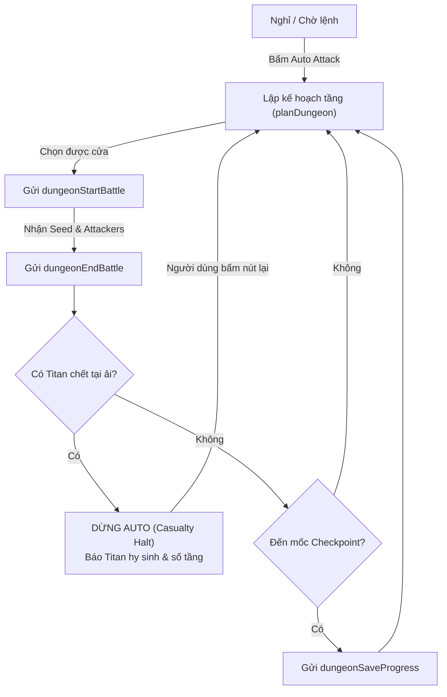

# Cơ Chế Tự Động Tấn Công Titan Dungeon (Dungeon Automation)

Tài liệu này mô tả chi tiết kiến trúc, thuật toán và cách tùy chỉnh cơ chế tự động tấn công hầm ngục Titan (Guild Dungeon) trong extension HWA Helper.

---

## 1. Tổng Quan

Chức năng tự động Dungeon cho phép extension tự động leo tầng Dungeon theo từng ải một cách an toàn, thông minh và tối ưu hóa việc giữ máu/sinh mệnh của các Titan.

Các điểm cốt lõi bao gồm:
1. **Reset trạng thái Titan mỗi ngày mới (Daily Rest Reset)**: Đảm bảo thông tin máu (HP) và năng lượng (Energy) của Titan được làm mới tinh tươm khi qua ngày mới.
2. **Chọn đội hình theo Ordered Titan Pool**: Mỗi thuộc tính có 1 danh sách Titan được sắp xếp theo thứ tự ưu tiên. Khi cửa yêu cầu hệ nào, hệ thống sẽ duyệt pool và nhặt **top 5 Titan còn sống** đầu tiên.
3. **Ưu tiên cửa thông minh (Door Priority)**:
   - Ưu tiên cửa có **số Titan chết ít nhất** (0 chết > 1 chết > 2 chết...).
   - Nếu số Titan chết bằng nhau: Ưu tiên theo thứ tự thuộc tính của Attacker (`water` -> `mixed/neutral` -> `earth` -> `fire`).
   - Nếu thuộc tính bằng nhau: Ưu tiên cửa có chiến lực địch (`enemyPower`) thấp hơn.
4. **Dừng lại khi có Titan hy sinh tại ải (Safety Casualty Halt)**:
   - Ngay khi kết thúc 1 trận đánh mà phát hiện có Titan trong đội vừa ngã xuống (`isDead: true` hoặc `hp <= 0`), chuỗi auto dừng lại ngay lập tức.
   - Người dùng có thể kiểm tra tình hình và bấm lại nút **Auto Attack** (hoặc **Continue Auto**) để bắt đầu một vòng auto mới với các Titan còn sống tiếp theo.

---

## 2. Cơ Chế Reset Dữ Liệu Ngày Mới (Daily Rest Reset)

- **Vấn đề**: Trong Hero Wars Alliance, sau mỗi lần reset ngày (Daily Reset/Rest), toàn bộ các Titan đã chết hoặc mất máu hôm trước sẽ được hồi phục hoàn toàn (Full HP, 0 energy/alive). Tuy nhiên, cache cục bộ nếu chỉ merge cộng dồn (`Object.assign`) sẽ vô tình giữ lại trạng thái đã chết (`isDead: true`) của ngày cũ.
- **Giải pháp**:
  - Trong [`extension/rpc-cache.js`](file:///C:/Projects/git/vplghost/VPL-HWA-Ext/extension/rpc-cache.js):
    Khi phát hiện ngày mới (`isNewDay`: ngày của bản ghi khác ngày đã lưu trong `dungeonStatus.updatedAt`), hoặc khi nhận snapshot đầy đủ từ lệnh `dungeonGetInfo`:
    ```javascript
    if (isNewDay) {
      mergedTitans = entry.data.states?.titans ? { ...entry.data.states.titans } : {};
    }
    ```
    Toàn bộ danh sách `titans` cũ bị xóa sạch, trả về trạng thái nguyên bản 100% sinh lực cho tất cả các Titan.

---

## 3. Cơ Chế Ordered Titan Pool (Bể Tướng Có Thứ Tự)

Mỗi nguyên tố (`attackerType`) của cửa Dungeon sở hữu một danh sách Titan có thứ tự ưu tiên:

### 3.1. Danh sách Pool mặc định (`DEFAULT_TITAN_POOLS`)

| Hệ Cửa (`attackerType`) | Thứ Tự Titan Trong Pool | Ghi Chú |
| :--- | :--- | :--- |
| **Water (Nước)** | `4000` (Sigurd) -> `4001` (Nova) -> `4052` (Orm) -> `4004` (Tydus) -> `4002` (Mairi) -> `4003` (Hyperion) | Sigurd đỡ đòn, Nova khống chế, Orm & Mairi hỗ trợ |
| **Earth (Đất)** | `4020` (Angus) -> `4022` (Avalon) -> `4024` (Verdoc) -> `4023` (Eden) -> `4021` (Sylva) | Angus gây sát thương diện rộng, Eden kéo địch |
| **Fire (Lửa)** | `4010` (Moloch) -> `4011` (Vulcan) -> `4013` (Araji) -> `4012` (Ignis) -> `4014` (Asherona) -> `4051` (Alecto) | Araji sát thương chủ lực, Moloch tank |
| **Mixed / Neutral (Hỗn hợp)** | `4000` -> `4001` -> `4052` -> `4004` -> `4002` -> `4020` -> `4023` -> `4013` -> `4022` -> `4021` -> `4010` -> `4011` -> `4012` -> `4053` | Tuyển chọn top các Titan mạnh nhất mọi hệ |

### 3.2. Thuật toán nhặt Lineup (`pickLineupFromPool`)

Khi chọn tướng cho một cửa:
1. Lấy danh sách pool của hệ cửa tương ứng (hoặc pool tùy chỉnh của người dùng).
2. Lần lượt kiểm tra từng Titan trong pool:
   - Titan được coi là còn sống nếu `!titanState.isDead && titanState.hp > 0` (hoặc chưa từng chịu sát thương trong ngày).
   - Nếu đã chết: đưa vào mảng `deadTitans`.
   - Nếu còn sống: đưa vào mảng `aliveTitans`.
3. Lấy **tối đa 5 Titan còn sống đầu tiên** (`aliveTitans.slice(0, 5)`).
4. Nếu một hệ có ít hơn 5 Titan (ví dụ hệ Fire chỉ sở hữu 4 Titan), hệ thống sẽ ra trận với toàn bộ số Titan còn sống của hệ đó.

---

## 4. Quy Tắc Đánh Giá Và Ưu Tiên Cửa (Door Evaluation)

Mỗi tầng thường có 2 cửa lựa chọn (Door 1 tại `teamNum = 0` và Door 2 tại `teamNum = 1`). Hệ thống đánh giá từng cửa qua hàm `evaluateDoor` và sắp xếp qua `selectBestDoor`:

### 4.1. Thứ tự ưu tiên (Sorting Rules)

```text
[Cửa tốt nhất]
   │
   ├─► 1. Ít Titan chết nhất (deadCount tăng dần: 0 chết < 1 chết < 2 chết)
   │
   ├─► 2. Thứ tự nguyên tố Attacker (nếu deadCount bằng nhau):
   │       water (Nước) ──► mixed/neutral (Hỗn hợp) ──► earth (Đất) ──► fire (Lửa)
   │       (Hoặc prime element nếu hệ đó là Prime của ngày)
   │
   ├─► 3. Chiến lực đối thủ (enemyPower thấp hơn xếp trước)
   │
   └─► 4. Index cửa (teamNum: Door 1 trước Door 2)
```

### 4.2. Ví dụ so sánh thực tế:
- **Trường hợp 1**: Door 1 là Nước (0 Titan chết), Door 2 là Lửa (1 Titan chết).
  - Kết quả: Chọn **Door 1 (Nước)** vì `0 chết < 1 chết`.
- **Trường hợp 2**: Door 1 là Đất (0 Titan chết), Door 2 là Nước (0 Titan chết).
  - Số Titan chết bằng nhau (`0 == 0`).
  - So sánh nguyên tố: `water` đứng trước `earth`.
  - Kết quả: Chọn **Door 2 (Nước)**.
- **Trường hợp 3**: Door 1 là Đất (1 Titan chết), Door 2 là Lửa (0 Titan chết).
  - Kết quả: Chọn **Door 2 (Lửa)** vì Lửa có 0 Titan chết, ưu tiên hơn Đất đã có 1 Titan chết.

---

## 5. Vòng Đời Auto Runner & Dừng An Toàn Khi Có Thương Vong

Quá trình chạy tự động được quản lý bởi `hwaHelperDungeonRunner` trong Service Worker ([`extension/dungeon-runner.js`](file:///C:/Projects/git/vplghost/VPL-HWA-Ext/extension/dungeon-runner.js)):

### 5.1. Sơ đồ trạng thái (State Flow)



### 5.2. Điều kiện dừng an toàn:
1. **Có Titan hy sinh (`checkCasualtiesInBattle`)**:
   - Nếu trong `progress[0].attackers.heroes` hoặc `states.titans` của 5 tướng ra trận có bất kỳ tướng nào `isDead === true` hoặc `hp <= 0`:
     - Trạng thái chuyển thành `phase: 'stopped'`.
     - Lý do dừng: `Titan casualty (Tên Titan) at floor <Số Tầng>. Halting dungeon automation. Press Auto Attack to start next round.`
     - Cập nhật nút trên giao diện thành: **Continue Auto** (hoặc Auto Attack).
2. **Không còn cửa nào có Titan sống**:
   - Dừng lại khi toàn bộ Titan của các hệ cửa khả dụng đều đã ngã xuống.
3. **Thất bại hoặc mất kết nối tab**:
   - Nếu server báo lỗi hoặc tab game bị đóng.

---

## 6. Hướng Dẫn Tùy Chỉnh Chi Tiết Cho Người Dùng

Bạn có thể dễ dàng điều chỉnh cấu hình theo sở thích cá nhân trong code:

### 6.1. Thay đổi danh sách Titan Pool của từng hệ
Mở file [`extension/dungeon-automation.js`](file:///C:/Projects/git/vplghost/VPL-HWA-Ext/extension/dungeon-automation.js), tìm biến `DEFAULT_TITAN_POOLS`:
```javascript
const DEFAULT_TITAN_POOLS = {
  // Thay đổi thứ tự ID titan bạn muốn ưu tiên lên trước:
  water: [4000, 4001, 4052, 4004, 4002, 4003],
  earth: [4020, 4022, 4024, 4023, 4021],
  fire: [4010, 4011, 4013, 4012, 4014, 4051],
  neutral: [4000, 4001, 4052, 4004, 4002, 4020, 4023, 4013, 4022, 4021, 4010, 4011, 4012, 4053]
};
```
*Ghi chú tra cứu ID Titan*:
- **Hệ Nước**: `4000` (Sigurd), `4001` (Nova), `4002` (Mairi), `4003` (Hyperion), `4004` (Tydus), `4052` (Orm).
- **Hệ Lửa**: `4010` (Moloch), `4011` (Vulcan), `4012` (Ignis), `4013` (Araji), `4014` (Asherona), `4051` (Alecto).
- **Hệ Đất**: `4020` (Angus), `4021` (Sylva), `4022` (Avalon), `4023` (Eden), `4024` (Verdoc).
- **Hệ Ánh Sáng/Bóng Tối/Tinh Thần**: `4030-4034` (Brustar, Keros, Mort, Tenebris, Umbra), `4040-4044` (Rigel, Amon, Iyari, Solaris, Lumira), `4050` (Pallant), `4053` (Metida).

### 6.2. Thay đổi thứ tự ưu tiên nguyên tố
Mở file [`extension/dungeon-automation.js`](file:///C:/Projects/git/vplghost/VPL-HWA-Ext/extension/dungeon-automation.js), tìm biến `DEFAULT_ATTACKER_PRIORITY`:
```javascript
// Mặc định: water -> mixed -> earth -> fire
const DEFAULT_ATTACKER_PRIORITY = ['water', 'mixed', 'neutral', 'earth', 'fire'];

// Nếu bạn muốn ưu tiên Earth trước:
// const DEFAULT_ATTACKER_PRIORITY = ['earth', 'water', 'mixed', 'neutral', 'fire'];
```

### 6.3. Bật chế độ tuyệt đối không đánh cửa có Titan chết (`requireIntactLineup`)
Nếu bạn muốn auto **không bao giờ** được phép đánh vào cửa mà đội hình đã mất dù chỉ 1 tướng (chỉ đánh cửa hoàn toàn nguyên vẹn 100%):
Truyền `{ requireIntactLineup: true }` vào cấu hình hoặc options khi gọi hàm.
