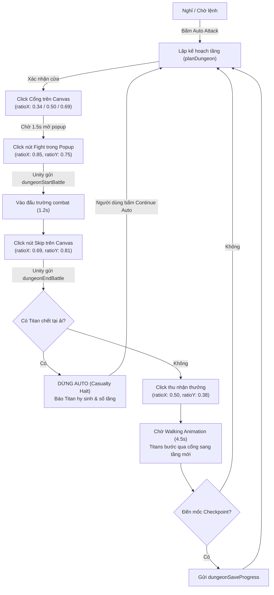

# Cơ Chế Tự Động Tấn Công Titan Dungeon (Dungeon Automation)

Tài liệu này mô tả chi tiết kiến trúc, thuật toán và cách tùy chỉnh cơ chế tự động tấn công hầm ngục Titan (Guild Dungeon) trong extension HWA Helper.

---

## 1. Tổng Quan

> [!NOTE]
> **Cập nhật chính sách**: Tính năng chạy auto tự động tấn công (auto battle runner) đã được **shelf (tạm dừng/ẩn)** khỏi giao diện người dùng do cơ chế đồng bộ client-server animation của game có độ trễ động không cố định.
> Trọng tâm hiện tại của hệ thống chuyển sang **Ghi nhận thông tin & Log chiến đấu trong ngày (Daily Combat Log)**:
> 1. Tự động thống kê các trận thắng hoàn mỹ không thương vong (flawless victories) chỉ bằng số lượng để giao diện tinh gọn.
> 2. Highlight đặc biệt và chi tiết các trận đánh có thương vong Titan (Casualties): tầng xảy ra, thời gian, tên và avatar các Titan hy sinh.
> 3. Cung cấp thông tin trực quan về cửa ải hiện tại, máu & năng lượng của từng Titan để người chơi chủ động đưa ra quyết định khi đánh tay.

Các điểm cốt lõi bao gồm:
1. **Reset trạng thái Titan mỗi ngày mới (Daily Rest Reset)**: Đảm bảo thông tin máu (HP) và năng lượng (Energy) của Titan được làm mới tinh tươm khi qua ngày mới.
2. **Chọn đội hình theo Ordered Titan Pool**: Mỗi thuộc tính có 1 danh sách Titan được sắp xếp theo thứ tự ưu tiên. Khi cửa yêu cầu hệ nào, hệ thống sẽ duyệt pool và nhặt **top 5 Titan còn sống** đầu tiên.
3. **Ưu tiên cửa thông minh (Door Priority)**:
   - Ưu tiên cửa có **số Titan chết ít nhất** (0 chết > 1 chết > 2 chết...).
   - Nếu số Titan chết bằng nhau: Ưu tiên theo thứ tự thuộc tính của Attacker (`water` -> `mixed/neutral` -> `earth` -> `fire`).
   - Nếu thuộc tính bằng nhau: Ưu tiên cửa có chiến lực địch (`enemyPower`) thấp hơn.
4. **Dừng lại khi có Titan hy sinh tại ải (Safety Casualty Halt)**:
   - Ngay khi kết thúc 1 trận đánh mà phát hiện có Titan trong đội vừa ngã xuống (`isDead: true` hoặc `hp <= 0`), chuỗi auto dừng lại ngay lập tức.
   - Người dùng có thể kiểm tra tình hình và bấm lại nút **Auto Attack** (hoặc **Continue Auto**) để bắt đầu một vòng auto mới với các Titan còn sống tiếp theo.

---

## 2. Cơ Chế Reset Dữ Liệu Ngày Mới (Daily Rest Reset)

- **Vấn đề**: Trong Hero Wars Alliance, sau mỗi lần reset ngày (Daily Reset/Rest), toàn bộ các Titan đã chết hoặc mất máu hôm trước sẽ được hồi phục hoàn toàn (Full HP, 0 energy/alive). Tuy nhiên, cache cục bộ nếu chỉ merge cộng dồn (`Object.assign`) sẽ vô tình giữ lại trạng thái đã chết (`isDead: true`) của ngày cũ.
- **Giải pháp**:
  - Trong [`extension/rpc-cache.js`](file:///C:/Projects/git/vplghost/VPL-HWA-Ext/extension/rpc-cache.js):
    Khi phát hiện ngày mới (`isNewDay`: ngày của bản ghi khác ngày đã lưu trong `dungeonStatus.updatedAt`), hoặc khi nhận snapshot đầy đủ từ lệnh `dungeonGetInfo`:
    ```javascript
    if (isNewDay) {
      mergedTitans = entry.data.states?.titans ? { ...entry.data.states.titans } : {};
    }
    ```
    Toàn bộ danh sách `titans` cũ bị xóa sạch, trả về trạng thái nguyên bản 100% sinh lực cho tất cả các Titan.

---

## 3. Cơ Chế Ordered Titan Pool (Bể Tướng Có Thứ Tự)

Mỗi nguyên tố (`attackerType`) của cửa Dungeon sở hữu một danh sách Titan có thứ tự ưu tiên:

### 3.1. Danh sách Pool mặc định (`DEFAULT_TITAN_POOLS`)

| Hệ Cửa (`attackerType`) | Thứ Tự Titan Trong Pool | Ghi Chú |
| :--- | :--- | :--- |
| **Water (Nước)** | `4000` (Sigurd) -> `4001` (Nova) -> `4052` (Orm) -> `4004` (Tydus) -> `4002` (Mairi) -> `4003` (Hyperion) | Sigurd đỡ đòn, Nova khống chế, Orm & Mairi hỗ trợ |
| **Earth (Đất)** | `4020` (Angus) -> `4022` (Avalon) -> `4024` (Verdoc) -> `4023` (Eden) -> `4021` (Sylva) | Angus gây sát thương diện rộng, Eden kéo địch |
| **Fire (Lửa)** | `4010` (Moloch) -> `4011` (Vulcan) -> `4013` (Araji) -> `4012` (Ignis) -> `4014` (Asherona) -> `4051` (Alecto) | Araji sát thương chủ lực, Moloch tank |
| **Mixed / Neutral (Hỗn hợp)** | `4000` -> `4001` -> `4052` -> `4004` -> `4002` -> `4020` -> `4023` -> `4013` -> `4022` -> `4021` -> `4010` -> `4011` -> `4012` -> `4053` | Tuyển chọn top các Titan mạnh nhất mọi hệ |

### 3.2. Thuật toán nhặt Lineup (`pickLineupFromPool`)

Khi chọn tướng cho một cửa:
1. Lấy danh sách pool của hệ cửa tương ứng (hoặc pool tùy chỉnh của người dùng).
2. Lần lượt kiểm tra từng Titan trong pool:
   - Titan được coi là còn sống nếu `!titanState.isDead && titanState.hp > 0` (hoặc chưa từng chịu sát thương trong ngày).
   - Nếu đã chết: đưa vào mảng `deadTitans`.
   - Nếu còn sống: đưa vào mảng `aliveTitans`.
3. Lấy **tối đa 5 Titan còn sống đầu tiên** (`aliveTitans.slice(0, 5)`).
4. Nếu một hệ có ít hơn 5 Titan (ví dụ hệ Fire chỉ sở hữu 4 Titan), hệ thống sẽ ra trận với toàn bộ số Titan còn sống của hệ đó.

---

## 4. Quy Tắc Đánh Giá Và Ưu Tiên Cửa (Door Evaluation)

Mỗi tầng thường có 2 cửa lựa chọn (Door 1 tại `teamNum = 0` và Door 2 tại `teamNum = 1`). Hệ thống đánh giá từng cửa qua hàm `evaluateDoor` và sắp xếp qua `selectBestDoor`:

### 4.1. Thứ tự ưu tiên (Sorting Rules)

```text
[Cửa tốt nhất]
   │
   ├─► 1. Ít Titan chết nhất (deadCount tăng dần: 0 chết < 1 chết < 2 chết)
   │
   ├─► 2. Thứ tự nguyên tố Attacker (nếu deadCount bằng nhau):
   │       water (Nước) ──► mixed/neutral (Hỗn hợp) ──► earth (Đất) ──► fire (Lửa)
   │       (Hoặc prime element nếu hệ đó là Prime của ngày)
   │
   ├─► 3. Chiến lực đối thủ (enemyPower thấp hơn xếp trước)
   │
   └─► 4. Index cửa (teamNum: Door 1 trước Door 2)
```

### 4.2. Ví dụ so sánh thực tế:
- **Trường hợp 1**: Door 1 là Nước (0 Titan chết), Door 2 là Lửa (1 Titan chết).
  - Kết quả: Chọn **Door 1 (Nước)** vì `0 chết < 1 chết`.
- **Trường hợp 2**: Door 1 là Đất (0 Titan chết), Door 2 là Nước (0 Titan chết).
  - Số Titan chết bằng nhau (`0 == 0`).
  - So sánh nguyên tố: `water` đứng trước `earth`.
  - Kết quả: Chọn **Door 2 (Nước)**.
- **Trường hợp 3**: Door 1 là Đất (1 Titan chết), Door 2 là Lửa (0 Titan chết).
  - Kết quả: Chọn **Door 2 (Lửa)** vì Lửa có 0 Titan chết, ưu tiên hơn Đất đã có 1 Titan chết.

---

## 5. Vòng Đời In-Game Canvas Runner & Dừng An Toàn Khi Có Thương Vong

Quá trình chạy tự động được quản lý bởi `hwaHelperDungeonRunner` trong Service Worker ([`extension/dungeon-runner.js`](file:///C:/Projects/git/vplghost/VPL-HWA-Ext/extension/dungeon-runner.js)) và tương tác bản xứ với Canvas game qua Content Script ([`extension/bridge.js`](file:///C:/Projects/git/vplghost/VPL-HWA-Ext/extension/bridge.js)):

### 5.1. Cơ chế chống lỗi "Invalid battle" qua In-Game Canvas Trigger (Hướng 2)
Do server Hero Wars Alliance chạy hệ thống kiểm tra mô phỏng replay (Deterministic Server Simulation) đối chiếu với `seed`, việc gửi lệnh `dungeonEndBattle` giả mạo bằng RPC chay sẽ luôn bị từ chối với mã lỗi `{"error": "Invalid battle"}`.

Vì vậy, hệ thống sử dụng **Cơ chế mô phỏng thao tác người dùng (In-Game Canvas Trigger)**:
1. **Xác nhận giao diện Dungeon**: Kiểm tra tab game đang hoạt động và snapshot cửa tầng hiện tại (`currentFloorDoors`) khả dụng.
2. **Tọa độ cổng tương đối (Normalized Gate Ratios)**:
   - Tầng 1 cửa (Neutral/Boss): Cổng trung tâm `ratioX: 0.50, ratioY: 0.79`.
   - Tầng 2 cửa: Cửa 1 (Trái) `ratioX: 0.34, ratioY: 0.79`; Cửa 2 (Phải) `ratioX: 0.69, ratioY: 0.79`.
   - Dispatch chuỗi sự kiện `pointerdown` -> `mousedown` -> `pointerup` -> `mouseup` -> `click` trực tiếp vào Canvas game.
3. **Trigger Fight & Skip**:
   - Sau 1.5s mở popup tầng: Tự động click nút **Fight** (`ratioX: 0.85, ratioY: 0.75`). Unity sẽ tự gửi `dungeonStartBattle` chính thức.
   - Khi vào đấu trường combat: Chờ 1.2s rồi tự động click nút **Skip** (`ratioX: 0.69, ratioY: 0.81`). WebAssembly của game sẽ tự chạy mô phỏng combat và gửi `dungeonEndBattle` với đầy đủ HP/Energy chuẩn xác lên server.
4. **Animation di chuyển qua cửa / tầng (Walking Animation Delay - 4.5s)**:
   - Sau khi kết thúc trận và thu thập thưởng (`Dismiss Victory` tại `ratioX: 0.50, ratioY: 0.38`), hệ thống chuyển sang trạng thái `walking-animation` và chờ **4.5 giây** cho các Titan hoàn tất hoạt ảnh bước qua cổng và camera cuộn tới tầng tiếp theo trước khi thực hiện chọn cửa mới.

### 5.2. Sơ đồ trạng thái (State Flow)



### 5.3. Điều kiện dừng an toàn:
1. **Có Titan hy sinh (`checkCasualtiesInBattle`)**:
   - Nếu trong `progress[0].attackers.heroes` hoặc `states.titans` của 5 tướng ra trận có bất kỳ tướng nào `isDead === true` hoặc `hp <= 0`:
     - Trạng thái chuyển thành `phase: 'stopped'`.
     - Lý do dừng: `Titan casualty (Tên Titan) at floor <Số Tầng>. Halting dungeon automation. Press Continue Auto to proceed with remaining titans.`
     - Cập nhật nút trên giao diện thành: **Continue Auto**.
2. **Không còn cửa nào có Titan sống**:
   - Dừng lại khi toàn bộ Titan của các hệ cửa khả dụng đều đã ngã xuống.
3. **Thất bại hoặc mất kết nối tab / Rời khỏi giao diện Dungeon**:
   - Nếu server báo lỗi, tab game bị đóng, hoặc giao diện Dungeon chưa được mở.

---

## 6. Giao Diện Tùy Chỉnh Trực Quan Trong Dungeon Dialog (Visual Strategy Customization)

Người dùng có thể trực tiếp xem và điều chỉnh chiến lược ngay trong **Dungeon Dialog** của extension mà không cần chỉnh sửa code thủ công:

### 6.1. Tùy chỉnh Thứ tự Ưu tiên Nguyên tố (Attacker Element Priority)
- Khung **Lineup Pools & Element Priority** có thể đóng/mở linh hoạt (`details/summary`).
- Hiển thị thứ hạng 4 nguyên tố: `💧 Water (Nước)`, `⚡ Mixed / Neutral (Hỗn hợp)`, `🌿 Earth (Đất)`, `🔥 Fire (Lửa)`.
- Sử dụng nút điều hướng **◀** (tăng bậc ưu tiên) và **▶** (giảm bậc ưu tiên) để thay đổi thứ tự.
- Nút **↺ Reset Priority** giúp khôi phục nhanh về thứ tự chuẩn: `Water -> Mixed -> Earth -> Fire`.
- Đánh giá cửa gợi ý (`⭐ Recommended`) tại mục Doors bên dưới sẽ lập tức được tính toán lại theo thứ tự mới.

### 6.2. Xem và Điều chỉnh Pools Titan (Titan Lineup Pools)
- **Tab nguyên tố**: Chuyển đổi linh hoạt giữa 4 pool `💧 Water`, `🌿 Earth`, `🔥 Fire`, `⚡ Mixed`.
- **Thứ tự điều động ra trận**:
  - Top 5 tướng đầu tiên có nhãn **Starter** (Đội hình xuất trận chính).
  - Các tướng từ vị trí #6 trở đi có nhãn **Reserve** (Dự bị - sẽ được đôn lên khi có Starter ngã xuống).
- **Trạng thái sinh mệnh trực quan**:
  - Hiển thị Avatar, tên Titan, vai trò (Tank, Marksman, Supertitan...).
  - Hiển thị trạng thái HP thực tế hoặc nhãn `❌ Fallen` nếu Titan đã tử trận.
- **Các thao tác điều chỉnh**:
  - Nút **⬆️ / ⬇️**: Thay đổi thứ tự ưu tiên pick của từng tướng.
  - Nút **✖**: Xóa tướng khỏi pool (chỉ cho phép khi pool có > 5 tướng để luôn đảm bảo đủ đội hình 5 người).
  - Menu **+ Add to Pool**: Cho phép bổ sung thêm các Titan khả dụng thuộc hệ tương ứng (hoặc bất kỳ Titan nào đối với hệ Mixed).
  - Nút **↺ Reset Pool**: Khôi phục pool của hệ đang chọn hoặc toàn bộ pools về mặc định.

### 6.3. Lưu trữ & Tự Động Đồng Bộ (Settings Persistence)
- Toàn bộ cấu hình được lưu vào `chrome.storage.local` dưới key `dungeonAutomationSettings` gắn với ID tài khoản game (`accountId`).
- Khi nhấn nút **Auto Attack**, popup sẽ tự động gửi kèm cấu hình `settings` (bao gồm `attackerPriority` và `pools`) sang background runner để thực hiện tấn công theo đúng chiến thuật đã thiết lập.

---

## 7. Hướng Dẫn Tùy Chỉnh Trong Code (Dành Cho Lập Trình Viên)

Bạn có thể dễ dàng điều chỉnh cấu hình theo sở thích cá nhân trong code:

### 6.1. Thay đổi danh sách Titan Pool của từng hệ
Mở file [`extension/dungeon-automation.js`](file:///C:/Projects/git/vplghost/VPL-HWA-Ext/extension/dungeon-automation.js), tìm biến `DEFAULT_TITAN_POOLS`:
```javascript
const DEFAULT_TITAN_POOLS = {
  // Thay đổi thứ tự ID titan bạn muốn ưu tiên lên trước:
  water: [4000, 4001, 4052, 4004, 4002, 4003],
  earth: [4020, 4022, 4024, 4023, 4021],
  fire: [4010, 4011, 4013, 4012, 4014, 4051],
  neutral: [4000, 4001, 4052, 4004, 4002, 4020, 4023, 4013, 4022, 4021, 4010, 4011, 4012, 4053]
};
```
*Ghi chú tra cứu ID Titan*:
- **Hệ Nước**: `4000` (Sigurd), `4001` (Nova), `4002` (Mairi), `4003` (Hyperion), `4004` (Tydus), `4052` (Orm).
- **Hệ Lửa**: `4010` (Moloch), `4011` (Vulcan), `4012` (Ignis), `4013` (Araji), `4014` (Asherona), `4051` (Alecto).
- **Hệ Đất**: `4020` (Angus), `4021` (Sylva), `4022` (Avalon), `4023` (Eden), `4024` (Verdoc).
- **Hệ Ánh Sáng/Bóng Tối/Tinh Thần**: `4030-4034` (Brustar, Keros, Mort, Tenebris, Umbra), `4040-4044` (Rigel, Amon, Iyari, Solaris, Lumira), `4050` (Pallant), `4053` (Metida).

### 6.2. Thay đổi thứ tự ưu tiên nguyên tố
Mở file [`extension/dungeon-automation.js`](file:///C:/Projects/git/vplghost/VPL-HWA-Ext/extension/dungeon-automation.js), tìm biến `DEFAULT_ATTACKER_PRIORITY`:
```javascript
// Mặc định: water -> mixed -> earth -> fire
const DEFAULT_ATTACKER_PRIORITY = ['water', 'mixed', 'neutral', 'earth', 'fire'];

// Nếu bạn muốn ưu tiên Earth trước:
// const DEFAULT_ATTACKER_PRIORITY = ['earth', 'water', 'mixed', 'neutral', 'fire'];
```

### 6.3. Bật chế độ tuyệt đối không đánh cửa có Titan chết (`requireIntactLineup`)
Nếu bạn muốn auto **không bao giờ** được phép đánh vào cửa mà đội hình đã mất dù chỉ 1 tướng (chỉ đánh cửa hoàn toàn nguyên vẹn 100%):
Truyền `{ requireIntactLineup: true }` vào cấu hình hoặc options khi gọi hàm.
