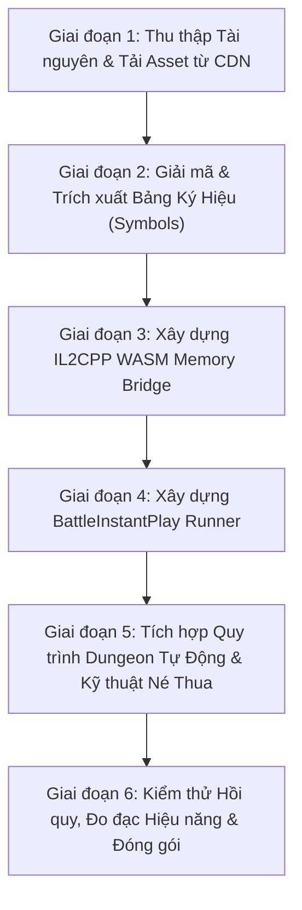

# KẾ HOẠCH TRIỂN KHAI TỪNG BƯỚC: BATTLE SIMULATION QUA WEBASSEMBLY
## DỰ ÁN: HWA-SIM (HERO WARS ALLIANCE SIMULATOR)

Tài liệu này xác định kế hoạch thực hiện 6 giai đoạn rõ ràng, có tiêu chí nghiệm thu cụ thể để xây dựng hoàn chỉnh công cụ giả lập trận đánh Dungeon Titan thông qua gọi hàm WASM trực tiếp.

---

## TỔNG THỂ 6 GIAI ĐOẠN



---

## GIAI ĐOẠN 1: THU THẬP TÀI NGUYÊN & TẢI ASSET TỪ CDN

### Mục tiêu
Tải toàn bộ bộ tệp tin runtime cần thiết cho engine mô phỏng từ CDN của Hero Wars: Alliance về thư mục `hwa-sim/downloads/`.

### Danh mục tệp tin cần tải (Client Version: `1.294.1020`)
1. `Build/54d2d94adc5081d334c2727860837cc8.loader.js` (Unity WebGL Loader, ~20 KB).
2. `Build/7a7a5fb4feff519341d18eff5f7fc83e.framework.js.gz` (Emscripten Framework Glue Code, ~566 KB).
3. `Build/632d18ee3062540a3bea5dae3d2f0c5f.wasm.gz` (Mã máy WebAssembly, ~208.2 MB).
4. `Build/546e27abe3e6e3b10b0e9370429f3ccb.data.gz` (Tài nguyên tĩnh ban đầu, ~129.6 MB).
5. `Build/1e68b42322b805375aa3cb060b79a0e4.symbols.json.gz` (Bảng ký hiệu ánh xạ IL2CPP, ~49.7 MB).
6. `lib/splitlib.json.zip` (Thư viện cấu hình tĩnh: `hero.json`, `titan.json`, `dungeon.json`, ~6 MB).

### Hành động cụ thể
- Chạy script `node hwa-sim/scripts/download-wasm-assets.mjs`.
- Script hỗ trợ tải song song, kiểm tra hash ETag/MD5 và tự động giải nén gzip.

### Tiêu chí nghiệm thu
- Các tệp tin nằm đầy đủ trong `hwa-sim/downloads/` với mã hash toàn vẹn.

---

## GIAI ĐOẠN 2: GIẢI MÃ & TRÍCH XUẤT BẢNG KÝ HIỆU (SYMBOLS)

### Mục tiêu
Phân tích tệp `symbols.json` (dung lượng ~50 MB với hơn 100,000 hàm) để lọc ra chính xác chỉ số hàm (function index) hoặc tên hàm xuất (exported function name) của 42 hàm cốt lõi.

### Hành động cụ thể
- Chạy script `node hwa-sim/scripts/extract-symbols.mjs`.
- Trích xuất các hàm quan trọng:
  - `BattleInstantPlay` methods: `Play_ctor`, `Play_start`, `Play_get_result`, `Play_createBattleData`, `Play_executeBattle`, `Play_createResult`, `Play_dispose`.
  - `BattlePresets` methods: `Presets_clanWarReplay`, `BattlePresets_ctor5`, `Presets_get_isReplay`.
  - `BattleData` methods: `BattleData_serializeResult`, `BattleData_getStars`.
  - JSON & Memory primitives: `JSON_Parse`, `DataObject_fromJSONNode`, `malloc`, `free`, `Type_GetType`, `GetUninitializedObject`, `GC_Collect`.
  - Config getters: `Config_get_titan`.
- Xuất file cấu hình hoàn chỉnh ra `hwa-sim/config/unity-symbol-map.json`.

### Tiêu chí nghiệm thu
- 100% các hàm trong danh sách mục tiêu đều được tìm thấy chỉ số hàm hợp lệ.

---

## GIAI ĐOẠN 3: XÂY DỰNG IL2CPP WASM MEMORY BRIDGE

### Mục tiêu
Tạo module JavaScript trung gian (`hwa-sim/src/memoryBridge.js` hoặc TypeScript trong extension) kết nối trực tiếp với không gian bộ nhớ tuyến tính `WebAssembly.Memory`.

### Các chức năng cần cài đặt:
1. **Cấu trúc Heap Views**: Khởi tạo các view `u8`, `u16`, `i32`, `u32`, `f32` bọc quanh `wasmMemory.buffer`.
2. **Quản lý Con trỏ (Pointer Helpers)**: `readPtr(ptr)`, `writePtr(ptr, value)`.
3. **Thao tác Chuỗi (String Serialization)**:
   - `readString(ptr)`: Đọc cấu trúc `System.String` (length tại `+8`, UTF-16 tại `+12`).
   - `forgeString(str)`: Cấp phát qua `malloc(16 + 2 * len)` và ghi chuỗi UTF-16.
   - `freeString(ptr)`: Giải phóng chuỗi bằng `free(ptr)`.
4. **Đối tượng IL2CPP (Object Instantiation)**:
   - `getType(typeName)`: Tìm kiếm con trỏ kiểu dữ liệu qua `Type_GetType`.
   - `classOfType(typeName)`: Lấy con trỏ lớp thông qua `GetUninitializedObject`.
5. **JSON Data Bridge**:
   - `dataObjectFromJson(jsonString)`: Gọi chuỗi `forgeString` $\to$ `JSON_Parse` $\to$ `DataObject_fromJSONNode`.

### Tiêu chí nghiệm thu
- Tạo được một chuỗi IL2CPP từ JS, đọc lại chuỗi đó bảo toàn 100% nội dung.
- Parse thử nghiệm thành công một payload JSON mẫu thành `DataObject` mà engine không báo lỗi exception.

---

## GIAI ĐOẠN 4: XÂY DỰNG BATTLE INSTANT PLAY RUNNER

### Mục tiêu
Tạo class điều khiển `WasmBattleRunner` có khả năng nhận dữ liệu trận đấu (`rawBattle`, `seed`) và trả về kết quả mô phỏng tức thời.

### Các bước trong Runner:
1. **Khởi tạo Preset**:
   - Lấy `battleConfigStorage` từ trường tĩnh `DataStorage`.
   - Lấy cấu hình Titan bằng `Config_get_titan(storage)`.
   - Tạo thực thể `BattlePresets` bằng `BattlePresets_ctor5(ptr, 1, 0, 1, titanConfig, 0)`.
2. **Khởi tạo BattleInstantPlay**:
   - Cấp phát đối tượng `BattleInstantPlay` qua `GetUninitializedObject`.
   - Gọi `Play_ctor(playPtr, rawBattleDataObject, presetPtr, 0, 0, 0)`.
   - Gọi `Play_start(playPtr)`.
3. **Thực thi Mô phỏng Trận đấu**:
   - Gọi `Play_createBattleData(playPtr, rawBattleDataObject, 1)`.
   - Gọi `Play_executeBattle(playPtr)`: Engine WASM tính toán toàn bộ trận đánh không đồ họa.
   - Gọi `Play_createResult(playPtr)`.
4. **Trích xuất Kết quả**:
   - Gọi `BattleData_serializeResult(battleDataPtr)` $\to$ `readString()` $\to$ `JSON.parse()`.
   - Gọi `BattleData_getStars(battleDataPtr)`.
   - Chuẩn hóa kết quả về cấu trúc:
     ```typescript
     interface SimOutcome {
       win: boolean;
       stars: number; // 0, 1, 2, 3
       duration: number; // Thời gian trận tính bằng giây
       attackers: Array<{ id: number; hp: number; maxHp: number; energy: number; isDead: boolean }>;
       defenders: Array<{ id: number; hp: number; maxHp: number; energy: number; isDead: boolean }>;
       healDelta: number; // Tổng lượng HP hồi phục ròng của toàn đội
     }
     ```
5. **Dọn dẹp Bộ nhớ**:
   - Gọi `Play_dispose(playPtr)`.
   - Gọi `GC_Collect()`.

### Tiêu chí nghiệm thu
- Chạy thử nghiệm với 1 gói dữ liệu trận Dungeon thật (lấy từ log `hwa-dungeon-battle-history-20261120_2.json`). Kết quả mô phỏng phải trùng khớp với kết quả ghi nhận từ server.

---

## GIAI ĐOẠN 5: TÍCH HỢP QUY TRÌNH DUNGEON VÀ KỸ THUẬT NÉ THUA

### Mục tiêu
Ghép nối module mô phỏng vào luồng macro tự động Dungeon trong extension:

1. **Pha Thăm dò (Pre-Battle Probing)**:
   - Gọi `dungeonStartBattle` với đội hình dự kiến để lấy dữ liệu phòng thủ thật từ máy chủ.
   - Chạy mô phỏng qua `WasmBattleRunner`.
2. **Thuật toán Chọn Đội Tối Ưu (`most-healing` & `tank-hp`)**:
   - Đánh giá chỉ số hồi phục máu:
     $$\Delta \text{HP}_{\text{team}} = \sum \left(\text{HP}_{\text{sau trận}} - \text{HP}_{\text{trước trận}}\right)$$
   - Đảm bảo các quy tắc Healer (Tydus/Hyperion hồi máu lớn; Avalon/Verdoc hồi nhỏ; team thuần Hỏa không thể hồi máu).
3. **Cơ chế An toàn Tuyệt đối (Safety Gate)**:
   - Nếu kết quả mô phỏng cho thấy có Titan chết (`stars < 3`) hoặc máu tank giảm dưới ngưỡng an toàn (ví dụ $< 30\%$):
     - **KHÔNG GỬI** RPC `dungeonEndBattle`.
     - Kích hoạt cơ chế hủy trận an toàn (chuyển sang cửa khác hoặc yêu cầu reload phiên).
     - Máy chủ tự động hủy phiên trận đấu, bảo toàn 100% sinh lực Titan!
   - Nếu kết quả Thắng an toàn (3 sao, hồi phục tốt):
     - Chờ đủ thời gian hợp lý (tối thiểu 500ms - 1000ms để tránh anti-cheat phát hiện tốc độ bất thường).
     - Gửi RPC `dungeonEndBattle` kèm payload tiến trình hợp lệ.

---

## GIAI ĐOẠN 6: KIỂM THỬ HỒI QUY, BENCHMARK & ĐÓNG GÓI

### Mục tiêu
Đảm bảo tính ổn định, tốc độ và độ tin cậy của giải pháp trước khi triển khai chính thức.

### Nội dung thực hiện:
- **Benchmark Tốc độ**: Đo thời gian thực thi 100 trận mô phỏng (mục tiêu: $\le 30$ms/trận trên CPU phổ thông).
- **Kiểm tra Rò rỉ Bộ nhớ (Memory Leak Check)**: Chạy 500 trận liên tiếp, giám sát `heap.u8.length` và đảm bảo GC thu hồi đều đặn sau mỗi 5 trận (`COLLECT_EVERY = 5`).
- **Tạo Unit Tests trong thư mục `tests/`**:
  - `tests/wasm-memory-bridge.test.mjs`
  - `tests/wasm-dungeon-simulator.test.mjs`
- **Tài liệu hóa**: Hướng dẫn vận hành và quy trình bảo trì khi game nâng cấp phiên bản mới.
