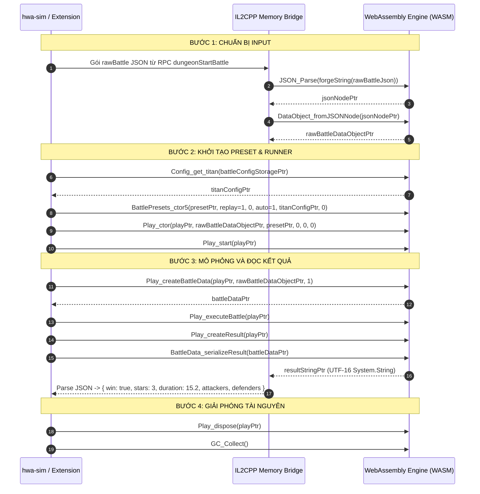

# BÁO CÁO PHÂN TÍCH KỸ THUẬT: ĐẢO MÃ WEBASSEMBLY & CƠ CHẾ BATTLE SIMULATION
## PHÂN HỆ: HERO WARS ALLIANCE UNITY IL2CPP ENGINE

> [!NOTE]
> **Phiên bản Game kiểm chứng:** `1.294.1020` (CDN Static: `1.294.0`, Build Release: `83d4310c-dded-4bd3-a443-55f22b534671`).
> **Đối tượng phân tích:** Unity WebGL WebAssembly Runtime, IL2CPP Linear Memory Model, và cơ chế `BattleInstantPlay`.

---

## 1. TỔNG QUAN KIẾN TRÚC CLIENT GAME

Client web của *Hero Wars: Alliance* được xây dựng bằng **Unity Engine**, biên dịch qua công nghệ **IL2CPP (Intermediate Language to C++)** và đóng gói thành **WebAssembly (WASM)** thông qua toolchain **Emscripten**.

### 1.1. Bộ Tệp Tin Cốt Lõi Trên CDN Game
Khi người dùng mở game tại `https://hero-wars-alliance.com`, launcher tải 5 tệp tin chính từ `https://cdn.hero-wars-alliance.com/build/release/83d4310c-dded-4bd3-a443-55f22b534671/`:

| Tên Tệp | Đường dẫn tương đối trên CDN | Kích thước nén | Kích thước giải nén | Định dạng & Ý nghĩa |
| :--- | :--- | :--- | :--- | :--- |
| **Loader Script** | `Build/54d2d94adc5081d334c2727860837cc8.loader.js` | ~20 KB | ~20 KB | Định nghĩa hàm `createUnityInstance(canvas, config, onProgress)`. |
| **Framework JS** | `Build/7a7a5fb4feff519341d18eff5f7fc83e.framework.js.gz` | 566 KB | ~2.1 MB | Runtime Emscripten (glue code JS, binding WebGL, audio, WebSockets, memory bridge). |
| **Data Binary** | `Build/546e27abe3e6e3b10b0e9370429f3ccb.data.gz` | 129.6 MB | ~280 MB | Virtual File System (VFS): metadata assets, textures, scenes, audio clips, shader bundles. |
| **WASM Binary** | `Build/632d18ee3062540a3bea5dae3d2f0c5f.wasm.gz` | 208.2 MB | ~410 MB | Mã máy WebAssembly chứa toàn bộ engine vật lý, AI, kỹ năng, công thức sát thương của game. |
| **Symbols Mapping** | `Build/1e68b42322b805375aa3cb060b79a0e4.symbols.json.gz` | 49.7 MB | ~50 MB | Bảng ánh xạ chỉ số hàm (function index) sang tên định danh C# IL2CPP. |

---

## 2. MÔ HÌNH BỘ NHỚ VÀ QUẢN LÝ CON TRỎ (IL2CPP MEMORY MODEL)

### 2.1. Không Gian Địa Chỉ Tuyến Tính (Linear Memory)
- WebAssembly sử dụng không gian địa chỉ tuyến tính 32-bit (`WebAssembly.Memory`).
- Toàn bộ con trỏ trong engine là địa chỉ số nguyên không dấu 32-bit (`u32 >>> 0`), tương ứng vị trí byte trong `ArrayBuffer`.
- Để đọc/ghi bộ nhớ từ JavaScript:
  ```javascript
  const buffer = wasmMemory.buffer;
  const heap = {
    u8: new Uint8Array(buffer),
    u16: new Uint16Array(buffer),
    i32: new Int32Array(buffer),
    u32: new Uint32Array(buffer),
    f32: new Float32Array(buffer)
  };
  
  // Đọc con trỏ 32-bit:
  const readPtr = (ptr) => heap.u32[ptr >>> 2];
  // Ghi con trỏ 32-bit:
  const writePtr = (ptr, val) => { heap.u32[ptr >>> 2] = val >>> 0; };
  ```

### 2.2. Cấu Trúc Đối Tượng Chuỗi IL2CPP (System.String Layout)
Trong IL2CPP 32-bit, một chuỗi `System.String` có cấu trúc:
- `offset + 0`: Con trỏ tới Class Descriptor của `System.String` (4 bytes).
- `offset + 4`: Reserved / Sync block index (4 bytes).
- `offset + 8`: Độ dài chuỗi `length` (32-bit signed int, 4 bytes).
- `offset + 12`: Mảng ký tự UTF-16 (`u16`, mỗi ký tự 2 bytes), kết thúc bằng ký tự null `\0`.

#### Hàm Đọc Chuỗi (`readString`):
```javascript
function readString(ptr) {
  if (!ptr) return null;
  const len = heap.i32[(ptr + 8) >>> 2];
  if (len < 0 || len > 100000) return null;
  const u16Start = (ptr + 12) >>> 1;
  let str = "";
  for (let i = 0; i < len; i += 8192) {
    str += String.fromCharCode.apply(null, heap.u16.subarray(u16Start + i, u16Start + Math.min(len, i + 8192)));
  }
  return str;
}
```

#### Hàm Tạo Chuỗi IL2CPP từ JavaScript (`forgeString`):
```javascript
let stringClassPtr = null; // Lấy từ Object.ToString của bất kỳ chuỗi mẫu nào

function forgeString(str) {
  const len = str.length;
  // Cấp phát bộ nhớ trong heap C++ thông qua malloc(16 + 2 * len)
  const ptr = invokeNative("malloc", 16 + 2 * len);
  heap.u32[ptr >>> 2] = stringClassPtr;
  heap.u32[(ptr + 4) >>> 2] = 0;
  heap.i32[(ptr + 8) >>> 2] = len;
  const u16Start = (ptr + 12) >>> 1;
  for (let i = 0; i < len; i++) {
    heap.u16[u16Start + i] = str.charCodeAt(i);
  }
  heap.u16[u16Start + len] = 0;
  return ptr;
}
```

---

## 3. DANH MỤC HÀM CỐT LÕI CẦN TRÍCH XUẤT TỪ WASM

Qua phân tích mã nguồn `temp/HWA-Ext/src/main.js` và bảng `symbols.json`, 42 hàm IL2CPP chia thành 4 nhóm nghiệp vụ chính:

### Nhóm 1: Quản Trị Hệ Thống & Bộ Nhớ IL2CPP (Core Primitives)
| Hàm Ký Hiệu | Chức Năng | Ghi Chú |
| :--- | :--- | :--- |
| `malloc` | Cấp phát khối bộ nhớ tuyến tính trong WASM | Xuất trực tiếp qua `wasm.exports` |
| `free` | Giải phóng khối bộ nhớ | Xuất trực tiếp qua `wasm.exports` |
| `Type_GetType` | Lấy con trỏ `System.Type` từ chuỗi tên lớp | `Type.GetType(string)` |
| `GetUninitializedObject` | Khởi tạo thực thể đối tượng mà không chạy constructor | `FormatterServices.GetUninitializedObject(Type)` |
| `Object_GetType` | Lấy `System.Type` từ con trỏ đối tượng | `obj.GetType()` |
| `Object_ToString` | Gọi phương thức `.ToString()` | `obj.ToString()` |
| `RuntimeType_get_FullName` | Lấy tên đầy đủ của kiểu dữ liệu | `type.FullName` |
| `GCHandle_Alloc` | Ghim (root) đối tượng tránh bị Garbage Collector thu hồi | `GCHandle.Alloc(obj, Normal)` |
| `GCHandle_FreeHandle` | Tháo ghim đối tượng | `GCHandle.Free()` |
| `GC_Collect` | Kích hoạt bộ dọn rác dọn sạch bộ nhớ sau mô phỏng | `GC.Collect()` |

### Nhóm 2: Chuyển Đổi Dữ Liệu & JSON (Data Serialization)
| Hàm Ký Hiệu | Chức Năng | Ghi Chú |
| :--- | :--- | :--- |
| `JSON_Parse` | Phân tích chuỗi JSON thành cây đối tượng `JSONNode` | `JSON.Parse(string)` |
| `DataObject_fromJSONNode` | Chuyển đổi `JSONNode` sang đối tượng `DataObject` nội bộ của game | Nạp dữ liệu `rawBattle` vào engine |

### Nhóm 3: Khởi Tạo Cấu Hình & Preset Trận Đánh (Battle Presets)
| Hàm Ký Hiệu | Chức Năng | Ghi Chú |
| :--- | :--- | :--- |
| `BattlePresets_ctor5` | Constructor khởi tạo cài đặt trận đánh | Tham số: `(this, replay: 1, 0, auto: 1, configStorage, 0)` |
| `Presets_clanWarReplay` | Tạo preset replay Bang Chiến (Hero: 1, Titan: 0) | Trả về thực thể `BattlePresets` |
| `Presets_arenaReplay` | Tạo preset replay Đấu Trường Arena | Dành cho chế độ Hero Arena |
| `Presets_get_isReplay` | Kiểm tra preset có phải là chế độ mô phỏng replay không | Trả về `bool` |
| `Config_get_titan` | Lấy cấu hình trận chiến Titan từ `BattleConfigStorage` | Truyền vào `BattlePresets_ctor5` cho Dungeon |

### Nhóm 4: Điều Khiển Trận Đấu Giả Lập (`BattleInstantPlay`)
| Hàm Ký Hiệu | Chức Năng | Chi Tiết Tham Số & Luồng Gọi |
| :--- | :--- | :--- |
| `Play_ctor` | Constructor của `BattleInstantPlay` | `(this, rawBattleDataObject, presetsPtr, 0, 0, 0)` |
| `Play_start` | Khởi động máy trạng thái của trận đánh | Kích hoạt vòng lặp tick toán học |
| `Play_get_result` | Thăm dò trạng thái hoàn thành trận đánh | Trả về con trỏ `BattleData` khi hoàn tất |
| `Play_createBattleData` | Tạo cấu trúc dữ liệu trận đánh `BattleData` | `(this, rawBattleDataObject, 1)` |
| `Play_executeBattle` | **Hàm tính toán vật lý & AI tức thì (Instant Simulate)** | Chạy toàn bộ trận chiến đến khi có bên thắng/hết giờ |
| `Play_createResult` | Đóng gói kết quả trận chiến | Chuẩn bị dữ liệu để tuần tự hóa |
| `BattleData_serializeResult` | **Tuần tự hóa kết quả thành chuỗi JSON** | Trả về con trỏ `System.String` chứa toàn bộ output |
| `BattleData_getStars` | Lấy số sao chiến thắng (1, 2, 3) | `battleData.getStars()` |
| `Play_dispose` | Hủy thực thể trận đấu và giải phóng tài nguyên | Tránh rò rỉ bộ nhớ WASM |

---

## 4. QUY TRÌNH THỰC THI MÔ PHỎNG MỘT TRẬN DUNGEON TITAN



---

## 5. ĐÁNH GIÁ 2 MÔ HÌNH TRIỂN KHAI

### Mô Hình A: In-Game Injection (Khuyến nghị cho tính năng Auto-Dungeon)
- **Cơ chế:** Content script tiêm mã vào tab game, hook `createUnityInstance` để lấy `Module`.
- **Ưu điểm:**
  - Không cần tải 400MB tệp WASM/Data về máy (game đã nạp sẵn vào RAM trình duyệt).
  - Khởi tạo ngay lập tức, độ trễ mô phỏng chỉ từ 10ms - 50ms mỗi trận.
  - Luôn đồng bộ 100% với phiên bản game hiện tại của tài khoản người dùng.
- **Cách triển khai:** Đưa logic bridge vào một content script injected (`src/sim/injectedSimBridge.ts`).

### Mô Hình B: Standalone Node.js Runner (Dành cho hwa-sim CLI)
- **Cơ chế:** Tải các tệp `.wasm`, `.data`, `.framework.js`, `.symbols.json` về thư mục cục bộ `hwa-sim/downloads/`. Giả lập môi trường DOM (canvas, audio, window) trong Node.js để nạp WASM.
- **Ưu điểm:**
  - Chạy độc lập hoàn toàn mà không cần mở trình duyệt hay đăng nhập game.
  - Phù hợp cho việc cày batch dữ liệu lớn, kiểm thử thuật toán tối ưu hóa đội hình, kiểm thử hồi quy CI/CD.
- **Thách thức:** Cần mock các API WebGL / Audio mà Unity Emscripten glue code yêu cầu khi khởi động.
